<div align="center">


# Bubble

**Translate, explore, and search anything directly on your screen.**

A lightweight, privacy-first Android screen assistant for live on-screen translation, full-screen text selection, automatic QR code scanning, and visual search — without root.

**English** | [Bahasa Indonesia](README_ID.md)

[-3DDC84?style=flat-square&logo=android&logoColor=white)](app/build.gradle.kts)
[](app/build.gradle.kts)
[](build.gradle.kts)
[](gradle/wrapper/gradle-wrapper.properties)
[](https://github.com/AprionoN-Officials/Bubble-Android/releases)

</div>

---

## About Bubble

Reading foreign-language apps, games, articles, or images on Android normally requires taking a screenshot, switching to a translation or search app, importing the image, and switching back.

**Bubble** (`com.bubble.screentools`) brings those actions into a single on-screen overlay that you can summon over any app:

- **Translate text in place** without leaving what you are reading.
- **Select and copy text from anywhere on screen**—including images and non-selectable layouts—directly inside Bubble.
- **Scan QR codes automatically** (including Indonesian QRIS, Wi-Fi, URLs, and contacts) without switching to a scanner app.
- **Search images visually** by cropping a region and sending it to Google Lens, Yandex Images, TinEye, or any installed app via Android's *Open With* chooser.

---

## Why Bubble?

| Capability | How Bubble Delivers It (Verified in Source) |
| --- | --- |
| **In-Place Screen Translation** | Renders translated text boxes directly over the selected screen region with an instant **Original ↔ Translated** toggle and **Copy** button. |
| **Minimal App Switching** | Summon via **Default Digital Assistant** (hold Home / corner swipe), **Accessibility Shortcut**, or **Quick Settings Tile** without leaving the foreground app. |
| **No "Start Recording" Popup** | Uses Android's **Digital Assistant (`VoiceInteractionService`)** on Android 7–15 or silent **`AccessibilityService.takeScreenshot()`** on Android 11+, avoiding `MediaProjection` prompts on supported modes. |
| **Hybrid Screen Scanning** | Combines on-device OCR (ML Kit Play Services + optional custom **Tesseract 5** `.traineddata` models) with `AssistStructure` / `AccessibilityNodeInfo` extraction as fallback. |
| **On-Device Offline Translation** | Downloads compact ML Kit translation models on demand across 31 curated languages and caches recent translations in a 256-entry in-memory `LruCache`. |
| **Auto-Hiding Minimalist Overlay** | Bottom action controls hide automatically while dragging selection handles and while viewing translation results, with a top-bar **Menu** toggle when needed. |
| **Multi-Engine Visual Search** | Defaults to **Google Lens**, with built-in **Yandex Images**, **TinEye**, and native **Open With** fallback—plus a 1.8-second cancelable countdown while adjusting handles. |
| **Privacy-First & Bubble Safe Mode** | Keeps full-screen snapshots strictly in RAM, skips password fields, respects `FLAG_SECURE`, and automatically halts scanning on excluded banking, e-wallet, and authenticator apps. |

---

## Featured Features

### 1. Live Screen Translation

Translate selected paragraphs or the entire screen directly over the active app, then toggle between **Original** and **Translated** text or copy the result in one tap.

<table>
  <tr>
    <td width="38%" align="center">
      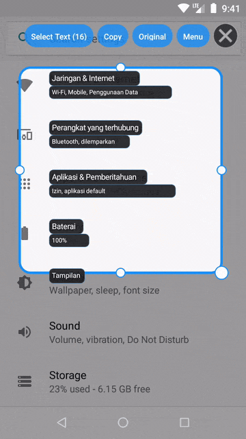<br />
      <sub>Real recording: EN → ID offline translation &amp; Original ↔ Translated toggle</sub>
    </td>
    <td width="62%" valign="top">
      <ul>
        <li><b>What it does:</b> Extracts text inside your selection box and renders translated overlays aligned to the original bounding boxes.</li>
        <li><b>Bidirectional language swap:</b> Switch <code>From ⇄ To</code> in Settings or directly inside the overlay language bar.</li>
        <li><b>How it works:</b> Captures the current screen in RAM → runs OCR or falls back to <code>AssistStructure</code> / <code>AccessibilityNodeInfo</code> → identifies language (or uses your chosen source) → translates on-device via ML Kit Translate.</li>
        <li><b>Clean reading view:</b> Bottom controls automatically collapse once translation blocks appear.</li>
      </ul>
    </td>
  </tr>
</table>

### 2. Instant Screen Selection & Assistant Overlay

Draw or adjust a **Rectangle**, **Ellipse**, or **Freeform** selection directly over any app with corner/edge handles and auto-hiding controls.

<table>
  <tr>
    <td width="50%" align="center">
      <br />
      <sub>Dragging selection handles with auto-hiding controls</sub>
    </td>
    <td width="50%" align="center">
      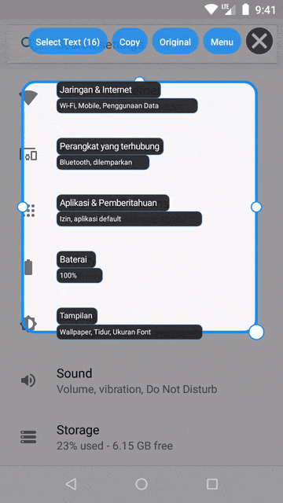<br />
      <sub>Top-bar Menu toggle, language swap, and mode switcher</sub>
    </td>
  </tr>
</table>

- **Three selection shapes:** Rectangle (default), Ellipse, and Freeform lasso configurable in Settings.
- **Smart debounce:** Waits `650 ms` before translating and `1,800 ms` (with a visible countdown) before launching external visual search; touching any handle cancels the timer immediately.

### 3. Smart Text Detection & Full-Screen Text Selection

Select and copy text from anywhere on screen—without opening Google Lens—using Bubble's built-in **Select Text** mode.

<table>
  <tr>
    <td width="38%" align="center">
      <br />
      <sub>Real recording: Full-screen Select Text (16 detected blocks)</sub>
    </td>
    <td width="62%" valign="top">
      <ul>
        <li><b>Hybrid detection:</b> Runs OCR (default unbundled Google Play Services ML Kit Text Recognition or optional custom Tesseract 5 models) with <code>BitmapCropHelper</code> upscaling and padding, and falls back to <code>AssistStructure</code> / <code>AccessibilityNodeInfo</code> while strictly skipping password fields.</li>
        <li><b>Tap-to-select overlay:</b> Highlights detected text blocks across the screen so you can tap individual lines or <b>Select All</b>, then <b>Copy</b>, <b>Translate</b>, or <b>Web Search</b>.</li>
      </ul>
    </td>
  </tr>
</table>

### 4. On-Device Offline Translation & Custom Tesseract 5 OCR

Manage offline translation models for 31 languages and import your own `.traineddata` files for non-Latin scripts.

<table>
  <tr>
    <td width="38%" align="center">
      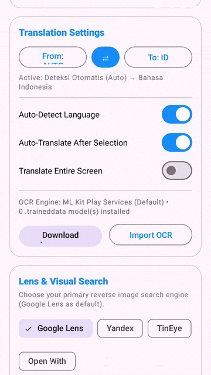<br />
      <sub>Real recording: Offline Language Manager (ML Kit &amp; Tesseract 5)</sub>
    </td>
    <td width="62%" valign="top">
      <ul>
        <li><b>31 curated ML Kit languages:</b> Download or remove offline translation models (~30 MB per language) on demand in <b>Offline Languages &amp; OCR Models</b>.</li>
        <li><b>Offline after download:</b> Once source and target models are installed on device, translation works without an active internet connection and caches recent strings in RAM (256-entry <code>LruCache</code>).</li>
        <li><b>Custom OCR (.traineddata):</b> Import local Tesseract 5 <code>.traineddata</code> files via Android's Storage Access Framework (SAF) or quick-download 10 official <code>tessdata_fast</code> packs (Japanese, Korean, Chinese, Arabic, Thai, Vietnamese, Russian, Indonesian, English).</li>
      </ul>
    </td>
  </tr>
</table>

> **Verified Offline OCR:** Custom Tesseract 5 `.traineddata` recognition is synchronized via an internal lock (`TesseractOcrManager.kt`) and verified live on pure raster images alongside ML Kit offline translation with zero native crashes.

### 5. Multi-Engine Visual Search (Google Lens, Yandex, TinEye & Open With)

Crop any object, product, or illustration on screen and run reverse image search using your preferred engine.

<table>
  <tr>
    <td width="38%" align="center">
      <br />
      <sub>Real recording: Search Image mode with engine selector</sub>
    </td>
    <td width="62%" valign="top">
      <ul>
        <li><b>Google Lens (Default):</b> Sends the temporary cropped PNG via <code>Intent.ACTION_SEND</code> + <code>FileProvider</code> directly to Google Lens (<code>com.google.ar.lens</code>) or Google App (<code>com.google.android.googlequicksearchbox</code>). Results open inside Google's external app.</li>
        <li><b>In-App Web Search (Yandex &amp; TinEye):</b> Opens <code>VisualSearchWebActivity</code> with automatic image file injection and engine switcher chips.</li>
        <li><b>Native Open With Fallback:</b> Uses Android's native <code>Intent.ACTION_VIEW</code> chooser ("Open with") when selected or when Google Lens is unavailable.</li>
      </ul>
    </td>
  </tr>
</table>

### 6. Automatic QR Code Scanner

When **Auto-Scan QR Codes** is enabled (default), Bubble scans the screen snapshot via unbundled Google Play Services ML Kit Barcode Scanning without pressing Lens:

- **Payment QR (Indonesian QRIS EMVCo TLV, PayNow, DuitNow, PromptPay, UPI & e-Wallet URIs):** Parses merchant name, city, and amount (verified via JVM unit tests) and offers a dedicated installed payment app picker, native Android *Open With*, or *Save QR* to `Pictures/BubbleQR`.
- **Wi-Fi QR:** Parses SSID, security type, and password; uses Android 11+ `ACTION_WIFI_ADD_NETWORKS` for 1-tap connect plus clipboard copy.
- **URLs, Contacts (vCard/MECARD), Email, Phone, SMS & Plain Text:** Launches native system actions.

> **Testing Note:** `QrCodeParser` TLV/Wi-Fi/UPI parsing passed JVM unit tests; live on-screen ML Kit Barcode scanning requires Google Play Services and was not exercised on the AOSP emulator (see [Test Report](docs/documentation-test-report.md)).

### 7. Quick Settings Tile, Accessibility Shortcut & Digital Assistant

Access Bubble from anywhere using three trigger mechanisms:

<table>
  <tr>
    <td width="38%" align="center">
      <br />
      <sub>Real recording: Bubble Screen tile in Android Quick Settings</sub>
    </td>
    <td width="62%" valign="top">
      <ul>
        <li><b>Default Digital Assistant (Recommended, Android 7–15):</b> Registers <code>BubbleVoiceInteractionService</code> + <code>BubbleRecognitionService</code>. Hold Home or swipe from the bottom corner to capture without Accessibility or Overlay permissions.</li>
        <li><b>Quick Settings Tile:</b> Add the <b>Bubble Screen</b> tile (<code>BubbleTileService</code>) to your notification shade. Uses Android 12–15 compliant <code>startActivityAndCollapse()</code> via <code>OverlayTriggerActivity</code>.</li>
        <li><b>Accessibility Shortcut / Button:</b> Enable Bubble in Android Accessibility settings to trigger via the system Accessibility Button or shortcut.</li>
      </ul>
    </td>
  </tr>
</table>

### 8. Bubble Safe Mode & Privacy Protection

Bubble Safe Mode is enabled by default to avoid interfering with sensitive apps:

- **14 Pre-Configured Protected Apps:** Includes common Indonesian mobile banking apps, e-wallets, password managers, authenticators, and digital ID apps (`BubblePreferences.DEFAULT_EXCLUDED_PACKAGES`), fully editable via **Excluded Apps**.
- **Automatic Halt & Dismiss:** Immediately cancels scanning, recycles RAM bitmaps, closes the overlay, and records the last blocked package whenever an excluded app is detected.
- **Safe Verification:** Tested in the emulator using Android's harmless built-in Clock app (`com.android.deskclock`) added temporarily to the excluded list—confirming Bubble blocked overlay launch and displayed the Safe Mode notice banner in the dashboard.

### 9. Lightweight Material 3 Settings & Automatic Dark Mode

Built with Material 3 (`Theme.Material3.DayNight.NoActionBar`), Bubble adapts automatically to your device's Light and Dark themes with streamlined segmented cards.

<table>
  <tr>
    <td width="50%" align="center">
      <br />
      <sub>Real recording: Segmented Material 3 settings</sub>
    </td>
    <td width="50%" align="center">
      <br />
      <sub>Real recording: Automatic Light ↔ Dark system theme support</sub>
    </td>
  </tr>
</table>

---

## Application Preview

All screenshots below were captured directly from **Bubble v1.0.0** running on Android 8.1.0 (`720×1280`, 320 dpi).

### Main Dashboard — Light, Dark & Bilingual (EN / ID)

<table>
  <tr>
    <td align="center" width="25%">
      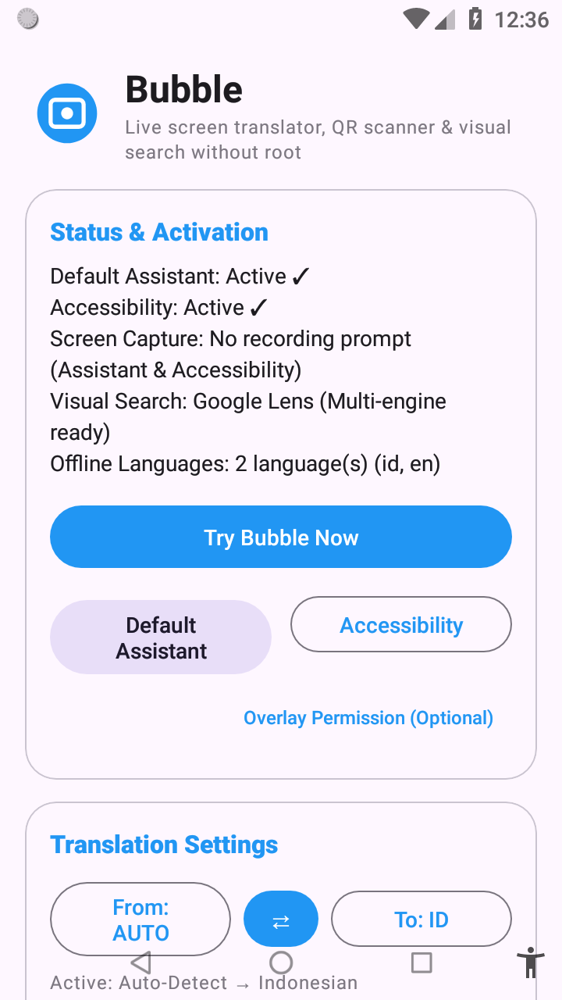<br />
      <sub><b>Dashboard (EN · Light)</b></sub>
    </td>
    <td align="center" width="25%">
      <br />
      <sub><b>Dashboard (ID · Light)</b></sub>
    </td>
    <td align="center" width="25%">
      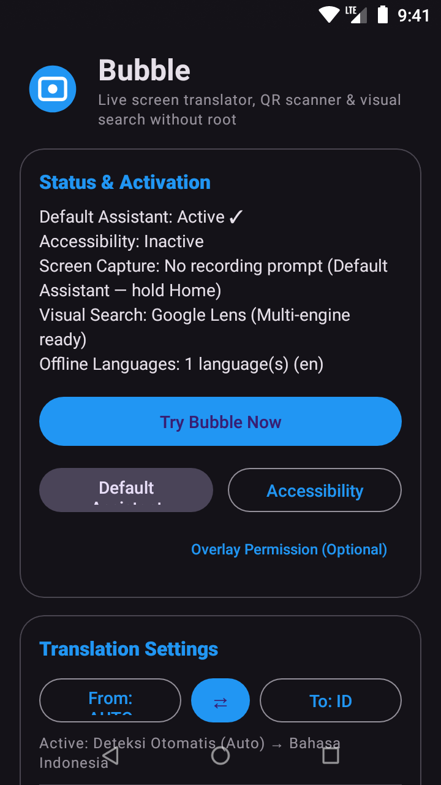<br />
      <sub><b>Dashboard (EN · Dark)</b></sub>
    </td>
    <td align="center" width="25%">
      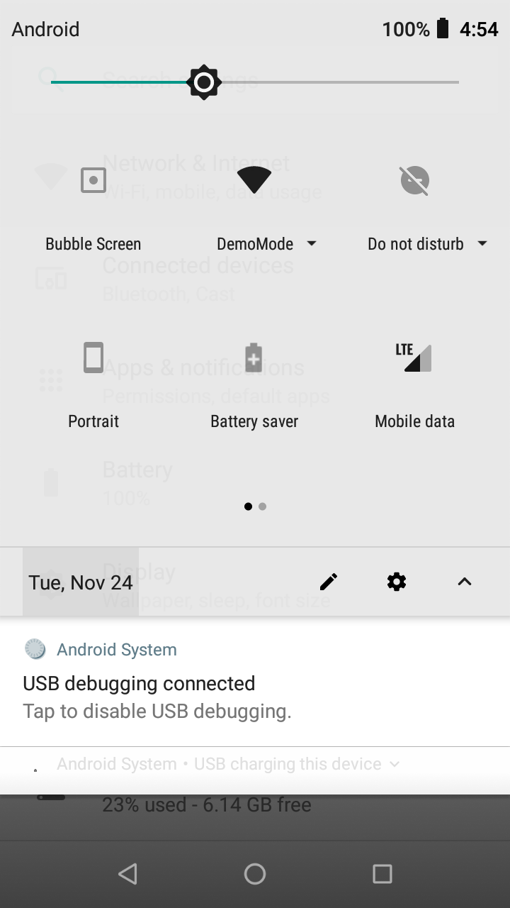<br />
      <sub><b>Quick Settings Tile</b></sub>
    </td>
  </tr>
</table>

### Overlay, Live Translation, Tesseract 5 OCR & Text Selection

<table>
  <tr>
    <td align="center" width="25%">
      <br />
      <sub><b>Assistant Overlay</b></sub>
    </td>
    <td align="center" width="25%">
      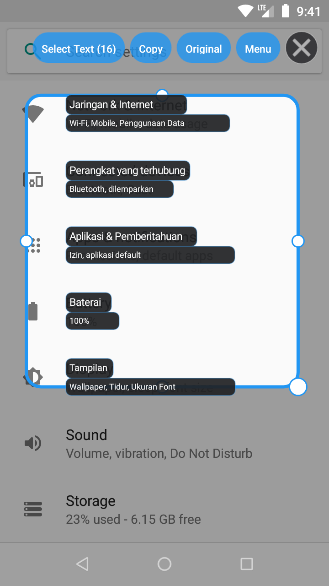<br />
      <sub><b>Live Translation (EN → ID)</b></sub>
    </td>
    <td align="center" width="25%">
      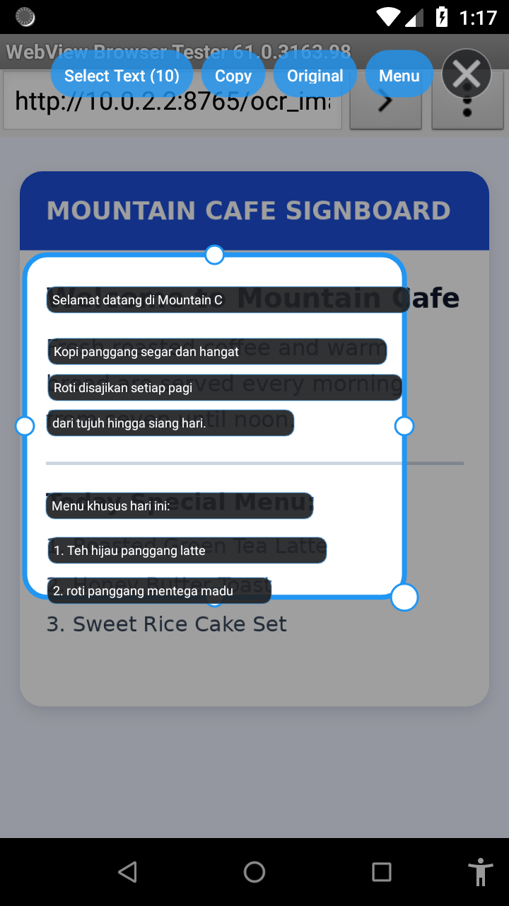<br />
      <sub><b>Tesseract 5 Image OCR</b></sub>
    </td>
    <td align="center" width="25%">
      <br />
      <sub><b>Full-Screen Select Text</b></sub>
    </td>
  </tr>
</table>

### Settings, Offline Models & Custom OCR

<table>
  <tr>
    <td align="center" width="33%">
      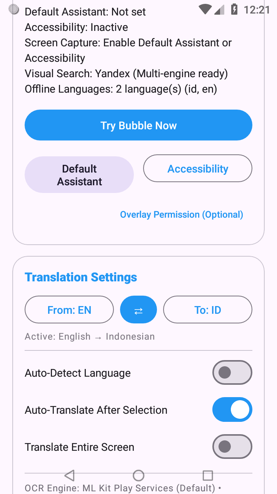<br />
      <sub><b>Translation Settings</b></sub>
    </td>
    <td align="center" width="33%">
      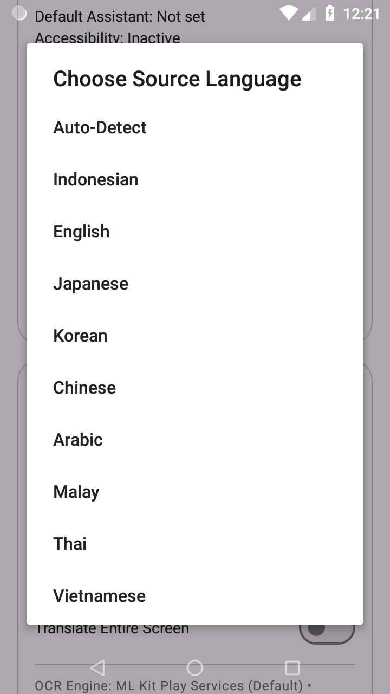<br />
      <sub><b>Source / Target Language Picker</b></sub>
    </td>
    <td align="center" width="33%">
      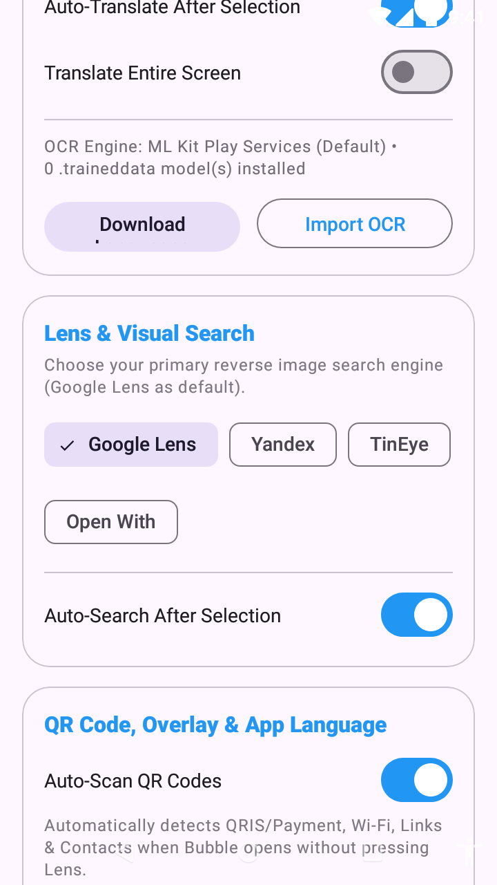<br />
      <sub><b>Visual Search &amp; QR Settings</b></sub>
    </td>
  </tr>
  <tr>
    <td align="center" width="33%">
      <br />
      <sub><b>Offline Models (EN &amp; ID Ready)</b></sub>
    </td>
    <td align="center" width="33%">
      <br />
      <sub><b>Custom OCR (.traineddata Active)</b></sub>
    </td>
    <td align="center" width="33%">
      <br />
      <sub><b>Visual Search (Yandex Web)</b></sub>
    </td>
  </tr>
</table>

### Privacy & Bubble Safe Mode

<table>
  <tr>
    <td align="center" width="33%">
      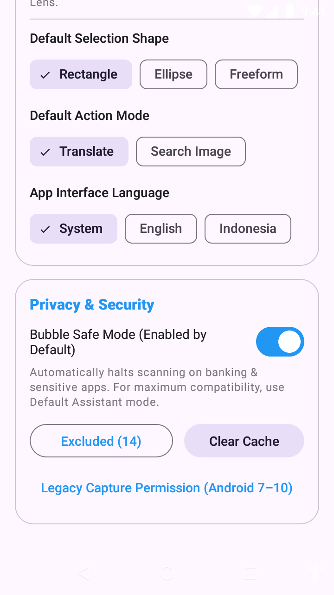<br />
      <sub><b>Privacy &amp; Safe Mode Settings</b></sub>
    </td>
    <td align="center" width="33%">
      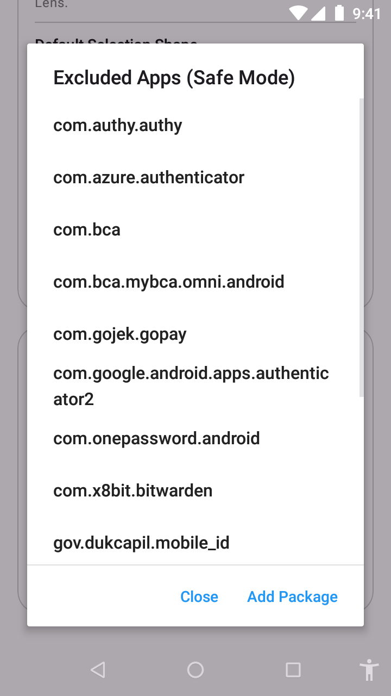<br />
      <sub><b>Excluded Sensitive Apps (14 Default)</b></sub>
    </td>
    <td align="center" width="33%">
      <br />
      <sub><b>Safe Mode Notice (Test App Blocked)</b></sub>
    </td>
  </tr>
</table>

---

## Real-World Use Cases

- **Understanding Foreign-Language App Menus & Games:** Translate UI labels, tutorials, and dialog text directly on screen without switching apps.
- **Reading Foreign Articles, Posts & Comics:** Select paragraphs or speech bubbles and translate them offline once the language pack is downloaded.
- **Copying Unselectable Text:** Use **Select Text** to grab text from images, posters, or restricted app views.
- **Translating Chats & Messages:** Quickly translate incoming messages and toggle back to the original text in one tap.
- **Identifying Products & Visuals:** Select an item on screen and send the crop to Google Lens, Yandex Images, or TinEye.
- **Acting on On-Screen QR Codes:** Automatically detect QRIS, Wi-Fi, URL, or contact QR codes displayed on screen without needing a second phone.

---

## How It Works

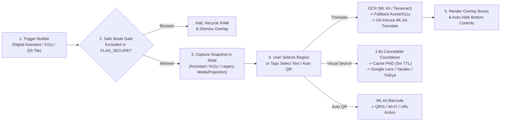

For full component-level details, see [docs/architecture.md](docs/architecture.md).

---

## Getting Started

1. **Install the APK:** Download the release APK matching your CPU architecture from [GitHub Releases](https://github.com/AprionoN-Officials/Bubble-Android/releases) (`arm64-v8a` for most modern Android devices) or build from source.
2. **Choose Your Trigger Mode (Only Grant What You Need):**
   - **Option 1 — Default Digital Assistant (Recommended, Android 7–15):** Open Bubble → tap **Default Assistant** → select **Bubble**. No Accessibility or Overlay permission is required.
   - **Option 2 — Accessibility & Quick Settings Tile:** Tap **Accessibility** → enable **Bubble**. On Android 11+, Bubble uses silent Accessibility screenshots. On Android 7–10 without Default Assistant mode, tap **Legacy Capture Permission** when prompted.
   - *(Optional)* Add the **Bubble Screen** tile in Android's Quick Settings editor.
3. **Configure Languages:** In **Translation Settings**, set your `From` and `To` languages (or keep `AUTO` detection) and tap **Download Languages** to pre-download offline ML Kit models.
4. **Translate or Search:** Open any app, trigger Bubble, adjust the selection frame, and tap **Translate** or **Search Image** (or tap **Select Text** at the top bar to select & copy text directly).
5. **Review Safe Mode:** Bubble Safe Mode is active by default. Open **Excluded Apps** under **Privacy & Security** to review or customize protected packages.

---

## Privacy & Security

Transparency about permissions and data handling based strictly on the source code:

- **Permissions & Why They Are Declared:**
  - `INTERNET` & `ACCESS_NETWORK_STATE`: Download on-demand ML Kit language packs, optional Tesseract `.traineddata` packs from GitHub, and load Yandex/TinEye web search pages.
  - `SYSTEM_ALERT_WINDOW`: Optional overlay permission when used outside `AccessibilityService` or `BubbleAssistantActivity`.
  - `BIND_VOICE_INTERACTION` / `BIND_ACCESSIBILITY_SERVICE` / `BIND_QUICK_SETTINGS_TILE`: System service bindings used solely when explicitly enabled by the user.
  - `FOREGROUND_SERVICE`, `FOREGROUND_SERVICE_MEDIA_PROJECTION`, `POST_NOTIFICATIONS`: Used only for the legacy Android 7–10 `MediaProjection` fallback (`MediaProjectionService`).
  - `QUERY_ALL_PACKAGES`: Checks installed Google Lens / Google App availability and lists installed payment apps for QRIS *Open With* dispatch on API 30+.
- **Local vs. External Processing:**
  - **On-Device (Local):** Screen capture in RAM, OCR (ML Kit Play Services / Tesseract 5), Language Identification, On-Device ML Kit Translation (after model download), and QR payload parsing run locally on your device.
  - **External Network / Third-Party Apps:** Downloading ML Kit models contacts Google servers; quick-downloading Tesseract models fetches from GitHub (`tesseract-ocr/tessdata_fast`); **Visual Search** sends the cropped PNG to the external app or web service you choose (Google Lens, Yandex Images, TinEye, or another app via *Open With*).
- **Temporary Buffers & Image Cleanup:**
  - Full-screen bitmaps stay strictly in RAM (`SessionSnapshotStore` / `BubbleOverlayController`) and are recycled when the overlay closes.
  - Cropped images for Visual Search or QR handoff are written privately to `cacheDir/lens_temp/` via `TemporaryImageProvider` (`FileProvider`), automatically purged after **5 minutes**, cleared on app startup (`BubbleApp.onCreate`), and removable immediately via **Clear Cache**.
  - Bubble never writes screenshots to your photo gallery unless you explicitly tap **Save QR** (or pick a payment app requiring gallery QRIS import), which saves only the cropped QR image to `Pictures/BubbleQR`.
- **Passwords, `FLAG_SECURE` & Banking App Compatibility:**
  - `ScreenTextExtractor` skips nodes with `isPassword == true`; `BubbleVoiceInteractionSession` skips password `InputType` fields.
  - Bubble respects Android's `FLAG_SECURE` window protection and never attempts to bypass secure screens.
  - **Important Note on Banking Apps:** Some banking apps detect *any* enabled third-party `AccessibilityService` at the OS level even when Bubble's overlay is closed. For maximum compatibility with strict banking apps, use **Default Digital Assistant** mode and keep Accessibility disabled unless needed.

---

## Technology Stack

| Layer | Technology / Library |
| --- | --- |
| **Language** | Kotlin `2.0.21` (`jvmTarget = 17`) + Kotlin Coroutines `1.9.0` |
| **Android SDK & Build** | Android Gradle Plugin `8.7.2`, Gradle Wrapper `8.9`, `compileSdk 35`, `targetSdk 35`, `minSdk 24` |
| **UI & Material Design** | Android Views, `androidx.appcompat:1.7.0`, `com.google.android.material:1.12.0` (`Theme.Material3.DayNight.NoActionBar`) |
| **OCR Engines** | `com.google.android.gms:play-services-mlkit-text-recognition:19.0.1` (unbundled) + `cz.adaptech.tesseract4android:tesseract4android:4.8.0` (optional custom `.traineddata`) |
| **Language ID & Translation** | `com.google.mlkit:language-id:17.0.6`, `com.google.mlkit:translate:17.0.3`, 256-entry `android.util.LruCache` |
| **QR Scanning** | `com.google.android.gms:play-services-mlkit-barcode-scanning:18.3.1` + pure-Kotlin `QrCodeParser` |
| **Screen Capture & Services** | `VoiceInteractionService`, `AccessibilityService.takeScreenshot()` (API 30+), `MediaProjection` + `ImageReader` (legacy API 24–29), `TileService` |
| **Visual Search & File Sharing** | `androidx.core.content.FileProvider` (`TemporaryImageProvider`), `Intent.ACTION_SEND` / `ACTION_VIEW`, Android `WebView` (`VisualSearchWebActivity`) |
| **Optimization** | R8 Full Mode (`isMinifyEnabled = true`, `isShrinkResources = true`), ABI splits (`arm64-v8a`, `armeabi-v7a`), compressed `jniLibs` (`useLegacyPackaging = true`), `resourceConfigurations += listOf("id", "in", "en")` |

---

## System Requirements

| Requirement | Verified Value |
| --- | --- |
| **Minimum Android Version** | Android 7.0 Nougat (API 24) |
| **Target / Compile SDK** | Android 15 (API 35) |
| **Verified Release APK Size** | `app-arm64-v8a-release.apk`: **12.29 MiB** (`12,883,409 bytes`)<br>`app-armeabi-v7a-release.apk`: **11.18 MiB** (`11,726,884 bytes`) |
| **Verified Debug APK Size** | `app-arm64-v8a-debug.apk`: **17.53 MiB** (`18,381,393 bytes`)<br>`app-armeabi-v7a-debug.apk`: **16.15 MiB** (`16,936,441 bytes`) |
| **Google Play Services** | Required for default unbundled ML Kit OCR and ML Kit Barcode/QR scanning. On-device ML Kit Translation and `AssistStructure`/`AccessibilityNodeInfo` extraction work without Play Services once models are downloaded. |
| **Internet Connection** | Required for initial translation model downloads, optional `.traineddata` quick downloads, and Visual Search. Not required for offline translation once language packs are downloaded. |
| **Google Lens / Google App** | Optional; required only for native Google Lens Visual Search. Without it, Bubble falls back to Yandex Images, TinEye, or Android's *Open With* chooser. |
| **Model Storage** | ~30 MB per downloaded ML Kit translation language; ~4–15 MB per optional Tesseract `.traineddata` file. |

---

## Installation & Build from Source

Verified in our build environment with **OpenJDK 21** (`sourceCompatibility` / `targetCompatibility` JDK 17), **Android SDK Platform 35**, **Build-Tools 35.0.0**, and **Gradle Wrapper 8.9** (`./gradlew`).

```bash
# 1. Clone the repository
git clone https://github.com/AprionoN-Officials/Bubble-Android.git
cd Bubble-Android

# 2. Run JVM unit tests (6 tests in BubbleCoreLogicTest)
./gradlew testReleaseUnitTest

# 3. Build Debug APKs
./gradlew assembleDebug

# 4. Build minified Release APKs (arm64-v8a & armeabi-v7a)
./gradlew assembleRelease
```

### Verified APK Output Locations

- `app/build/outputs/apk/release/app-arm64-v8a-release.apk`
- `app/build/outputs/apk/release/app-armeabi-v7a-release.apk`
- `app/build/outputs/apk/debug/app-arm64-v8a-debug.apk`
- `app/build/outputs/apk/debug/app-armeabi-v7a-debug.apk`

> **Release Signing (Optional):** If `keystore/bubble-release.jks` is present, Gradle signs release APKs using `BUBBLE_KEYSTORE_PASSWORD`, `BUBBLE_KEY_ALIAS`, and `BUBBLE_KEY_PASSWORD` environment variables. Without a keystore file, `assembleRelease` builds unsigned release APKs cleanly.

---

## Known Limitations

- **Android `FLAG_SECURE`:** Protected screens (e.g., banking PIN screens, DRM video, incognito tabs) block screenshots at the OS level. Bubble respects this restriction and does not attempt to bypass it.
- **Google Lens Rendering:** Google Lens does not expose a public embedded API for rendering results inside third-party overlays; Bubble hands off the temporary cropped image to Google Lens / Google App via `Intent.ACTION_SEND` + `FileProvider`.
- **Banking App Accessibility Checks:** Some financial apps warn about *any* active `AccessibilityService` on the device; use **Default Digital Assistant** mode to avoid enabling Accessibility.

---

## Project Status & Roadmap

Based strictly on the current codebase and live QA verification (`v1.0.0`, `versionCode = 8`):

| Status | Item |
| --- | --- |
| **Implemented & Verified** | Default Digital Assistant trigger (`VoiceInteractionService` with resilient `1200ms` screenshot handoff), Live On-Screen Offline Translation (31 ML Kit languages), Thread-Safe Custom Tesseract 5 `.traineddata` OCR & SAF Import, Bilingual EN/ID Interface Switching (cold-relaunch verified), Bidirectional `From ⇄ To` swap, Full-Screen `Select Text`, Rectangle/Ellipse/Freeform Selection with auto-hiding controls, Multi-Engine Visual Search (Google Lens / Yandex / TinEye / Open With), Quick Settings Tile, Material 3 Settings with System Light/Dark Mode & Light Status Bar Icons, Bubble Safe Mode with editable excluded list. |
| **Implemented (Requires Play Services Device Verification)** | Unbundled ML Kit OCR (`play-services-mlkit-text-recognition`), Automatic QR Code Scanning via ML Kit Barcode (`QrCodeParser` verified via JVM unit tests), Native Google Lens app (`com.google.ar.lens`) handoff, Android 11+ silent `AccessibilityService.takeScreenshot()`. |
| **Resolved in QA Pass (`versionCode = 8`)** | All 6 defects found during live emulator QA (`BUG-01` Indonesian locale crash, `BUG-02` Tesseract concurrent `SIGSEGV`, `BUG-03` 2-line button clipping, `BUG-04` Light Mode status bar icons, `BUG-05` hardcoded Indonesian strings in English mode, `BUG-06` `400ms` screenshot fallback race) are **fixed & live-verified** — full evidence in [docs/documentation-test-report.md](docs/documentation-test-report.md). |

---

## Contributing, Credits & License

### Contributing
Bug reports, device compatibility feedback, and pull requests are welcome via [GitHub Issues](https://github.com/AprionoN-Officials/Bubble-Android/issues) and Pull Requests. When reporting a bug, please include your Android version, device model, trigger mode (Default Assistant vs. Accessibility), and reproduction steps.

### Credits & Third-Party Libraries
- Built by **AprionoN-Officials**.
- Powered by [AndroidX & Material Components](https://developer.android.com/jetpack), [Google ML Kit](https://developers.google.com/ml-kit) (Text Recognition, Barcode Scanning, Language ID, On-Device Translation), and [Tesseract4Android](https://github.com/adaptech-cz/Tesseract4Android) (Tesseract 5 OCR).

### License
No open-source license file (`LICENSE`) is currently included in this repository. All rights remain with the repository owner until an explicit license is added.
