<div align="center">

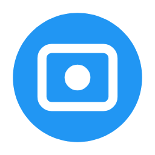

# Bubble

**Translate, explore, and search anything directly on your screen.**

A lightweight, privacy-first Android screen assistant for live on-screen translation, full-screen text selection, smart link & automatic QR detection, and multi-engine visual search — without root.

**English** | [Bahasa Indonesia](README_ID.md)

[-3DDC84?style=flat-square&logo=android&logoColor=white)](app/build.gradle.kts)
[](app/build.gradle.kts)
[](build.gradle.kts)
[](gradle/wrapper/gradle-wrapper.properties)
[](https://github.com/AprionoN-Officials/Bubble-Android/releases)

</div>

---

## Future Plan

Planned improvements and feature ideas for **Bubble** updates:

- [x] **Update UI** — Refreshing the user interface to **Material You Expressive** (7-tab hub with live previews, True AMOLED Black, and Material You Dynamic Color) — *UI update idea contributed by [Ardyan (@kouzen-neo)](https://github.com/kouzen-neo)*.
- [x] **Uncensored & Multi-Engine Visual Search** — Multi-engine visual search, custom search delay, built-in browser AdBlocker, and custom engines ([Custom Engine Guide](docs/Custom-Engine.md)).
- [x] **Full-Screen Selection & Smart Link Detection** — Adjustable full-screen selection and enhanced `X.com` / URL detection.
- ~~**Simple ChatBot AI**~~ — *Canceled because it does not align with Bubble's lightweight, privacy-first direction; may be explored as a separate project in the future.*

---

## What's New in v1.1.1 — Personalization & Material 3 Expressive Update

- **Material 3 Expressive 7-Tab UI:** Clean top scrollable segment navigation (**General**, **Translation**, **Search**, **Selection**, **Panel**, **Appearance**, **More**) with preserved per-tab scroll state, dynamic build version badge, and zero bottom navigation clutter. Core controls (**App Language**, **Default Action Mode**, **Auto-Scan QR**, **Auto-Detect Links**) live right in **General**.
- **Full-Screen Selection (`Full Screen`):** Expand the selection region to the entire screen in one tap while keeping all edges and corners freely adjustable before scanning—available in the top overlay bar and as an optional tool in the Action Panel.
- **Improved Smart Link Detection & Select Text:** Automatically detects `X.com`, `fb.watch`, social preview links, and web URLs on screen with a non-blocking **"Link found. Open link?"** quick card (**Open Link** / **Copy Link**), while yielding priority to QR codes so cards never overlap.
- **Multi-Engine Visual Search, Custom Delay & Built-In Browser AdBlocker:** Supports **Google Lens**, **Yandex Images**, **TinEye**, **Bing Visual Search**, **SauceNAO**, **trace.moe**, **Open With**, and custom engines ([Custom Engine Guide](docs/Custom-Engine.md)). Configure visual search delay (`1s / 2s / 5s / 7s / 10s / Custom`), block ads locally inside Bubble's built-in visual search browser, and return straight to your previous app when closing it.
- **5 Selection Shapes & 4 Stroke Styles:** Interactive **Live Selection Preview** supporting **Rectangle**, **Rounded**, **Ellipse**, **Freeform**, and **Curved** shapes; **Solid**, **Dashed**, **Dotted**, and **Dash-Dot** strokes; custom HEX/RGB colors; and unified non-rectangular masking.
- **Custom Action Panel (Up to 7 Tools):** Preserves Bubble's iconic minimalist **2-button default** (`Translate` & `Search Image`), expandable up to **7 real tools** (`Translate`, `Search Image`, `Select Text`, `Full Screen`, `Copy Image`, `Save Image`, `Share Image`) with drag-to-reorder **`=`** handles and **Top / Bottom / Left / Right / Custom** docking.
- **Translation Quality Modes & Context Profiles:** Real pipeline tuning across **Fast / Accurate / Natural** modes, **General / Literal / Natural / Manga-Game** context reconstruction, 31 downloadable offline ML Kit languages, custom **Tesseract 5** `.traineddata` OCR, and **Delete Unused Models**.
- **Theme Personalization:** **Follow System**, **Light**, **Dark**, and **True AMOLED Black (`#000000`)**, Android 12+ **Material You Dynamic Color**, 7 curated color palettes + custom HEX/RGB picker, and independent **Theme Scope** controls.
- **Play-Protect-Friendly GitHub Updates & Zero Trackers:** Lightweight `JobScheduler` release checker opening official GitHub Releases in your browser—removing `QUERY_ALL_PACKAGES` and `REQUEST_INSTALL_PACKAGES` completely. 100% free, no ads, no accounts, no paywalls. See full [CHANGELOG.md](CHANGELOG.md) and [v1.1.1 Visual Feature Documentation](docs/v1.1-Feature-Documentation.md).

---

## About Bubble

Reading foreign-language apps, games, articles, or images on Android normally requires taking a screenshot, switching to a translation or search app, importing the image, and switching back.

**Bubble** (`com.bubble.screentools`) brings those workflows into a single on-screen overlay you can summon over any app:

- **Translate text in place** without leaving what you are reading.
- **Select and copy text from anywhere on screen**—including images and non-selectable layouts—directly inside Bubble.
- **Detect links & scan QR codes automatically** (including `X.com` URLs, Indonesian QRIS, Wi-Fi, and contacts) without switching apps.
- **Search images visually** across multiple engines with custom search delay and a built-in ad-blocking search browser.

---

## Why Bubble?

| Capability | How Bubble Delivers It (Verified in Source) |
| --- | --- |
| **In-Place Screen Translation** | Renders translated text boxes directly over your selection with an instant **Original ↔ Translated** toggle and one-tap **Copy**. |
| **Minimal App Switching** | Summon via **Default Digital Assistant** (hold Home / corner swipe), **Accessibility Shortcut**, or **Quick Settings Tile** without leaving the foreground app. |
| **No "Start Recording" Popup** | Uses Android's **Digital Assistant (`VoiceInteractionService`)** on Android 7–15 or silent **`AccessibilityService.takeScreenshot()`** on Android 11+, avoiding `MediaProjection` prompts on supported modes. |
| **Hybrid Screen Scanning** | Combines on-device OCR (unbundled ML Kit Play Services + optional custom **Tesseract 5** `.traineddata` models) with `AssistStructure` / `AccessibilityNodeInfo` extraction as fallback. |
| **On-Device Offline Translation** | Downloads compact ML Kit translation models on demand across 31 curated languages and caches recent translations in a 256-entry RAM `LruCache`. |
| **Multi-Engine Visual Search + AdBlocker** | Defaults to **Google Lens**, plus **Yandex Images**, **TinEye**, **Bing Visual**, **SauceNAO**, **trace.moe**, **Open With**, custom engines, configurable delay (`1s–10s` or custom), and local ad blocking inside Bubble's built-in search browser. |
| **Privacy-First & Bubble Safe Mode** | Keeps full-screen snapshots strictly in RAM, skips password fields, respects `FLAG_SECURE`, uses explicit `<queries>` instead of `QUERY_ALL_PACKAGES`, and automatically halts scanning on excluded banking, e-wallet, and authenticator apps. |

---

## Featured Features (Live Android 14 v1.1.1 Recordings)

> All visual previews below were authentically captured from **Bubble v1.1.1** running on **Android 14 (API 34, Pixel 6)**. Every feature also has a high-clarity **720×1600 @ 30 FPS MP4** recording in [`docs/assets/v1.1/videos/`](docs/assets/v1.1/videos/) — browse the full catalog in [v1.1.1 Visual Feature Documentation](docs/v1.1-Feature-Documentation.md).

### 1. Material 3 Expressive 7-Tab Interface

Clean top scrollable segments (**General**, **Translation**, **Search**, **Selection**, **Panel**, **Appearance**, **More**) with preserved scroll state and live previews.

<table>
  <tr>
    <td width="40%" align="center">
      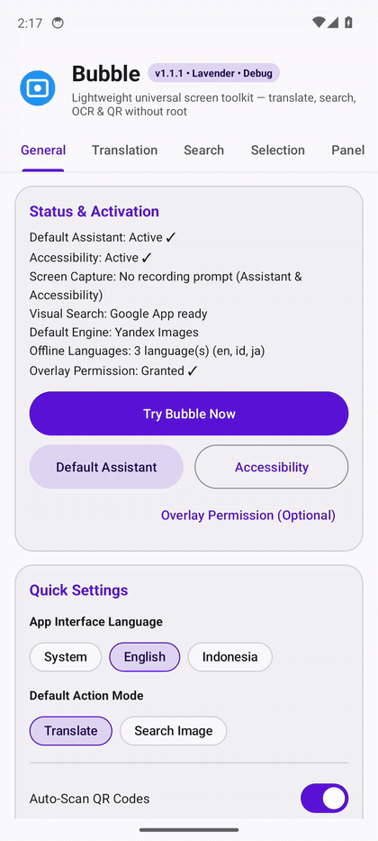<br />
      <sub>Live Android 14 capture · <a href="docs/assets/v1.1/videos/01-tabs-navigation.mp4">Watch 30 FPS MP4</a></sub>
    </td>
    <td width="60%" valign="top">
      <ul>
        <li><b>Real-time status dashboard:</b> See Default Assistant, Accessibility, Capture Mode, Visual Search readiness, Offline Language count, and Overlay status at a glance in <b>General</b>.</li>
        <li><b>Core controls upfront:</b> Toggle App Language, Default Action Mode, Auto-Scan QR, and Auto-Detect Links without digging through menus.</li>
        <li><b>Live previews everywhere:</b> Test selection shapes, panel layout, and color themes directly inside settings before launching the overlay.</li>
      </ul>
    </td>
  </tr>
</table>

### 2. Live On-Screen Translation & Custom Tesseract 5 OCR

Translate selected paragraphs or the entire screen offline after downloading language packs, then toggle between **Original** and **Translated** text or copy in one tap.

<table>
  <tr>
    <td width="40%" align="center">
      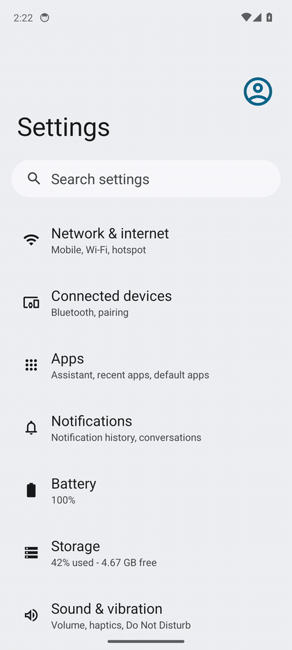<br />
      <sub>Live Android 14 capture · <a href="docs/assets/v1.1/videos/07-overlay-live-translation.mp4">Watch 30 FPS MP4</a></sub>
    </td>
    <td width="60%" valign="top">
      <ul>
        <li><b>31 downloadable offline ML Kit languages:</b> Download or remove language models (~30 MB each) on demand, plus <b>Delete Unused Models</b> cleanup.</li>
        <li><b>Quality &amp; context tuning:</b> Choose <b>Fast / Accurate / Natural</b> modes and <b>General / Literal / Natural / Manga-Game</b> context reconstruction (speech-bubble merging, vertical CJK handling, de-hyphenation).</li>
        <li><b>Custom Tesseract 5 OCR (<code>.traineddata</code>):</b> Import local files via Android SAF or quick-download 10 official <code>tessdata_fast</code> packs with binary-header validation.</li>
        <li><b>Clean reading view:</b> Bottom controls automatically collapse once translated overlays appear; tap <b>Original</b> or <b>Copy</b> anytime from the top bar.</li>
      </ul>
    </td>
  </tr>
</table>

### 3. Multi-Engine Visual Search, Custom Delay & Built-In Browser AdBlocker

Crop any object, product, or artwork on screen and run reverse image search across your preferred engines—with configurable countdown delay and local ad blocking inside Bubble's built-in search browser.

<table>
  <tr>
    <td width="50%" align="center">
      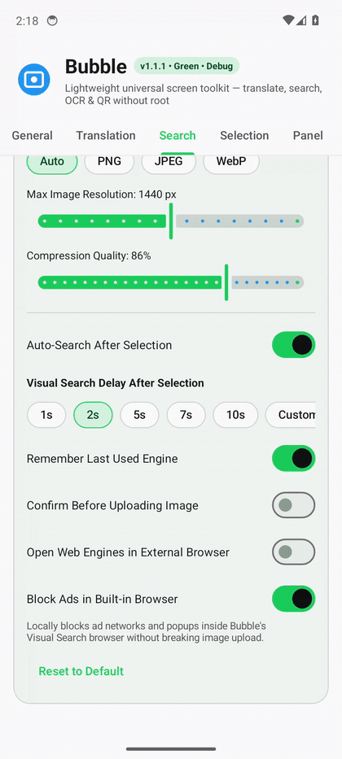<br />
      <sub>Custom delay (1s–10s / Custom) &amp; AdBlocker · <a href="docs/assets/v1.1/videos/05-search-delay-adblock.mp4">MP4</a></sub>
    </td>
    <td width="50%" align="center">
      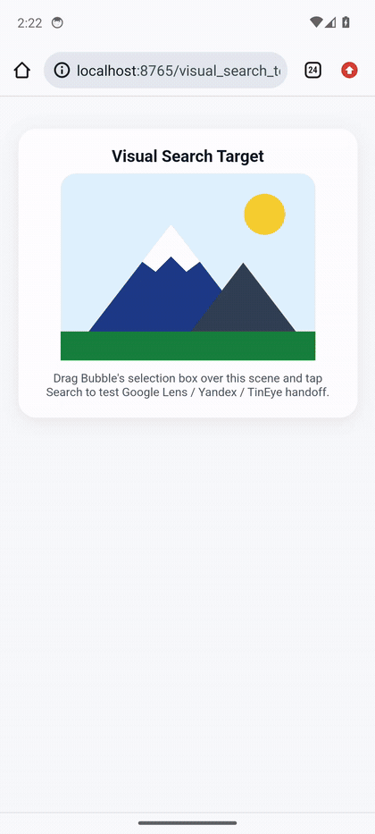<br />
      <sub>In-app visual search browser → returns to active app · <a href="docs/assets/v1.1/videos/09-overlay-visual-search-adblock.mp4">MP4</a></sub>
    </td>
  </tr>
</table>

- **7 Built-in Engines + Custom Engines:** Google Lens, Yandex Images, TinEye, Bing Visual Search, SauceNAO, trace.moe, and Android *Open With*—plus user-defined visual & text search engines ([Custom Engine Guide](docs/Custom-Engine.md)).
- **Configurable Search Delay:** Pick `1s`, `2s`, `5s`, `7s`, `10s`, or type a custom duration; touching any handle cancels the countdown immediately.
- **Built-In Browser AdBlocker & Clean Exit:** `WebViewAdBlocker` locally blocks ad domains and popups inside Bubble's built-in visual search browser without breaking image upload, and closing the browser returns you straight to the app you were using instead of Bubble's dashboard.

### 4. Selection Customization (5 Shapes, 4 Strokes) & Full-Screen Selection

Customize how Bubble selects your screen, or tap **Full Screen** to select the entire display while keeping edges adjustable before running Translate or Visual Search.

<table>
  <tr>
    <td width="50%" align="center">
      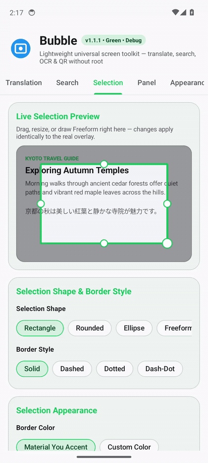<br />
      <sub>5 shapes &amp; 4 border styles live preview · <a href="docs/assets/v1.1/videos/03-selection-shapes-preview.mp4">MP4</a></sub>
    </td>
    <td width="50%" align="center">
      <br />
      <sub>Full-screen selection (still adjustable) · <a href="docs/assets/v1.1/videos/06-overlay-fullscreen-selection.mp4">MP4</a></sub>
    </td>
  </tr>
</table>

- **5 Shapes & 4 Border Styles:** Rectangle, Rounded, Ellipse, Freeform lasso, and Custom Curved with Solid, Dashed, Dotted, or Dash-Dot strokes and unified non-rectangular masking across OCR & Visual Search.
- **Full-Screen Selection (`Full Screen`):** Expands the frame to full screen without auto-triggering a scan, so you can trim corners or edges first and then choose Translate, Search Image, or Select Text.

### 5. Smart Link Detection (`X.com` / URLs) & Automatic QR Scanner

Bubble automatically recognizes web links and QR codes on screen without opening an external scanner.

<table>
  <tr>
    <td width="50%" align="center">
      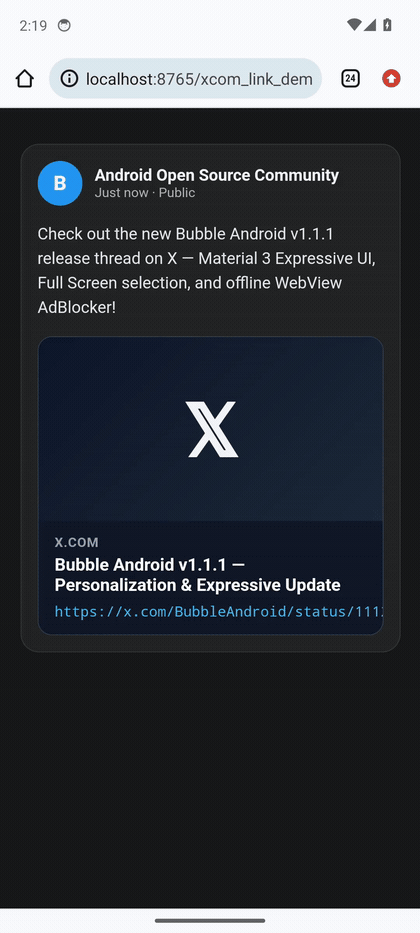<br />
      <sub>Auto-detects X.com &amp; URLs (Open / Copy Link) · <a href="docs/assets/v1.1/videos/08-overlay-smart-link-xcom.mp4">MP4</a></sub>
    </td>
    <td width="50%" align="center">
      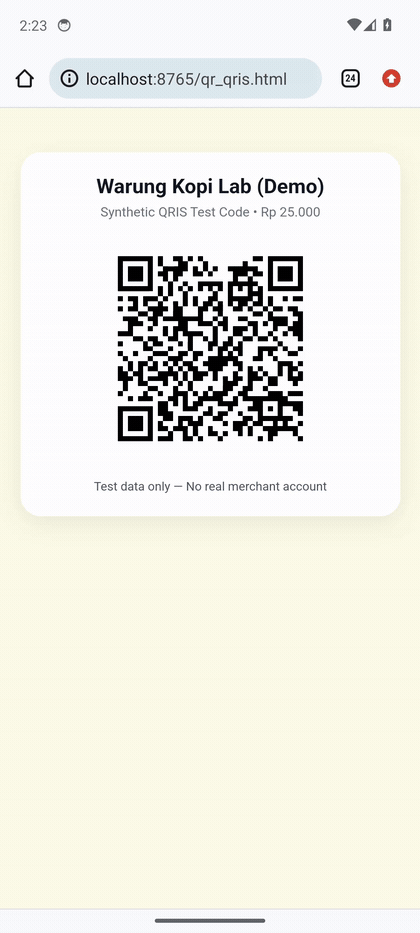<br />
      <sub>Auto QR scanner overlay (QRIS demo) · <a href="docs/assets/v1.1/videos/10-overlay-auto-qr-scan.mp4">MP4</a></sub>
    </td>
  </tr>
</table>

- **Smart Link Detection (`ScreenLinkDetector`):** Detects `http://`/`https://` URLs and public domains including `X.com` and `fb.watch`, presenting a non-blocking **"Link found. Open link?"** quick card (**Open Link** / **Copy Link**).
- **Automatic QR Scanner:** Parses Indonesian **QRIS (EMVCo TLV)**, PayNow, DuitNow, PromptPay, UPI, **Wi-Fi QR** (1-tap Android 11+ connect), URLs, contacts, email, phone, and SMS—prioritizing QR cards over link cards so overlays never collide.

### 6. Full-Screen Select Text Mode

Tap **Select Text** on the top bar to highlight every text block on screen (even inside images or unselectable app views), select individual lines or **Select All**, then **Copy**, **Translate**, **Open Link**, or **Web Search**.

<table>
  <tr>
    <td width="40%" align="center">
      <br />
      <sub>Live Android 14 capture (41 detected blocks) · <a href="docs/assets/v1.1/videos/11-overlay-select-text.mp4">Watch 30 FPS MP4</a></sub>
    </td>
    <td width="60%" valign="top">
      <ul>
        <li><b>Hybrid OCR + Accessibility fallback:</b> Runs ML Kit / Tesseract OCR with <code>BitmapCropHelper</code> upscaling and falls back to <code>AssistStructure</code> / <code>AccessibilityNodeInfo</code> while strictly skipping password fields.</li>
        <li><b>Smart URL actions:</b> Detected URLs inside Select Text are highlighted and directly clickable, offering <b>Copy Link</b> and <b>Open Link</b> in one tap.</li>
      </ul>
    </td>
  </tr>
</table>

### 7. Custom Action Panel & Theme Personalization (Light / Dark / True AMOLED)

Make Bubble feel native to your workflow and device theme.

<table>
  <tr>
    <td width="50%" align="center">
      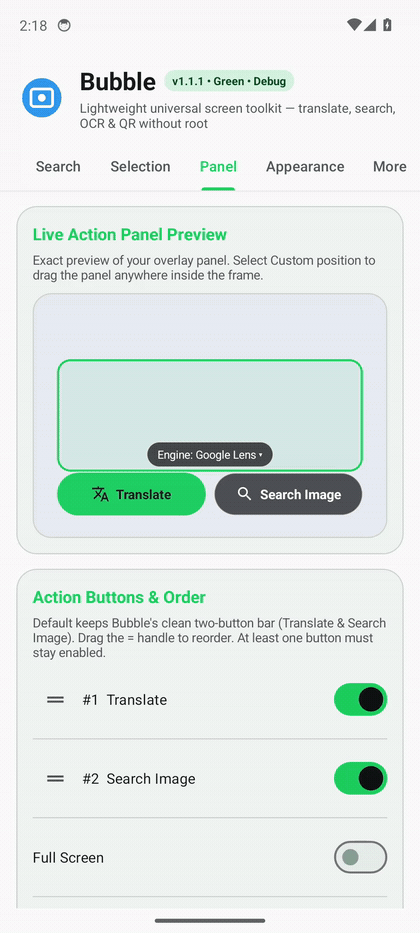<br />
      <sub>Action Panel customization &amp; drag-to-reorder · <a href="docs/assets/v1.1/videos/04-panel-customize.mp4">MP4</a></sub>
    </td>
    <td width="50%" align="center">
      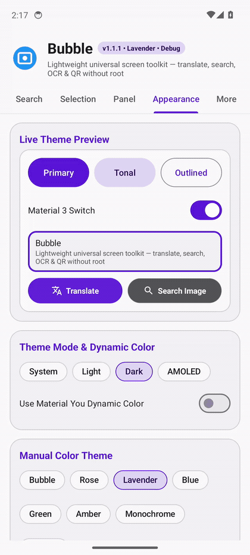<br />
      <sub>Light, Dark, True AMOLED Black &amp; palettes · <a href="docs/assets/v1.1/videos/02-theme-amoled-switch.mp4">MP4</a></sub>
    </td>
  </tr>
</table>

- **Custom Action Panel:** Starts clean with **2 buttons** (`Translate` & `Search Image`) and expands up to **7 tools** (`+ Select Text, Full Screen, Copy Image, Save Image, Share Image`) with drag-to-reorder **`=`** handles, Horizontal Scroll / Two Rows / Icon-Only layouts, and Top / Bottom / Left / Right / Custom drag positioning.
- **Theme Personalization:** Follow System, Light, Dark, or **True AMOLED Black (`#000000`)**, Android 12+ **Material You Dynamic Color**, 7 curated color palettes (Bubble, Rose, Lavender, Blue, Green, Amber, Monochrome) + custom HEX/RGB picker, and independent **Theme Scope** toggles.

---

## Application Preview (Authentic v1.1.1 Screenshots — Android 14)

### 7-Tab Material 3 Expressive Hub

<table>
  <tr>
    <td align="center" width="25%">
      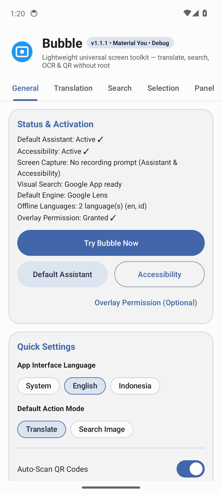<br />
      <sub><b>General (Light)</b></sub>
    </td>
    <td align="center" width="25%">
      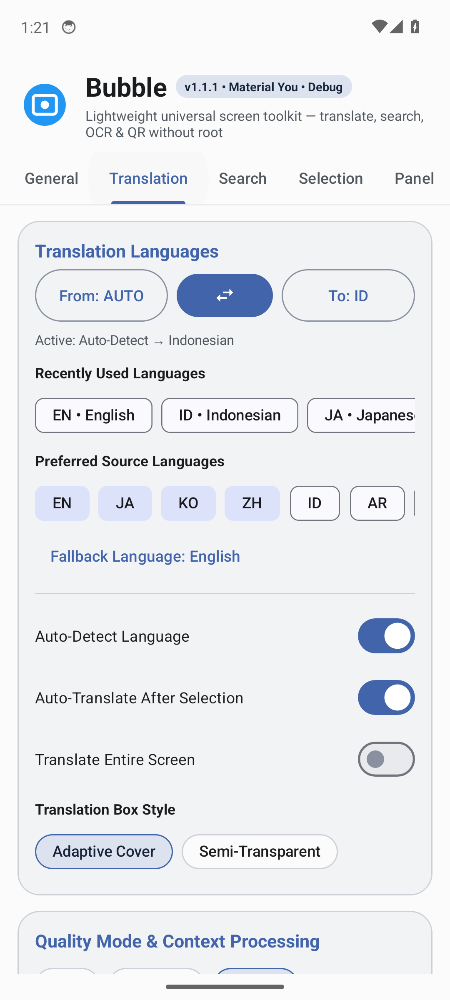<br />
      <sub><b>Translation</b></sub>
    </td>
    <td align="center" width="25%">
      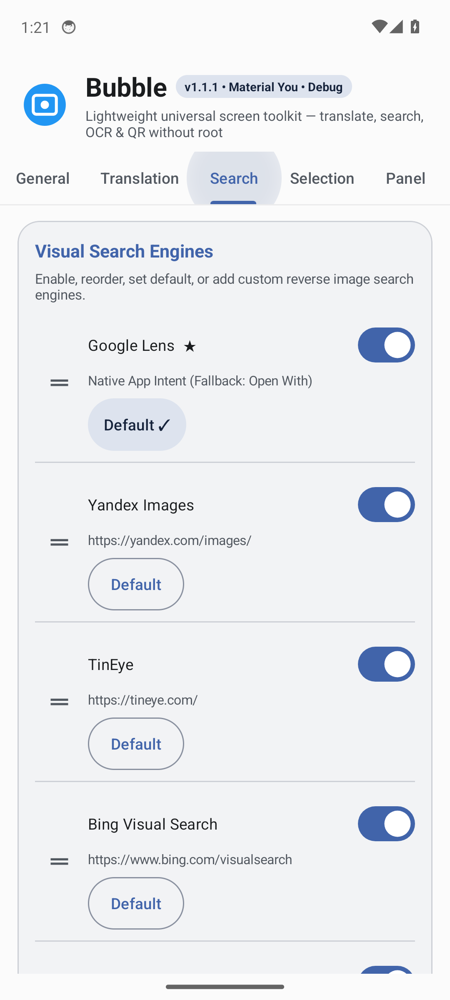<br />
      <sub><b>Search Engines</b></sub>
    </td>
    <td align="center" width="25%">
      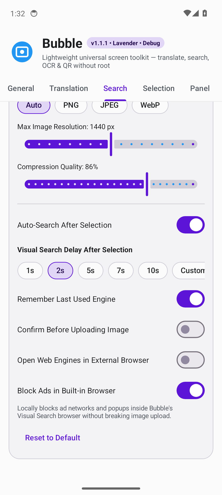<br />
      <sub><b>Search Delay &amp; AdBlocker</b></sub>
    </td>
  </tr>
  <tr>
    <td align="center" width="25%">
      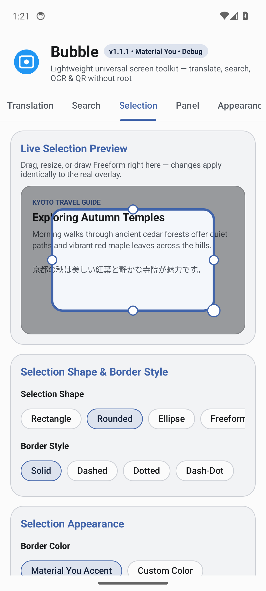<br />
      <sub><b>Selection &amp; Live Preview</b></sub>
    </td>
    <td align="center" width="25%">
      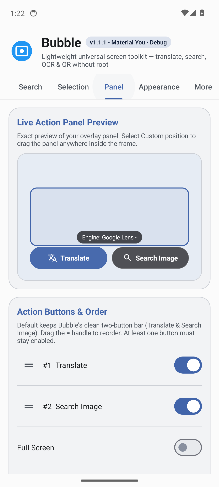<br />
      <sub><b>Custom Action Panel</b></sub>
    </td>
    <td align="center" width="25%">
      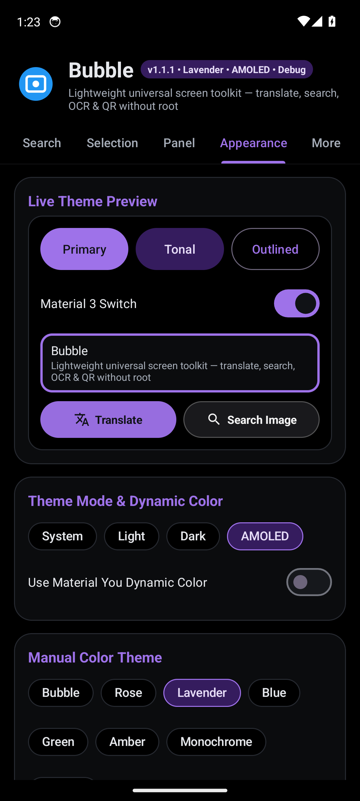<br />
      <sub><b>Appearance (AMOLED)</b></sub>
    </td>
    <td align="center" width="25%">
      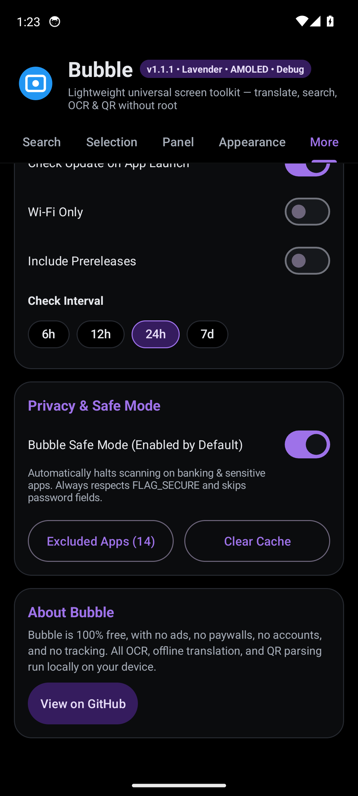<br />
      <sub><b>More &amp; Safe Mode</b></sub>
    </td>
  </tr>
</table>

### Live Overlays, Offline Models & Safe Mode

<table>
  <tr>
    <td align="center" width="25%">
      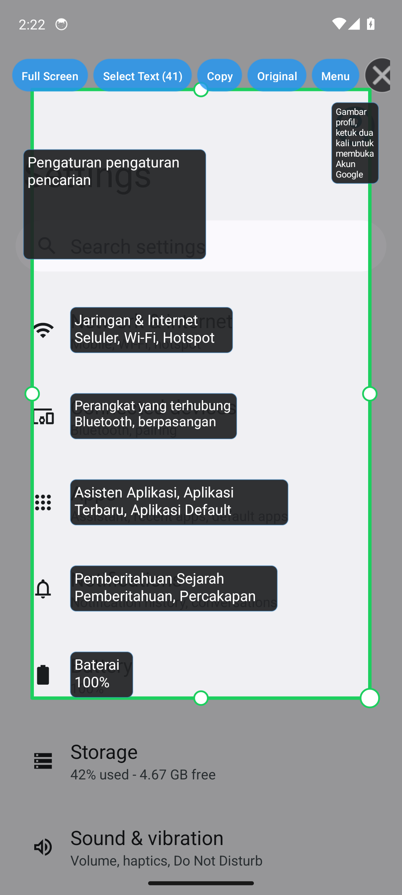<br />
      <sub><b>Live Translation (EN → ID)</b></sub>
    </td>
    <td align="center" width="25%">
      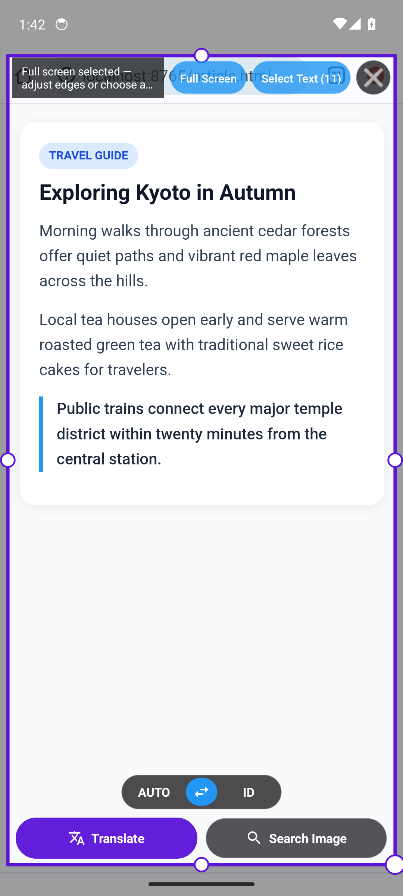<br />
      <sub><b>Full-Screen Selection</b></sub>
    </td>
    <td align="center" width="25%">
      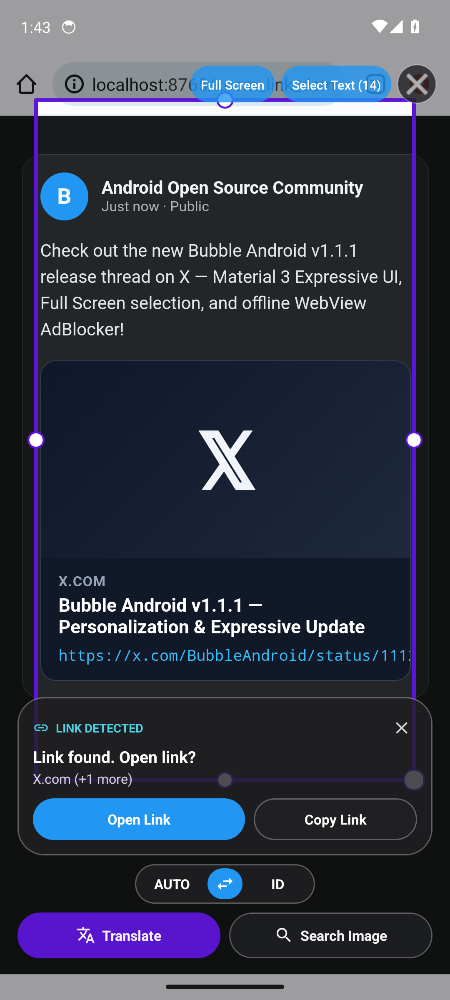<br />
      <sub><b>Smart Link (X.com)</b></sub>
    </td>
    <td align="center" width="25%">
      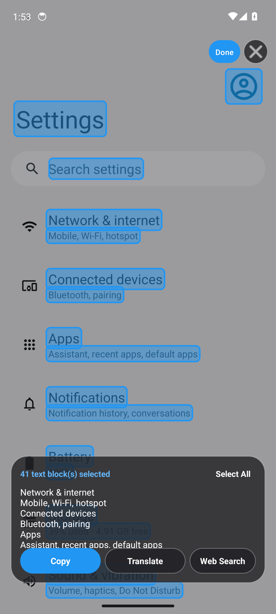<br />
      <sub><b>Select Text (41 Blocks)</b></sub>
    </td>
  </tr>
  <tr>
    <td align="center" width="25%">
      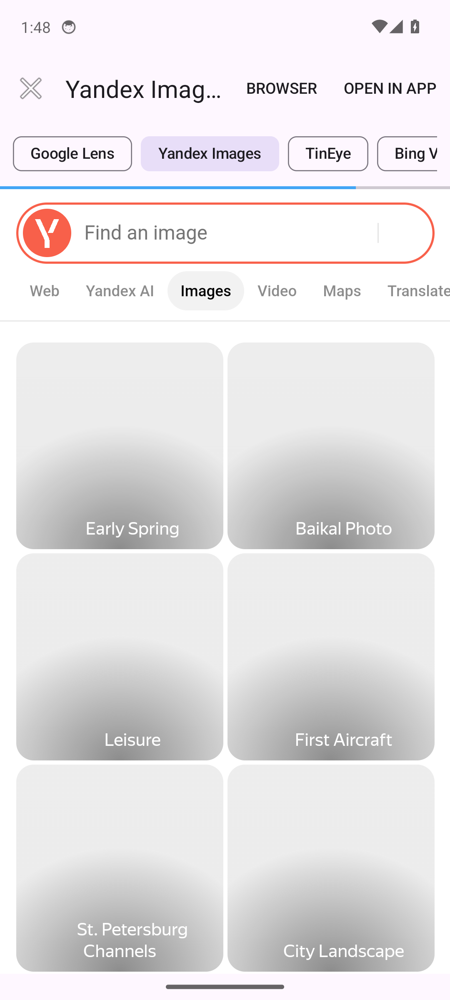<br />
      <sub><b>Visual Search Browser</b></sub>
    </td>
    <td align="center" width="25%">
      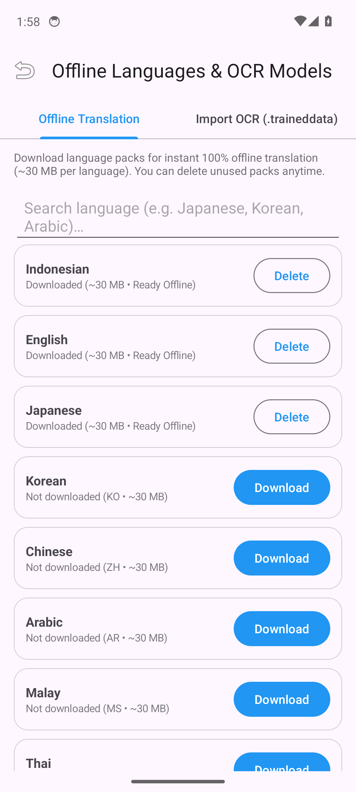<br />
      <sub><b>Offline Languages (31)</b></sub>
    </td>
    <td align="center" width="25%">
      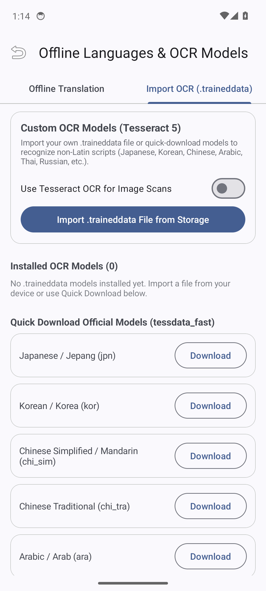<br />
      <sub><b>Custom Tesseract 5 OCR</b></sub>
    </td>
    <td align="center" width="25%">
      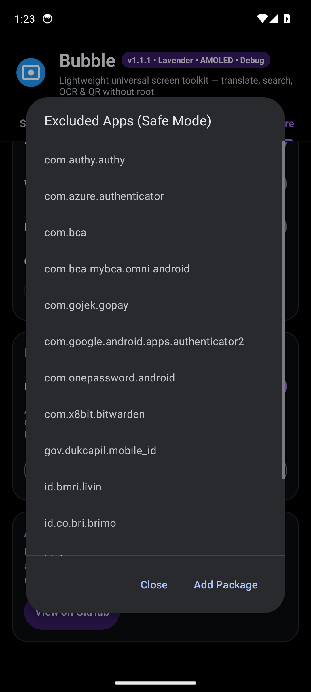<br />
      <sub><b>Safe Mode Excluded (14)</b></sub>
    </td>
  </tr>
</table>

> Browse all 17 screenshots, 11 MP4 clips, 11 GIFs, and the 33-frame QA contact sheet in [`docs/v1.1-Feature-Documentation.md`](docs/v1.1-Feature-Documentation.md).

---

## How It Works

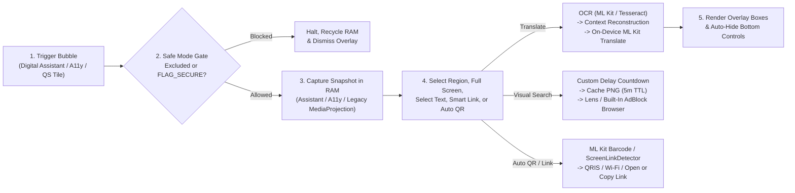

For component-level details, see [docs/architecture.md](docs/architecture.md).

---

## Getting Started

1. **Install the APK:** Download the release APK matching your CPU architecture from [GitHub Releases](https://github.com/AprionoN-Officials/Bubble-Android/releases) (`arm64-v8a` for most modern Android devices) or build from source.
2. **Choose Your Trigger Mode (Only Grant What You Need):**
   - **Option 1 — Default Digital Assistant (Recommended, Android 7–15):** Open Bubble → tap **Default Assistant** → select **Bubble**. No Accessibility or Overlay permission is required.
   - **Option 2 — Accessibility & Quick Settings Tile:** Tap **Accessibility** → enable **Bubble**. On Android 11+, Bubble uses silent Accessibility screenshots. On Android 7–10 without Default Assistant mode, grant Legacy Capture Permission when prompted.
   - *(Optional)* Add the **Bubble Screen** tile in Android's Quick Settings editor.
3. **Configure Languages:** Open the **Translation** tab, set your `From` and `To` languages (or keep `AUTO`), and tap **Offline Languages & OCR Models** to download the offline packs you need.
4. **Customize Your Workflow:** Tune **Search** (engine order, search delay, built-in browser AdBlocker), **Selection** (5 shapes, 4 border styles), **Panel** (up to 7 tools, docking), and **Appearance** (Light / Dark / AMOLED / Material You).
5. **Review Safe Mode:** Bubble Safe Mode is enabled by default under **More → Privacy & Safe Mode**. Tap **Excluded Apps (14)** to inspect or customize protected packages.

---

## Privacy & Security

Transparency about permissions and data handling based strictly on [`AndroidManifest.xml`](app/src/main/AndroidManifest.xml) and source code:

- **Permissions & Why They Are Declared:**
  - `INTERNET` & `ACCESS_NETWORK_STATE`: Download on-demand ML Kit language packs, optional Tesseract `.traineddata` packs from GitHub, check GitHub Releases updates, and load in-app web visual search pages.
  - `SYSTEM_ALERT_WINDOW`: Optional overlay permission when used outside `AccessibilityService` or `BubbleAssistantActivity`.
  - `BIND_VOICE_INTERACTION` / `BIND_ACCESSIBILITY_SERVICE` / `BIND_QUICK_SETTINGS_TILE`: System service bindings used solely when explicitly enabled by the user.
  - `FOREGROUND_SERVICE`, `FOREGROUND_SERVICE_MEDIA_PROJECTION`, `POST_NOTIFICATIONS`: Used only for the legacy Android 7–10 `MediaProjection` fallback (`MediaProjectionService`).
  - **No `QUERY_ALL_PACKAGES` & No `REQUEST_INSTALL_PACKAGES`:** Replaced with explicit `<queries>` entries (for Google Lens, Google App, supported QRIS payment apps, and `SEND`/`VIEW` intents) and transparent browser handoff to GitHub Releases.
- **Local vs. External Processing:**
  - **On-Device (Local):** Screen capture in RAM, OCR (ML Kit Play Services / Tesseract 5), Language Identification, On-Device ML Kit Translation (after model download), Smart Link detection, QR payload parsing, and built-in visual search browser AdBlocker rules run locally on your device.
  - **External Network / Third-Party Apps:** Downloading ML Kit models contacts Google servers; quick-downloading Tesseract models fetches from GitHub (`tesseract-ocr/tessdata_fast`); **Visual Search** sends only your cropped image to the external app or web engine you choose.
- **Temporary Buffers & Image Cleanup:**
  - Full-screen bitmaps stay strictly in RAM (`SessionSnapshotStore` / `BubbleOverlayController`) and are recycled when the overlay closes.
  - Cropped images for Visual Search or QR handoff are written privately to `cacheDir/lens_temp/` via `TemporaryImageProvider` (`FileProvider`), automatically purged after **5 minutes**, cleared on app startup (`BubbleApp.onCreate`), and removable immediately via **Clear Cache**.
  - Bubble never writes screenshots to your photo gallery unless you explicitly tap **Save Image** or **Save QR**.
- **Passwords, `FLAG_SECURE` & Banking App Compatibility:**
  - `ScreenTextExtractor` skips nodes with `isPassword == true`; `BubbleVoiceInteractionSession` skips password `InputType` fields.
  - Bubble respects Android's `FLAG_SECURE` window protection and never attempts to bypass secure screens.
  - **Note on Banking Apps:** Some banking apps detect *any* enabled third-party `AccessibilityService` at the OS level even when Bubble's overlay is closed. For maximum compatibility with strict banking apps, use **Default Digital Assistant** mode and keep Accessibility disabled unless needed.

---

## Technology Stack

| Layer | Technology / Library |
| --- | --- |
| **Language** | Kotlin `2.0.21` (`jvmTarget = 17`) + Kotlin Coroutines `1.9.0` |
| **Android SDK & Build** | Android Gradle Plugin `8.7.2`, Gradle Wrapper `8.9`, `compileSdk 35`, `targetSdk 35`, `minSdk 24` |
| **UI & Material Design** | Android Views, `androidx.appcompat:1.7.0`, `com.google.android.material:1.12.0` (`Theme.Material3.DayNight.NoActionBar`) |
| **OCR Engines** | `com.google.android.gms:play-services-mlkit-text-recognition:19.0.1` (unbundled) + `cz.adaptech.tesseract4android:tesseract4android:4.8.0` (optional custom `.traineddata`) |
| **Language ID & Translation** | `com.google.mlkit:language-id:17.0.6`, `com.google.mlkit:translate:17.0.3`, 256-entry `android.util.LruCache` |
| **QR & Link Detection** | `com.google.android.gms:play-services-mlkit-barcode-scanning:18.3.1`, pure-Kotlin `QrCodeParser`, `ScreenLinkDetector` |
| **Screen Capture & Services** | `VoiceInteractionService`, `AccessibilityService.takeScreenshot()` (API 30+), `MediaProjection` + `ImageReader` (legacy API 24–29), `TileService`, `JobScheduler` |
| **Visual Search & AdBlocker** | `FileProvider` (`TemporaryImageProvider`), `Intent.ACTION_SEND` / `ACTION_VIEW`, isolated-task `VisualSearchWebActivity` + `WebViewAdBlocker` |
| **Optimization** | R8 Full Mode (`isMinifyEnabled = true`, `isShrinkResources = true`), ABI splits (`arm64-v8a`, `armeabi-v7a`), compressed `jniLibs`, `resourceConfigurations += listOf("id", "in", "en")` |

---

## System Requirements

| Requirement | Verified Value (`v1.1.1`) |
| --- | --- |
| **Minimum Android Version** | Android 7.0 Nougat (API 24) |
| **Target / Compile SDK** | Android 15 (API 35) |
| **Verified Release APK Size** | `arm64-v8a`: **12.35 MiB** (`12,953,326 bytes`)<br>`armeabi-v7a`: **11.25 MiB** (`11,796,790 bytes`) |
| **Verified Debug APK Size** | `arm64-v8a`: **18.41 MiB** (`19,307,373 bytes`)<br>`armeabi-v7a`: **17.03 MiB** (`17,862,421 bytes`) |
| **Google Play Services** | Required for default unbundled ML Kit OCR and ML Kit Barcode/QR scanning. On-device ML Kit Translation and `AssistStructure`/`AccessibilityNodeInfo` extraction work without Play Services once models are downloaded. |
| **Internet Connection** | Required for initial translation model downloads, optional `.traineddata` quick downloads, GitHub update checks, and Visual Search. Not required for offline translation once language packs are downloaded. |
| **Model Storage** | ~30 MB per downloaded ML Kit translation language; ~4–15 MB per optional Tesseract `.traineddata` file. |

---

## Installation & Build from Source

Verified with **OpenJDK 17/21**, **Android SDK Platform 35**, **Build-Tools 35.0.0**, and **Gradle Wrapper 8.9** (`./gradlew`).

```bash
# 1. Clone the repository
git clone https://github.com/AprionoN-Officials/Bubble-Android.git
cd Bubble-Android

# 2. Run all 7 JVM unit test suites
./gradlew testReleaseUnitTest

# 3. Build Debug APKs
./gradlew assembleDebug

# 4. Build minified Release APKs (arm64-v8a & armeabi-v7a)
./gradlew assembleRelease
```

> **Release Signing (Optional):** If `keystore/bubble-release.jks` is present, Gradle signs release APKs using `BUBBLE_KEYSTORE_PASSWORD`, `BUBBLE_KEY_ALIAS`, and `BUBBLE_KEY_PASSWORD` environment variables. Without a keystore file, `assembleRelease` produces unsigned release APKs cleanly.

---

## Customization & Power-User Guide

- **Custom Search Engines:** Add your own visual or text search engine (custom URL template or compatible Android app) — see the step-by-step **[Custom Search Engine Guide](docs/Custom-Engine.md)**.
- **Model & OCR Separation:** ML Kit offline translation packs (~30 MB per language, with **Delete Unused Models**) and Tesseract 5 `.traineddata` OCR models (`16 KB–150 MB`, header-validated) are managed separately so files are never misclassified.
- **GitHub Automatic Update Checker:** Configure under **More → GitHub Automatic Updates** (`6h / 12h / 24h / 7d`, Wi-Fi Only, optional Prereleases). Opens official GitHub Releases in your browser.
- **Voluntary Support (Free Forever):** Bubble is **100% free** with zero ads, zero paywalls, zero accounts, and zero locked features. A voluntary donation reminder may appear once on first install when opening an in-app customization tab (**Search**, **Selection**, **Panel**, or **Appearance**), followed by a shared **72-hour cooldown** across all tabs (never during overlay gestures, shortcuts, translation, Safe Mode, or update checks).

---

## Known Limitations

- **Android `FLAG_SECURE`:** Protected screens (banking PINs, DRM video, incognito tabs) block screenshots at the OS level; Bubble respects this restriction and never attempts to bypass it.
- **AdBlocker Scope:** Bubble's built-in AdBlocker operates strictly inside Bubble's in-app Visual Search WebView (`VisualSearchWebActivity`), not device-wide across other browsers or apps.
- **Google Lens Rendering:** Google Lens does not expose a public embedded API for third-party overlays; Bubble hands off the cropped PNG via `Intent.ACTION_SEND` + `FileProvider`.
- **Banking App Accessibility Checks:** Some financial apps warn about *any* enabled `AccessibilityService`; use **Default Digital Assistant** mode to avoid enabling Accessibility.

---

## Contributors, Credits & License

- **Contributors:**
  - **[Ardyan (@kouzen-neo)](https://github.com/kouzen-neo)** — Contributed the idea for updating Bubble's UI to **Material You Expressive**.
- **Contributing:** Bug reports, device compatibility feedback, and pull requests are welcome via [GitHub Issues](https://github.com/AprionoN-Officials/Bubble-Android/issues). Please include your Android version, device model, trigger mode (Default Assistant vs. Accessibility), and reproduction steps.
- **Credits:** Built by **AprionoN-Officials**. Powered by [AndroidX & Material Components](https://developer.android.com/jetpack), [Google ML Kit](https://developers.google.com/ml-kit), and [Tesseract4Android](https://github.com/adaptech-cz/Tesseract4Android).
- **License:** No open-source license file (`LICENSE`) is currently included in this repository. All rights remain with the repository owner until an explicit license is added.
