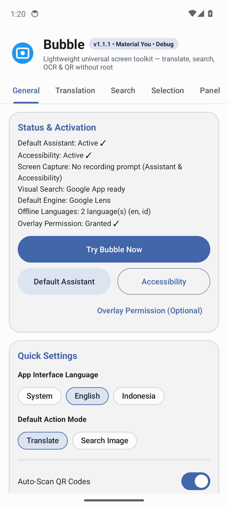
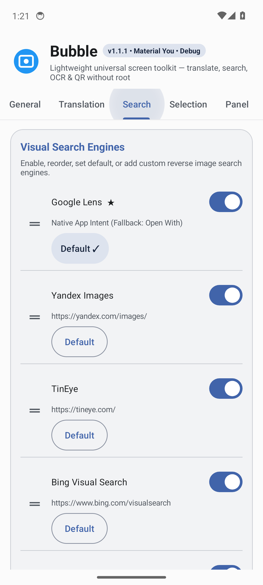
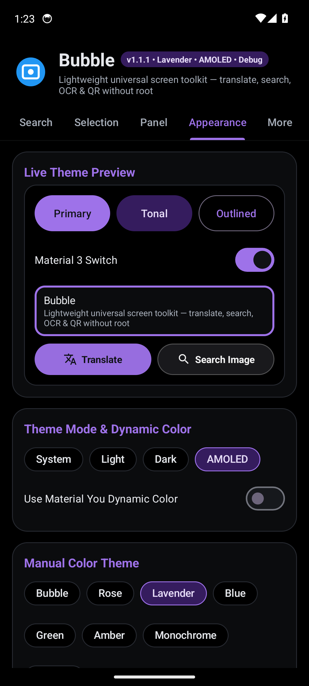
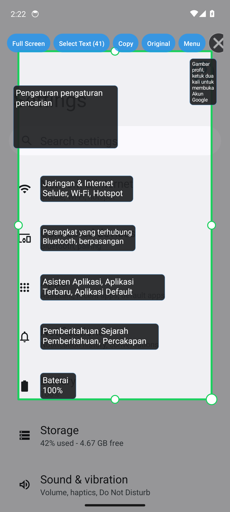
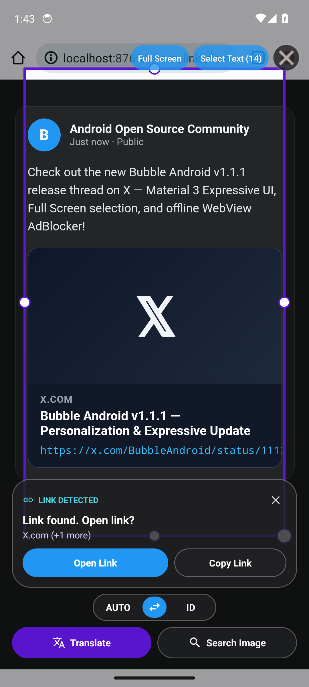
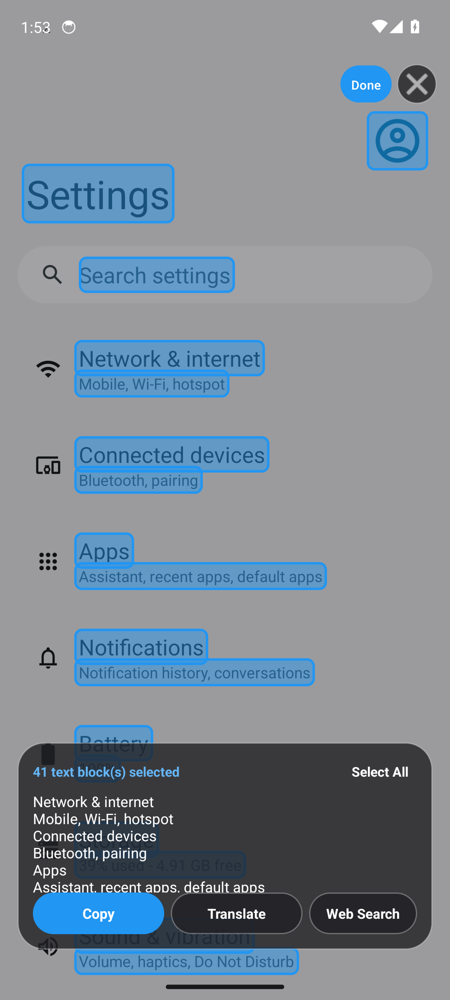
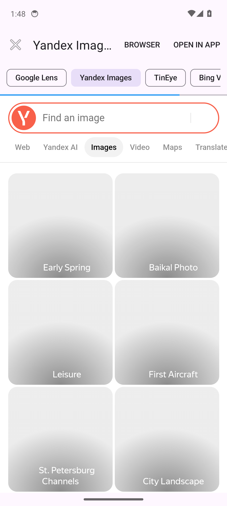
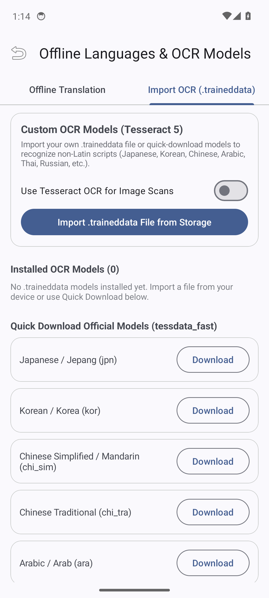
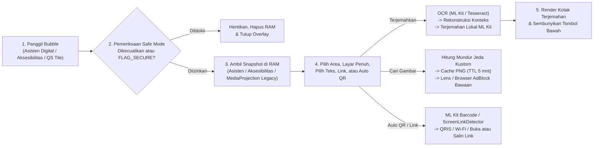

<div align="center">


# Bubble

**Terjemahkan, jelajahi, dan cari informasi langsung dari layar Anda.**

Asisten layar Android yang ringan dan mengutamakan privasi untuk penerjemahan langsung di layar, pilih & salin teks seluruh layar, deteksi tautan & pemindaian QR otomatis, serta pencarian visual multi-mesin — tanpa root.

[English](README.md) | **Bahasa Indonesia**

[-3DDC84?style=flat-square&logo=android&logoColor=white)](app/build.gradle.kts)
[](app/build.gradle.kts)
[](build.gradle.kts)
[](gradle/wrapper/gradle-wrapper.properties)
[](https://github.com/AprionoN-Officials/Bubble-Android/releases)

</div>

---

## Pembaruan v1.1.1 — Personalization & Material 3 Expressive Update

- **Redesign UI Material 3 Expressive (7 Tab Atas):** Navigasi segmen geser horizontal yang bersih di bagian atas (**Umum**, **Terjemahan**, **Pencarian**, **Seleksi**, **Panel**, **Tampilan**, **Lainnya**) tanpa Bottom Navigation Bar, state gulir tersimpan per tab, dan badge versi dinamis. Pengaturan inti (**Bahasa Antarmuka**, **Mode Tindakan Default**, **Pindai QR Otomatis**, **Deteksi Link Otomatis**) langsung tersedia di tab **Umum**.
- **Scan Seluruh Layar (`Full Screen`):** Perluas bingkai seleksi menjadi satu layar penuh dalam sekali ketuk namun tetap bebas digeser atau diperkecil sudut/tepinya sebelum memindai—tersedia di bilah atas overlay serta sebagai alat opsional di Panel Aksi.
- **Peningkatan Deteksi Link Pintar & Pilih Teks:** Mendeteksi tautan `X.com`, `fb.watch`, kartu pratinjau media sosial, dan URL web secara otomatis dengan kartu cepat non-blocking **"Ditemukan Link. Buka link?"** (**Buka Link** / **Salin Link**), sambil tetap memberi prioritas pada kartu QR agar tidak saling menimpa.
- **Pencarian Visual Multi-Mesin, Jeda Kustom & AdBlocker Browser Bawaan:** Mendukung **Google Lens**, **Yandex Images**, **TinEye**, **Bing Visual Search**, **SauceNAO**, **trace.moe**, **Buka Dengan**, serta mesin kustom ([Panduan Mesin Kustom](docs/Custom-Engine_ID.md)). Atur jeda pencarian gambar (`1d / 2d / 5d / 7d / 10d / Kustom`), blokir iklan secara lokal di dalam browser pencarian gambar bawaan Bubble, dan langsung kembali ke aplikasi sebelumnya saat browser ditutup.
- **5 Bentuk Seleksi & 4 Gaya Garis:** **Live Selection Preview** interaktif dengan bentuk **Persegi**, **Membulat**, **Elips**, **Bebas (Freeform)**, dan **Lengkung (Curved)**; gaya garis **Solid**, **Putus-Putus**, **Titik-Titik**, dan **Garis-Titik**; warna HEX/RGB kustom; serta masking non-persegi terpadu.
- **Custom Action Panel (Hingga 7 Alat):** Mempertahankan **tampilan default 2 tombol** yang minimalis (`Terjemahkan` & `Cari Gambar`), dapat diperluas hingga **7 alat nyata** (`Terjemahkan`, `Cari Gambar`, `Pilih Teks`, `Layar Penuh`, `Salin Gambar`, `Simpan Gambar`, `Bagikan Gambar`) dengan handle geser **`=`** dan posisi **Atas / Bawah / Kiri / Kanan / Kustom**.
- **Mode Kualitas Terjemahan & Profil Konteks:** Pemrosesan nyata pada mode **Cepat / Akurat / Natural**, profil konteks **Umum / Literal / Natural / Manga-Game**, 31 bahasa offline ML Kit yang dapat diunduh sesuai kebutuhan, OCR kustom **Tesseract 5** `.traineddata`, dan tombol **Hapus Model Tidak Terpakai**.
- **Personalisasi Tema:** **Ikuti Sistem**, **Terang**, **Gelap**, dan **True AMOLED Black (`#000000`)**, **Material You Dynamic Color** (Android 12+), 7 palet warna bawaan + pemilih warna HEX/RGB kustom, serta pengaturan **Cakupan Tema** independen.
- **Pembaruan GitHub Ramah Play Protect & Tanpa Pelacak:** Pengecekan rilis ringan via `JobScheduler` yang membuka GitHub Releases resmi di browser—tanpa izin `QUERY_ALL_PACKAGES` maupun `REQUEST_INSTALL_PACKAGES`. 100% gratis, tanpa iklan, tanpa akun, dan tanpa paywall. Lihat [CHANGELOG.md](CHANGELOG.md) serta [Dokumentasi Visual Fitur v1.1.1](docs/v1.1-Feature-Documentation.md).

---

## Tentang Bubble

Memahami aplikasi, game, artikel, atau gambar berbahasa asing di Android biasanya mengharuskan Anda mengambil tangkapan layar, berpindah ke aplikasi penerjemah atau pencari gambar, mengimpor gambar, lalu kembali lagi ke aplikasi sebelumnya.

**Bubble** (`com.bubble.screentools`) menyatukan seluruh alur tersebut ke dalam satu overlay layar yang bisa dipanggil langsung di atas aplikasi apa saja:

- **Terjemahkan teks langsung di tempat** tanpa meninggalkan layar yang sedang dibuka.
- **Pilih dan salin teks dari mana saja di layar**—termasuk gambar maupun tampilan aplikasi yang tidak bisa diseleksi.
- **Deteksi tautan & pindai kode QR secara otomatis** (termasuk URL `X.com`, QRIS Indonesia, Wi-Fi, dan kontak) tanpa berpindah aplikasi.
- **Cari informasi visual dari gambar di layar** lewat berbagai mesin pencari dengan jeda kustom serta browser pencarian bawaan yang dilengkapi pemblokir iklan.

---

## Mengapa Bubble?

| Aspek | Implementasi Aktual di Bubble (Terverifikasi dari Source Code) |
| --- | --- |
| **Terjemahan Langsung di Layar** | Menampilkan kotak hasil terjemahan tepat di atas area seleksi lengkap dengan tombol **Original ↔ Translated** dan tombol **Salin** sekali ketuk. |
| **Mengurangi Perpindahan Aplikasi** | Dapat dipanggil melalui **Asisten Digital Default** (tahan tombol Home / usap pojok bawah), **Pintasan Aksesibilitas**, atau **Quick Settings Tile**. |
| **Tanpa Pop-up "Mulai Rekaman"** | Memanfaatkan **Asisten Digital (`VoiceInteractionService`)** di Android 7–15 atau **`AccessibilityService.takeScreenshot()`** di Android 11+, menghindari dialog `MediaProjection` pada mode yang didukung. |
| **Pemindaian Layar Hibrida** | Menggabungkan OCR lokal (ML Kit Play Services unbundled + opsional **Tesseract 5** `.traineddata`) dengan ekstraksi `AssistStructure` / `AccessibilityNodeInfo` sebagai cadangan. |
| **Terjemahan Offline di Perangkat** | Mengunduh model terjemahan ML Kit sesuai kebutuhan (31 bahasa pilihan) dan menyimpan hasil terbaru di cache RAM `LruCache` (256 entri). |
| **Pencarian Visual Multi-Mesin + AdBlocker** | Default ke **Google Lens**, ditambah **Yandex Images**, **TinEye**, **Bing Visual**, **SauceNAO**, **trace.moe**, **Buka Dengan**, mesin kustom, jeda pencarian yang bisa diatur (`1d–10d` / kustom), dan pemblokir iklan lokal di browser pencarian bawaan. |
| **Privacy-First & Bubble Safe Mode** | Tangkapan layar penuh hanya disimpan sementara di RAM, melewati kolom kata sandi, menghormati `FLAG_SECURE`, menggunakan `<queries>` eksplisit tanpa `QUERY_ALL_PACKAGES`, serta otomatis berhenti pada aplikasi perbankan, e-wallet, dan autentikator yang dikecualikan. |

---

## Fitur Andalan (Rekaman Langsung Android 14 v1.1.1)

> Seluruh pratinjau visual di bawah ini direkam langsung dari **Bubble v1.1.1** pada **Android 14 (API 34, Pixel 6)**. Setiap fitur juga memiliki rekaman **MP4 tajam `720×1600 @ 30 FPS`** di [`docs/assets/v1.1/videos/`](docs/assets/v1.1/videos/) — lihat katalog lengkapnya di [Dokumentasi Visual Fitur v1.1.1](docs/v1.1-Feature-Documentation.md).

### 1. Antarmuka Material 3 Expressive (7 Tab Navigasi)

Navigasi segmen geser di bagian atas (**Umum**, **Terjemahan**, **Pencarian**, **Seleksi**, **Panel**, **Tampilan**, **Lainnya**) dengan state gulir tersimpan dan pratinjau langsung.

<table>
  <tr>
    <td width="40%" align="center">
      <br />
      <sub>Rekaman asli Android 14 · <a href="docs/assets/v1.1/videos/01-tabs-navigation.mp4">Tonton MP4 30 FPS</a></sub>
    </td>
    <td width="60%" valign="top">
      <ul>
        <li><b>Ringkasan status real-time:</b> Pantau status Asisten Default, Aksesibilitas, Mode Tangkap Layar, Pencarian Visual, jumlah bahasa offline, dan izin Overlay langsung di tab <b>Umum</b>.</li>
        <li><b>Pengaturan inti langsung di depan:</b> Atur Bahasa Antarmuka, Mode Tindakan Default, Pindai QR Otomatis, dan Deteksi Link Otomatis tanpa masuk ke submenu bertingkat.</li>
        <li><b>Pratinjau langsung di setiap kustomisasi:</b> Uji bentuk seleksi, susunan panel aksi, dan tema warna secara langsung sebelum memanggil overlay.</li>
      </ul>
    </td>
  </tr>
</table>

### 2. Penerjemahan Layar Langsung & OCR Kustom Tesseract 5

Terjemahkan paragraf terpilih atau seluruh layar secara offline setelah paket bahasa diunduh, lalu beralih antara teks **Original** dan **Terjemahan** atau salin dalam sekali ketuk.

<table>
  <tr>
    <td width="40%" align="center">
      <br />
      <sub>Rekaman asli Android 14 · <a href="docs/assets/v1.1/videos/07-overlay-live-translation.mp4">Tonton MP4 30 FPS</a></sub>
    </td>
    <td width="60%" valign="top">
      <ul>
        <li><b>31 bahasa offline ML Kit (unduh sesuai kebutuhan):</b> Unduh atau hapus model bahasa (~30 MB per bahasa) kapan saja, plus tombol <b>Hapus Model Tidak Terpakai</b>.</li>
        <li><b>Pengaturan kualitas &amp; konteks:</b> Pilih mode <b>Cepat / Akurat / Natural</b> serta profil rekonstruksi <b>Umum / Literal / Natural / Manga-Game</b> (penggabungan balon komik, teks vertikal CJK, perbaikan kata terpotong).</li>
        <li><b>OCR Kustom Tesseract 5 (<code>.traineddata</code>):</b> Impor file lokal lewat Android SAF atau unduh cepat 10 paket resmi <code>tessdata_fast</code> dengan validasi header biner.</li>
        <li><b>Tampilan baca bersih:</b> Kontrol bawah otomatis tersembunyi saat hasil terjemahan tampil; tombol <b>Original</b> dan <b>Salin</b> tetap siap di bilah atas.</li>
      </ul>
    </td>
  </tr>
</table>

### 3. Pencarian Visual Multi-Mesin, Jeda Kustom & AdBlocker Browser Bawaan

Potong objek, produk, atau ilustrasi apa pun di layar dan lakukan pencarian gambar lintas mesin dengan jeda hitung mundur yang bisa diatur serta pemblokir iklan lokal di browser pencarian bawaan.

<table>
  <tr>
    <td width="50%" align="center">
      <br />
      <sub>Jeda kustom (1d–10d / Kustom) &amp; AdBlocker · <a href="docs/assets/v1.1/videos/05-search-delay-adblock.mp4">MP4</a></sub>
    </td>
    <td width="50%" align="center">
      <br />
      <sub>Browser pencarian bawaan → kembali ke aplikasi asal · <a href="docs/assets/v1.1/videos/09-overlay-visual-search-adblock.mp4">MP4</a></sub>
    </td>
  </tr>
</table>

- **7 Mesin Bawaan + Mesin Kustom:** Google Lens, Yandex Images, TinEye, Bing Visual Search, SauceNAO, trace.moe, dan Android *Buka Dengan*—plus mesin pencarian gambar & teks kustom ([Panduan Mesin Kustom](docs/Custom-Engine_ID.md)).
- **Jeda Pencarian Kustom:** Pilih preset `1d`, `2d`, `5d`, `7d`, `10d`, atau masukkan durasi detik sendiri; menyentuh titik seleksi langsung membatalkan hitung mundur.
- **AdBlocker Browser Bawaan & Keluar Bersih:** `WebViewAdBlocker` memblokir domain iklan dan popup secara lokal di browser pencarian gambar bawaan Bubble tanpa mengganggu unggah gambar, dan menutup browser langsung mengembalikan Anda ke aplikasi sebelumnya (bukan ke menu utama Bubble).

### 4. Kustomisasi Seleksi (5 Bentuk, 4 Gaya Garis) & Scan Seluruh Layar

Sesuaikan gaya seleksi layar sesuai preferensi Anda, atau tekan **Full Screen / Layar Penuh** untuk melebarkan seleksi satu layar penuh dengan sudut/tepi yang tetap bebas diubah sebelum memindai.

<table>
  <tr>
    <td width="50%" align="center">
      <br />
      <sub>5 bentuk &amp; 4 gaya garis secara langsung · <a href="docs/assets/v1.1/videos/03-selection-shapes-preview.mp4">MP4</a></sub>
    </td>
    <td width="50%" align="center">
      <br />
      <sub>Scan seluruh layar (tetap bisa disesuaikan) · <a href="docs/assets/v1.1/videos/06-overlay-fullscreen-selection.mp4">MP4</a></sub>
    </td>
  </tr>
</table>

- **5 Bentuk & 4 Gaya Garis:** Persegi, Membulat, Elips, Bebas (Freeform), dan Lengkung (Curved) dengan gaya Solid, Putus-Putus, Titik-Titik, atau Garis-Titik serta masking non-persegi terpadu untuk OCR dan Pencarian Visual.
- **Scan Seluruh Layar (`Full Screen`):** Mengubah area seleksi menjadi layar penuh tanpa langsung mengeksekusi pindai, sehingga Anda masih leluasa menyesuaikan batas tepi sebelum menekan Terjemahkan, Cari Gambar, atau Pilih Teks.

### 5. Deteksi Link Pintar (`X.com` / URL) & Pemindai QR Otomatis

Bubble mengenali tautan web dan kode QR di layar secara otomatis tanpa perlu membuka aplikasi pemindai eksternal.

<table>
  <tr>
    <td width="50%" align="center">
      <br />
      <sub>Deteksi otomatis X.com &amp; URL (Buka / Salin Link) · <a href="docs/assets/v1.1/videos/08-overlay-smart-link-xcom.mp4">MP4</a></sub>
    </td>
    <td width="50%" align="center">
      <br />
      <sub>Overlay Auto QR scanner (demo QRIS) · <a href="docs/assets/v1.1/videos/10-overlay-auto-qr-scan.mp4">MP4</a></sub>
    </td>
  </tr>
</table>

- **Deteksi Link Pintar (`ScreenLinkDetector`):** Mendeteksi URL `http://`/`https://` serta domain publik termasuk `X.com` dan `fb.watch`, menampilkan kartu cepat non-blocking **"Ditemukan Link. Buka link?"** (**Buka Link** / **Salin Link**).
- **Pemindai QR Otomatis:** Mem-parsing **QRIS Indonesia (EMVCo TLV)**, PayNow, DuitNow, PromptPay, UPI, **QR Wi-Fi** (sambung 1 ketuk Android 11+), URL, kontak, email, telepon, dan SMS—dengan prioritas QR di atas kartu tautan agar tidak bertumpuk.

### 6. Mode Pilih Teks Seluruh Layar (`Select Text`)

Ketuk **Select Text** di bilah atas untuk menyorot seluruh blok teks di layar (termasuk teks di dalam gambar atau tampilan non-seleksi), pilih baris tertentu atau **Pilih Semua**, lalu **Salin**, **Terjemahkan**, **Buka Link**, atau **Cari di Web**.

<table>
  <tr>
    <td width="40%" align="center">
      <br />
      <sub>Rekaman asli Android 14 (41 blok teks) · <a href="docs/assets/v1.1/videos/11-overlay-select-text.mp4">Tonton MP4 30 FPS</a></sub>
    </td>
    <td width="60%" valign="top">
      <ul>
        <li><b>Deteksi hibrida OCR + Aksesibilitas:</b> Menjalankan OCR ML Kit / Tesseract dengan peningkatan skala <code>BitmapCropHelper</code> serta cadangan <code>AssistStructure</code> / <code>AccessibilityNodeInfo</code> sambil tetap melewati kolom kata sandi.</li>
        <li><b>Aksi tautan cerdas:</b> URL yang terdeteksi di mode Pilih Teks ditandai secara visual dan dapat diklik langsung untuk <b>Salin Link</b> atau <b>Buka Link</b> dalam satu ketukan.</li>
      </ul>
    </td>
  </tr>
</table>

### 7. Custom Action Panel & Personalisasi Tema (Light / Dark / True AMOLED)

Sesuaikan tampilan dan alat kerja Bubble agar menyatu dengan perangkat serta alur kerja harian Anda.

<table>
  <tr>
    <td width="50%" align="center">
      <br />
      <sub>Kustomisasi Panel Aksi &amp; urutkan tombol · <a href="docs/assets/v1.1/videos/04-panel-customize.mp4">MP4</a></sub>
    </td>
    <td width="50%" align="center">
      <br />
      <sub>Tema Light, Dark, True AMOLED Black &amp; palet · <a href="docs/assets/v1.1/videos/02-theme-amoled-switch.mp4">MP4</a></sub>
    </td>
  </tr>
</table>

- **Custom Action Panel:** Dimulai ringkas dengan **2 tombol** (`Terjemahkan` & `Cari Gambar`) dan bisa diperluas hingga **7 alat** (`+ Pilih Teks, Layar Penuh, Salin Gambar, Simpan Gambar, Bagikan Gambar`) dengan handle geser **`=`**, tata letak Geser Horizontal / Dua Baris / Ikon Saja, dan posisi Atas / Bawah / Kiri / Kanan / Kustom.
- **Personalisasi Tema:** Ikuti Sistem, Terang, Gelap, atau **True AMOLED Black (`#000000`)**, **Material You Dynamic Color** (Android 12+), 7 palet warna kurasi (Bubble, Rose, Lavender, Blue, Green, Amber, Monochrome) + pemilih warna HEX/RGB kustom, serta pengaturan **Cakupan Tema**.

---

## Tampilan Aplikasi (Screenshot Asli v1.1.1 — Android 14)

### Navigasi 7 Tab Material 3 Expressive

<table>
  <tr>
    <td align="center" width="25%">
      <br />
      <sub><b>Umum (Light)</b></sub>
    </td>
    <td align="center" width="25%">
      <br />
      <sub><b>Terjemahan</b></sub>
    </td>
    <td align="center" width="25%">
      <br />
      <sub><b>Mesin Pencarian</b></sub>
    </td>
    <td align="center" width="25%">
      <br />
      <sub><b>Jeda &amp; AdBlocker</b></sub>
    </td>
  </tr>
  <tr>
    <td align="center" width="25%">
      <br />
      <sub><b>Seleksi &amp; Live Preview</b></sub>
    </td>
    <td align="center" width="25%">
      <br />
      <sub><b>Custom Action Panel</b></sub>
    </td>
    <td align="center" width="25%">
      <br />
      <sub><b>Tampilan (AMOLED)</b></sub>
    </td>
    <td align="center" width="25%">
      <br />
      <sub><b>Lainnya &amp; Safe Mode</b></sub>
    </td>
  </tr>
</table>

### Overlay Langsung, Model Offline & Safe Mode

<table>
  <tr>
    <td align="center" width="25%">
      <br />
      <sub><b>Terjemahan Langsung (EN → ID)</b></sub>
    </td>
    <td align="center" width="25%">
      <br />
      <sub><b>Scan Seluruh Layar</b></sub>
    </td>
    <td align="center" width="25%">
      <br />
      <sub><b>Deteksi Link (X.com)</b></sub>
    </td>
    <td align="center" width="25%">
      <br />
      <sub><b>Pilih Teks (41 Blok)</b></sub>
    </td>
  </tr>
  <tr>
    <td align="center" width="25%">
      <br />
      <sub><b>Browser Pencarian Visual</b></sub>
    </td>
    <td align="center" width="25%">
      <br />
      <sub><b>Bahasa Offline (31)</b></sub>
    </td>
    <td align="center" width="25%">
      <br />
      <sub><b>OCR Kustom Tesseract 5</b></sub>
    </td>
    <td align="center" width="25%">
      <br />
      <sub><b>Aplikasi Dikecualikan (14)</b></sub>
    </td>
  </tr>
</table>

> Lihat seluruh 17 screenshot, 11 video MP4, 11 GIF, dan contact sheet QA 33 frame di [`docs/v1.1-Feature-Documentation.md`](docs/v1.1-Feature-Documentation.md).

---

## Cara Kerja Bubble



Detail arsitektur komponen lengkap tersedia di [docs/architecture.md](docs/architecture.md).

---

## Panduan Memulai (Getting Started)

1. **Instal APK:** Unduh APK rilis sesuai arsitektur perangkat dari [GitHub Releases](https://github.com/AprionoN-Officials/Bubble-Android/releases) (`arm64-v8a` untuk sebagian besar perangkat Android modern) atau build dari source code.
2. **Pilih Mode Aktivasi (Berikan Izin Seperlunya Saja):**
   - **Opsi 1 — Asisten Digital Default (Disarankan, Android 7–15):** Buka Bubble → ketuk **Asisten Default** → pilih **Bubble**. Mode ini tidak memerlukan izin Aksesibilitas maupun izin Overlay.
   - **Opsi 2 — Aksesibilitas & Quick Settings Tile:** Ketuk **Aksesibilitas** → aktifkan **Bubble**. Di Android 11+, Bubble mengambil tangkapan layar senyap lewat Aksesibilitas. Pada Android 7–10 tanpa mode Asisten Digital, berikan izin tangkap layar legacy saat diminta.
   - *(Opsional)* Tambahkan ubin **Bubble Screen** melalui editor panel Quick Settings Android.
3. **Atur Bahasa Terjemahan:** Buka tab **Terjemahan**, tentukan bahasa `Asal` dan `Target` (atau biarkan `AUTO`), lalu ketuk **Bahasa Offline & Model OCR** untuk mengunduh paket bahasa yang dibutuhkan.
4. **Sesuaikan Pengalaman Anda:** Atur tab **Pencarian** (urutan mesin, jeda pencarian, AdBlocker browser bawaan), **Seleksi** (5 bentuk & 4 gaya garis), **Panel** (hingga 7 alat & posisi), serta **Tampilan** (Terang / Gelap / AMOLED / Material You).
5. **Tinjau Safe Mode:** Bubble Safe Mode aktif otomatis di tab **Lainnya → Privasi & Safe Mode**. Ketuk **Aplikasi Dikecualikan (14)** untuk meninjau atau mengubah daftar aplikasi terlindungi.

---

## Privasi & Keamanan

Penjelasan transparan mengenai izin dan penanganan data berdasarkan [`AndroidManifest.xml`](app/src/main/AndroidManifest.xml) serta source code aktual:

- **Izin & Alasan Penggunaannya:**
  - `INTERNET` & `ACCESS_NETWORK_STATE`: Mengunduh paket bahasa ML Kit sesuai permintaan, mengunduh file `.traineddata` opsional dari GitHub, mengecek rilis GitHub terbaru, serta memuat halaman web pencarian visual in-app.
  - `SYSTEM_ALERT_WINDOW`: Izin overlay opsional bila digunakan di luar konteks `AccessibilityService` atau `BubbleAssistantActivity`.
  - `BIND_VOICE_INTERACTION` / `BIND_ACCESSIBILITY_SERVICE` / `BIND_QUICK_SETTINGS_TILE`: Binding layanan sistem Android yang hanya berjalan ketika diaktifkan secara eksplisit oleh pengguna.
  - `FOREGROUND_SERVICE`, `FOREGROUND_SERVICE_MEDIA_PROJECTION`, `POST_NOTIFICATIONS`: Hanya dipakai untuk cadangan `MediaProjection` pada Android 7–10 (`MediaProjectionService`).
  - **Tanpa `QUERY_ALL_PACKAGES` & Tanpa `REQUEST_INSTALL_PACKAGES`:** Digantikan oleh deklarasi `<queries>` eksplisit (untuk Google Lens, Google App, aplikasi pembayaran QRIS, dan intent `SEND`/`VIEW`) serta pengunduhan rilis transparan lewat browser.
- **Pemrosesan Lokal vs. Layanan Eksternal:**
  - **Lokal di Perangkat:** Pengambilan snapshot di RAM, OCR (ML Kit Play Services / Tesseract 5), identifikasi bahasa, terjemahan offline ML Kit (setelah model terunduh), deteksi tautan pintar, parsing payload QR, dan aturan AdBlocker browser pencarian visual berjalan lokal di perangkat.
  - **Jaringan Eksternal / Aplikasi Pihak Ketiga:** Unduhan model ML Kit mengakses server Google; unduhan cepat Tesseract mengambil dari GitHub (`tesseract-ocr/tessdata_fast`); fitur **Pencarian Visual** hanya mengirimkan potongan gambar terpilih ke aplikasi atau mesin web yang Anda pilih.
- **Buffer Sementara & Pembersihan Gambar:**
  - Bitmap tangkapan layar penuh hanya disimpan di RAM (`SessionSnapshotStore` / `BubbleOverlayController`) dan langsung dibersihkan (`recycle`) saat overlay ditutup.
  - Gambar potongan sementara untuk Pencarian Visual atau QR ditulis secara privat ke `cacheDir/lens_temp/` lewat `TemporaryImageProvider` (`FileProvider`), otomatis terhapus setelah **5 menit**, dibersihkan saat aplikasi dibuka (`BubbleApp.onCreate`), dan dapat dihapus instan lewat **Bersihkan Cache**.
  - Bubble tidak pernah menyimpan tangkapan layar ke galeri foto kecuali Anda secara eksplisit memilih **Simpan Gambar** atau **Simpan QR**.
- **Kata Sandi, `FLAG_SECURE` & Kompatibilitas Aplikasi Perbankan:**
  - `ScreenTextExtractor` melewati node dengan `isPassword == true`; `BubbleVoiceInteractionSession` melewati kolom dengan `InputType` kata sandi.
  - Bubble menghormati proteksi `FLAG_SECURE` Android dan tidak pernah mencoba melakukan bypass terhadap layar terproteksi.
  - **Catatan Aplikasi Perbankan:** Sebagian aplikasi perbankan mendeteksi *setiap* `AccessibilityService` pihak ketiga yang aktif di sistem meskipun overlay Bubble sedang tertutup. Untuk kompatibilitas terbaik, gunakan mode **Asisten Digital Default** dan biarkan layanan Aksesibilitas nonaktif bila tidak dibutuhkan.

---

## Stack Teknologi

| Lapisan | Teknologi / Library |
| --- | --- |
| **Bahasa Pemrograman** | Kotlin `2.0.21` (`jvmTarget = 17`) + Kotlin Coroutines `1.9.0` |
| **Android SDK & Build** | Android Gradle Plugin `8.7.2`, Gradle Wrapper `8.9`, `compileSdk 35`, `targetSdk 35`, `minSdk 24` |
| **UI & Material Design** | Android Views, `androidx.appcompat:1.7.0`, `com.google.android.material:1.12.0` (`Theme.Material3.DayNight.NoActionBar`) |
| **Mesin OCR** | `com.google.android.gms:play-services-mlkit-text-recognition:19.0.1` (unbundled) + `cz.adaptech.tesseract4android:tesseract4android:4.8.0` (`.traineddata` opsional) |
| **Deteksi Bahasa & Terjemahan** | `com.google.mlkit:language-id:17.0.6`, `com.google.mlkit:translate:17.0.3`, `android.util.LruCache` (256 entri) |
| **Deteksi QR & Tautan** | `com.google.android.gms:play-services-mlkit-barcode-scanning:18.3.1`, parser Kotlin murni `QrCodeParser`, `ScreenLinkDetector` |
| **Tangkap Layar & Layanan** | `VoiceInteractionService`, `AccessibilityService.takeScreenshot()` (API 30+), `MediaProjection` + `ImageReader` (cadangan API 24–29), `TileService`, `JobScheduler` |
| **Pencarian Visual & AdBlocker** | `FileProvider` (`TemporaryImageProvider`), `Intent.ACTION_SEND` / `ACTION_VIEW`, `VisualSearchWebActivity` (task terisolasi) + `WebViewAdBlocker` |
| **Optimasi Ukuran APK** | R8 Full Mode (`isMinifyEnabled = true`, `isShrinkResources = true`), ABI splits (`arm64-v8a`, `armeabi-v7a`), kompresi `jniLibs`, `resourceConfigurations += listOf("id", "in", "en")` |

---

## Persyaratan Sistem

| Persyaratan | Nilai Terverifikasi (`v1.1.1`) |
| --- | --- |
| **Versi Android Minimum** | Android 7.0 Nougat (API 24) |
| **Target / Compile SDK** | Android 15 (API 35) |
| **Ukuran APK Release Terverifikasi** | `arm64-v8a`: **12,35 MiB** (`12.953.326 byte`)<br>`armeabi-v7a`: **11,25 MiB** (`11.796.790 byte`) |
| **Ukuran APK Debug Terverifikasi** | `arm64-v8a`: **18,41 MiB** (`19.307.373 byte`)<br>`armeabi-v7a`: **17,03 MiB** (`17.862.421 byte`) |
| **Google Play Services** | Diperlukan untuk ML Kit OCR default (unbundled) dan pemindaian QR ML Kit Barcode. Terjemahan offline ML Kit dan ekstraksi `AssistStructure`/`AccessibilityNodeInfo` tetap bekerja tanpa Play Services setelah model diunduh. |
| **Koneksi Internet** | Diperlukan untuk unduhan awal model bahasa, unduhan cepat `.traineddata`, pengecekan pembaruan GitHub, dan Pencarian Visual. Tidak diperlukan untuk penerjemahan offline setelah model tersedia. |
| **Ruang Penyimpanan Model** | ~30 MB per bahasa terjemahan ML Kit; ~4–15 MB per file `.traineddata` Tesseract opsional. |

---

## Instalasi & Build dari Source Code

Terverifikasi dengan **OpenJDK 17/21**, **Android SDK Platform 35**, **Build-Tools 35.0.0**, dan **Gradle Wrapper 8.9** (`./gradlew`).

```bash
# 1. Clone repository
git clone https://github.com/AprionoN-Officials/Bubble-Android.git
cd Bubble-Android

# 2. Jalankan seluruh 7 suite unit test JVM
./gradlew testReleaseUnitTest

# 3. Build APK Debug
./gradlew assembleDebug

# 4. Build APK Release ramping (arm64-v8a & armeabi-v7a)
./gradlew assembleRelease
```

> **Signing Release (Opsional):** Jika `keystore/bubble-release.jks` tersedia, Gradle menandatangani APK release menggunakan variabel lingkungan `BUBBLE_KEYSTORE_PASSWORD`, `BUBBLE_KEY_ALIAS`, dan `BUBBLE_KEY_PASSWORD`. Tanpa keystore, `assembleRelease` menghasilkan APK release unsigned dengan bersih.

---

## Panduan Kustomisasi & Fitur Lanjutan

- **Mesin Pencari Kustom:** Tambahkan mesin pencarian gambar atau teks pilihan Anda sendiri (template URL atau aplikasi Android kompatibel) — lihat **[Panduan Mesin Pencari Kustom](docs/Custom-Engine_ID.md)**.
- **Pemisahan Model Terjemahan & OCR:** Paket terjemahan offline ML Kit (~30 MB per bahasa, dengan **Hapus Model Tidak Terpakai**) dan model OCR Tesseract 5 `.traineddata` (`16 KB–150 MB`, tervalidasi header biner) dipisahkan agar tidak pernah salah klasifikasi.
- **Pembaruan Otomatis GitHub:** Atur di **Lainnya → Pembaruan Otomatis GitHub** (`6 jam / 12 jam / 24 jam / 7 hari`, Hanya Wi-Fi, opsional Prerelease). Membuka halaman resmi GitHub Releases di browser.
- **Dukungan Sukarela (Tetap Gratis Selamanya):** Bubble **100% gratis** tanpa iklan, tanpa paywall, tanpa akun, dan tanpa fitur terkunci. Pengingat donasi sukarela hanya dapat muncul 1 kali saat pertama install ketika membuka tab kustomisasi (**Pencarian**, **Seleksi**, **Panel**, atau **Tampilan**), lalu mengikuti **cooldown global 72 jam** (tidak pernah muncul saat gestur overlay, pintasan, terjemahan, Safe Mode, atau cek pembaruan).

---

## Rencana & Roadmap

- [x] **Update UI** — Antarmuka Material 3 Expressive 7 tab atas dengan pratinjau langsung, True AMOLED Black, dan Material You Dynamic Color.
- [x] **Pencarian Gambar Multi-Mesin & Tanpa Sensor** — Dukungan multi-mesin, jeda pencarian kustom, AdBlocker browser bawaan, serta mesin kustom ([Panduan Mesin Kustom](docs/Custom-Engine_ID.md)).
- [x] **Scan Seluruh Layar & Deteksi Link Pintar** — Seleksi layar penuh yang tetap bisa disesuaikan serta deteksi tautan `X.com` & URL yang lebih akurat.
- ~~**Simple ChatBot AI**~~ — *Dibatalkan karena tidak selaras dengan arah aplikasi yang ringan dan mengutamakan privasi; mungkin dibuat sebagai proyek terpisah di masa mendatang.*

---

## Keterbatasan yang Diketahui

- **Android `FLAG_SECURE`:** Layar terproteksi (PIN perbankan, video DRM, tab penyamaran) diblokir langsung oleh OS Android; Bubble menghormati pembatasan ini dan tidak pernah mencoba melakukan bypass.
- **Cakupan AdBlocker:** AdBlocker bawaan Bubble bekerja khusus di dalam WebView Pencarian Visual bawaan (`VisualSearchWebActivity`), bukan pemblokir iklan seluruh perangkat.
- **Tampilan Hasil Google Lens:** Google Lens tidak menyediakan API publik untuk merender hasil di dalam overlay pihak ketiga; Bubble meneruskan gambar potongan PNG melalui `Intent.ACTION_SEND` + `FileProvider`.
- **Deteksi Aksesibilitas oleh Aplikasi Perbankan:** Sebagian aplikasi keuangan memperingatkan pengguna bila ada `AccessibilityService` aktif; gunakan mode **Asisten Digital Default** agar tidak perlu mengaktifkan Aksesibilitas.

---

## Kontribusi, Kredit & Lisensi

- **Kontribusi:** Laporan bug, masukan kompatibilitas perangkat, dan *pull request* sangat diterima melalui [GitHub Issues](https://github.com/AprionoN-Officials/Bubble-Android/issues). Sertakan versi Android, model perangkat, mode aktivasi (Asisten Default vs. Aksesibilitas), serta langkah reproduksinya.
- **Kredit:** Dikembangkan oleh **AprionoN-Officials**. Menggunakan [AndroidX & Material Components](https://developer.android.com/jetpack), [Google ML Kit](https://developers.google.com/ml-kit), dan [Tesseract4Android](https://github.com/adaptech-cz/Tesseract4Android).
- **Lisensi:** Belum ada file lisensi open-source (`LICENSE`) pada repository ini. Seluruh hak cipta tetap berada pada pemilik repository hingga lisensi resmi ditetapkan.
