<div align="center">

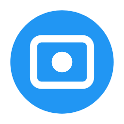

# Bubble

**Terjemahkan, jelajahi, dan cari informasi langsung dari layar Anda.**

Asisten layar Android yang ringan dan mengutamakan privasi untuk penerjemahan langsung di layar, pilih & salin teks seluruh layar, pemindaian QR otomatis, serta pencarian visual — tanpa root.

[English](README.md) | **Bahasa Indonesia**

[-3DDC84?style=flat-square&logo=android&logoColor=white)](app/build.gradle.kts)
[](app/build.gradle.kts)
[](build.gradle.kts)
[](gradle/wrapper/gradle-wrapper.properties)
[](https://github.com/AprionoN-Officials/Bubble-Android/releases)

</div>

---

## Future Plan

Rencana pengembangan dan ide fitur untuk pembaruan **Bubble** di masa mendatang:

- [ ] **Update UI** — Pembaruan antarmuka pengguna agar lebih modern, rapi, dan nyaman digunakan.
- [ ] **Uncensored Search With Image** — Dukungan pencarian gambar tanpa sensor (bisa mencari gambar NSFW).
- [ ] **Simple ChatBot AI** — Fitur chatbot AI sederhana *(masih tahap konsep, bisa dibatalkan atau dilanjutkan)*.

---

## Tentang Bubble

Memahami aplikasi, game, artikel, atau gambar berbahasa asing di Android biasanya mengharuskan pengguna mengambil tangkapan layar, berpindah ke aplikasi penerjemah atau pencari gambar, mengimpor gambar, lalu kembali lagi ke aplikasi sebelumnya.

**Bubble** (`com.bubble.screentools`) menyatukan alur tersebut ke dalam satu overlay layar yang dapat dipanggil langsung di atas aplikasi apa saja:

- **Terjemahkan teks langsung di tempat** tanpa perlu meninggalkan layar yang sedang dibuka.
- **Pilih dan salin teks dari mana saja di layar**—termasuk gambar maupun tampilan aplikasi yang tidak mendukung seleksi teks.
- **Pindai kode QR secara otomatis** (termasuk QRIS Indonesia, Wi-Fi, tautan URL, dan kontak) tanpa berpindah ke aplikasi scanner lain.
- **Cari informasi visual dari gambar di layar** dengan menyeleksi area tertentu dan mengirimkannya ke Google Lens, Yandex Images, TinEye, atau aplikasi lain melalui dialog *Buka Dengan* bawaan Android.

---

## Mengapa Bubble?

| Aspek | Implementasi Aktual di Bubble (Terverifikasi dari Source Code) |
| --- | --- |
| **Terjemahan Langsung di Layar** | Menampilkan kotak hasil terjemahan tepat di atas area teks terpilih, lengkap dengan tombol **Original ↔ Translated** dan tombol **Salin** sekali ketuk. |
| **Mengurangi Perpindahan Aplikasi** | Dapat dipanggil langsung melalui **Asisten Digital Default** (tahan tombol Home / usap pojok bawah), **Pintasan Aksesibilitas**, atau **Quick Settings Tile**. |
| **Tanpa Pop-up "Mulai Rekaman"** | Memanfaatkan **Asisten Digital (`VoiceInteractionService`)** di Android 7–15 atau **`AccessibilityService.takeScreenshot()`** di Android 11+, sehingga tidak memunculkan dialog `MediaProjection` pada mode yang didukung. |
| **Pemindaian Layar Hibrida** | Menggabungkan OCR lokal (ML Kit Play Services + dukungan opsional **Tesseract 5** `.traineddata`) dengan ekstraksi `AssistStructure` / `AccessibilityNodeInfo` sebagai cadangan. |
| **Terjemahan Offline di Perangkat** | Mengunduh model terjemahan ML Kit sesuai kebutuhan (31 bahasa pilihan) dan menyimpan terjemahan terbaru dalam cache RAM `LruCache` (256 entri). |
| **Overlay Minimalis & Tidak Menghalangi** | Panel tombol bawah otomatis tersembunyi saat menggeser kotak seleksi maupun saat membaca hasil terjemahan, dengan tombol **Menu** di bar atas bila diperlukan. |
| **Pencarian Visual Multi-Mesin** | Menggunakan **Google Lens** sebagai pilihan utama, ditambah **Yandex Images**, **TinEye**, dan **Buka Dengan (*Open With*)**—dengan hitung mundur 1,8 detik yang langsung batal saat handle seleksi disentuh. |
| **Pendekatan Privacy-First & Bubble Safe Mode** | Tangkapan layar penuh hanya disimpan sementara di RAM, melewati kolom kata sandi, menghormati `FLAG_SECURE`, dan otomatis berhenti pada aplikasi perbankan, e-wallet, serta autentikator yang dikecualikan. |

---

## Fitur Andalan

### 1. Penerjemahan Layar Langsung (Live Screen Translation)

Terjemahkan paragraf terpilih atau seluruh layar langsung di atas aplikasi yang sedang aktif, lalu beralih antara teks **Asli (Original)** dan **Terjemahan (Translated)** atau salin teks dalam sekali ketuk.

<table>
  <tr>
    <td width="38%" align="center">
      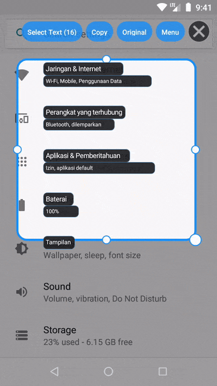<br />
      <sub>Rekaman asli: Terjemahan offline EN → ID &amp; tombol Original ↔ Translated</sub>
    </td>
    <td width="62%" valign="top">
      <ul>
        <li><b>Fungsi:</b> Mendeteksi teks di dalam area seleksi dan merender terjemahan selaras dengan posisi teks aslinya.</li>
        <li><b>Tukar bahasa dua arah:</b> Ganti bahasa <code>Asal ⇄ Target</code> di Pengaturan atau langsung di bilah bahasa overlay.</li>
        <li><b>Cara kerja singkat:</b> Mengambil snapshot layar di RAM → menjalankan OCR atau cadangan <code>AssistStructure</code> / <code>AccessibilityNodeInfo</code> → mendeteksi bahasa (atau memakai bahasa asal pilihan) → menerjemahkan secara lokal lewat ML Kit Translate.</li>
        <li><b>Tampilan baca bersih:</b> Tombol aksi di bagian bawah otomatis tersembunyi begitu hasil terjemahan tampil.</li>
      </ul>
    </td>
  </tr>
</table>

### 2. Seleksi Layar Instan & Assistant Overlay

Gambar atau sesuaikan area seleksi **Persegi**, **Elips**, atau **Bebas (Freeform)** langsung di atas aplikasi apa saja dengan titik sudut yang mudah ditarik.

<table>
  <tr>
    <td width="50%" align="center">
      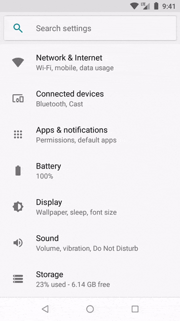<br />
      <sub>Mengubah ukuran kotak seleksi dengan tombol bawah otomatis tersembunyi</sub>
    </td>
    <td width="50%" align="center">
      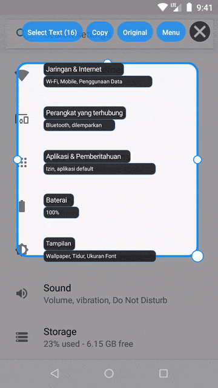<br />
      <sub>Tombol Menu di bar atas, tukar bahasa, dan pengalih mode aksi</sub>
    </td>
  </tr>
</table>

- **Tiga bentuk seleksi:** Persegi (*Rectangle* sebagai default), Elips (*Ellipse*), dan Bebas (*Freeform*) yang dapat diatur di Pengaturan.
- **Jeda pintar:** Menunggu `650 ms` sebelum menerjemahkan dan `1.800 ms` (dengan hitung mundur terlihat) sebelum membuka pencarian visual eksternal; menyentuh titik seleksi langsung membatalkan hitung mundur.

### 3. Deteksi Teks Cerdas & Pilih Teks Seluruh Layar

Pilih dan salin teks langsung dari seluruh layar—tanpa membuka Google Lens—melalui mode **Select Text** bawaan Bubble.

<table>
  <tr>
    <td width="38%" align="center">
      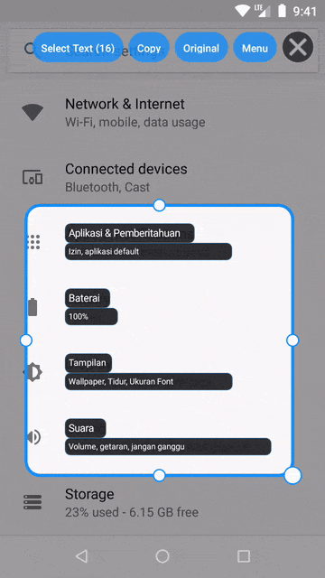<br />
      <sub>Rekaman asli: Mode Select Text seluruh layar (16 blok teks terdeteksi)</sub>
    </td>
    <td width="62%" valign="top">
      <ul>
        <li><b>Deteksi hibrida:</b> Menjalankan OCR (default ML Kit Play Services unbundled atau model kustom Tesseract 5) dengan peningkatan skala &amp; padding lewat <code>BitmapCropHelper</code>, serta cadangan <code>AssistStructure</code> / <code>AccessibilityNodeInfo</code> dengan tetap melewati kolom kata sandi.</li>
        <li><b>Ketuk untuk memilih:</b> Menyorot blok teks di seluruh layar sehingga Anda bisa mengetuk baris tertentu atau <b>Select All</b>, lalu <b>Salin</b>, <b>Terjemahkan</b>, atau <b>Cari di Web</b>.</li>
      </ul>
    </td>
  </tr>
</table>

### 4. Terjemahan Offline di Perangkat & OCR Kustom Tesseract 5

Kelola paket bahasa offline untuk 31 bahasa dan impor file `.traineddata` milik sendiri untuk aksara non-Latin.

<table>
  <tr>
    <td width="38%" align="center">
      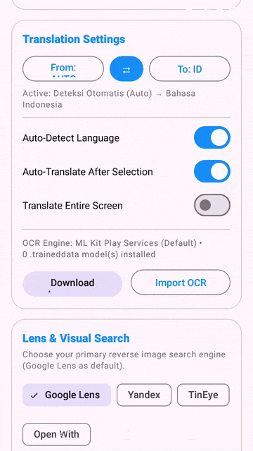<br />
      <sub>Rekaman asli: Manajer Bahasa Offline (ML Kit &amp; Tesseract 5)</sub>
    </td>
    <td width="62%" valign="top">
      <ul>
        <li><b>31 bahasa ML Kit pilihan:</b> Unduh atau hapus paket terjemahan offline (~30 MB per bahasa) kapan saja di menu <b>Offline Languages &amp; OCR Models</b>.</li>
        <li><b>Bekerja offline setelah diunduh:</b> Setelah model bahasa asal dan target tersedia di perangkat, penerjemahan berjalan tanpa koneksi internet dan memanfaatkan cache RAM (256 entri <code>LruCache</code>).</li>
        <li><b>OCR kustom (.traineddata):</b> Impor file <code>.traineddata</code> lokal lewat Storage Access Framework (SAF) Android atau unduh cepat 10 model resmi <code>tessdata_fast</code> (Jepang, Korea, Mandarin, Arab, Thailand, Vietnam, Rusia, Indonesia, Inggris).</li>
      </ul>
    </td>
  </tr>
</table>

> **OCR Offline Terverifikasi:** Pemindaian kustom Tesseract 5 `.traineddata` telah disinkronkan secara *thread-safe* di `TesseractOcrManager.kt` dan terverifikasi langsung pada gambar raster murni bersama terjemahan offline ML Kit tanpa crash native.

### 5. Pencarian Visual Multi-Mesin (Google Lens, Yandex, TinEye & Buka Dengan)

Potong objek, produk, atau ilustrasi apa pun di layar dan lakukan pencarian gambar terbalik dengan mesin pilihan Anda.

<table>
  <tr>
    <td width="38%" align="center">
      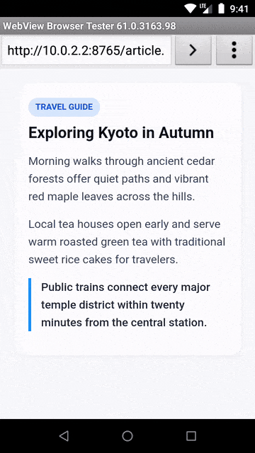<br />
      <sub>Rekaman asli: Mode Search Image dengan pemilih mesin pencari</sub>
    </td>
    <td width="62%" valign="top">
      <ul>
        <li><b>Google Lens (Default):</b> Mengirim gambar potongan sementara (PNG) melalui <code>Intent.ACTION_SEND</code> + <code>FileProvider</code> langsung ke aplikasi Google Lens (<code>com.google.ar.lens</code>) atau Google App (<code>com.google.android.googlequicksearchbox</code>). Hasil pencarian ditampilkan di aplikasi eksternal tersebut.</li>
        <li><b>Pencarian Web In-App (Yandex &amp; TinEye):</b> Membuka <code>VisualSearchWebActivity</code> dengan injeksi file gambar otomatis serta chip pengalih mesin pencari.</li>
        <li><b>Buka Dengan (Open With):</b> Memunculkan dialog <code>Intent.ACTION_VIEW</code> bawaan Android ("Pilih aplikasi untuk membuka") bila dipilih atau saat Google Lens tidak terpasang.</li>
      </ul>
    </td>
  </tr>
</table>

### 6. Pemindai Kode QR Otomatis

Saat opsi **Auto-Scan QR Codes** aktif (default), Bubble otomatis memindai tangkapan layar melalui Google Play Services ML Kit Barcode Scanning tanpa menekan tombol Lens:

- **QR Pembayaran (QRIS Indonesia EMVCo TLV, PayNow, DuitNow, PromptPay, UPI & URI e-Wallet):** Mem-parsing nama merchant, kota, dan nominal (terverifikasi lewat unit test JVM), lalu menampilkan pemilih aplikasi pembayaran terpasang, opsi *Buka Dengan* bawaan Android, atau *Simpan QR* ke `Pictures/BubbleQR`.
- **QR Wi-Fi:** Membaca SSID, tipe keamanan, dan kata sandi; mendukung sambung 1 ketuk via `ACTION_WIFI_ADD_NETWORKS` pada Android 11+ sekaligus salin sandi ke clipboard.
- **URL, Kontak (vCard/MECARD), Email, Telepon, SMS & Teks Biasa:** Menjalankan aksi sistem bawaan secara langsung.

> **Catatan Pengujian:** Parsing payload `QrCodeParser` (QRIS TLV, Wi-Fi, UPI) telah lulus unit test JVM; pemindaian QR langsung di layar via ML Kit Barcode memerlukan Google Play Services sehingga belum dapat dijalankan pada emulator AOSP (lihat [Laporan Pengujian](docs/documentation-test-report.md)).

### 7. Quick Settings Tile, Pintasan Aksesibilitas & Asisten Digital

Akses Bubble kapan saja melalui tiga jalur pemicu:

<table>
  <tr>
    <td width="38%" align="center">
      <br />
      <sub>Rekaman asli: Ubin Bubble Screen pada panel Quick Settings Android</sub>
    </td>
    <td width="62%" valign="top">
      <ul>
        <li><b>Asisten Digital Default (Disarankan, Android 7–15):</b> Mendaftarkan <code>BubbleVoiceInteractionService</code> + <code>BubbleRecognitionService</code>. Tahan tombol Home atau usap pojok bawah layar tanpa memerlukan izin Aksesibilitas maupun Overlay.</li>
        <li><b>Quick Settings Tile:</b> Tambahkan ubin <b>Bubble Screen</b> (<code>BubbleTileService</code>) di panel Pengaturan Cepat. Menggunakan <code>startActivityAndCollapse()</code> melalui <code>OverlayTriggerActivity</code> yang kompatibel dengan Android 12–15.</li>
        <li><b>Pintasan / Tombol Aksesibilitas:</b> Aktifkan layanan aksesibilitas Bubble di pengaturan Android untuk memanggil overlay lewat tombol atau pintasan Aksesibilitas.</li>
      </ul>
    </td>
  </tr>
</table>

### 8. Bubble Safe Mode & Perlindungan Privasi

Bubble Safe Mode aktif secara default untuk meminimalkan gangguan terhadap aplikasi sensitif:

- **14 Aplikasi Terlindungi Bawaan:** Mencakup aplikasi m-banking Indonesia, dompet digital, pengelola kata sandi, autentikator, dan identitas digital (`BubblePreferences.DEFAULT_EXCLUDED_PACKAGES`), yang dapat ditambah atau dihapus kapan saja di menu **Excluded Apps**.
- **Penghentian Fail-Safe Otomatis:** Segera menghentikan pemindaian, membersihkan bitmap di RAM, menutup overlay, dan mencatat paket terakhir yang diblokir setiap kali aplikasi sensitif terbuka.
- **Pengujian Aman:** Diverifikasi di emulator menggunakan aplikasi sistem Jam bawaan (`com.android.deskclock`) yang ditambahkan sementara ke daftar pengecualian—terbukti Bubble langsung menolak menampilkan overlay dan menampilkan banner peringatan Safe Mode di halaman utama.

### 9. Pengaturan Material 3 Ringan & Dukungan Light / Dark Mode

Dibangun dengan Material 3 (`Theme.Material3.DayNight.NoActionBar`), antarmuka Bubble otomatis mengikuti tema Terang (Light) dan Gelap (Dark) sistem Android dalam kartu pengaturan bersegmen yang rapi.

<table>
  <tr>
    <td width="50%" align="center">
      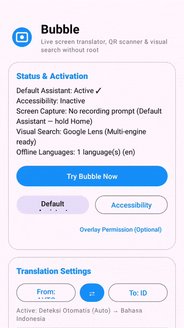<br />
      <sub>Rekaman asli: Pengaturan Material 3 bersegmen</sub>
    </td>
    <td width="50%" align="center">
      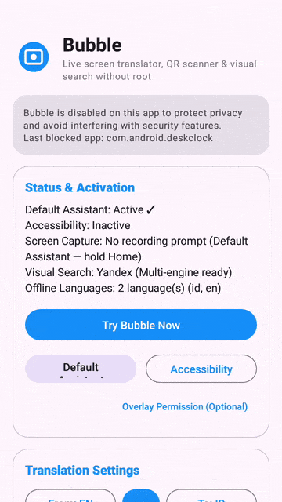<br />
      <sub>Rekaman asli: Dukungan tema sistem Light ↔ Dark otomatis</sub>
    </td>
  </tr>
</table>

---

## Tampilan Aplikasi (Screenshot Asli)

Seluruh screenshot di bawah diambil langsung dari **Bubble v1.0.0** yang berjalan pada Android 8.1.0 (`720×1280`, 320 dpi).

### Dashboard Utama — Light, Dark & Bilingual (EN / ID)

<table>
  <tr>
    <td align="center" width="25%">
      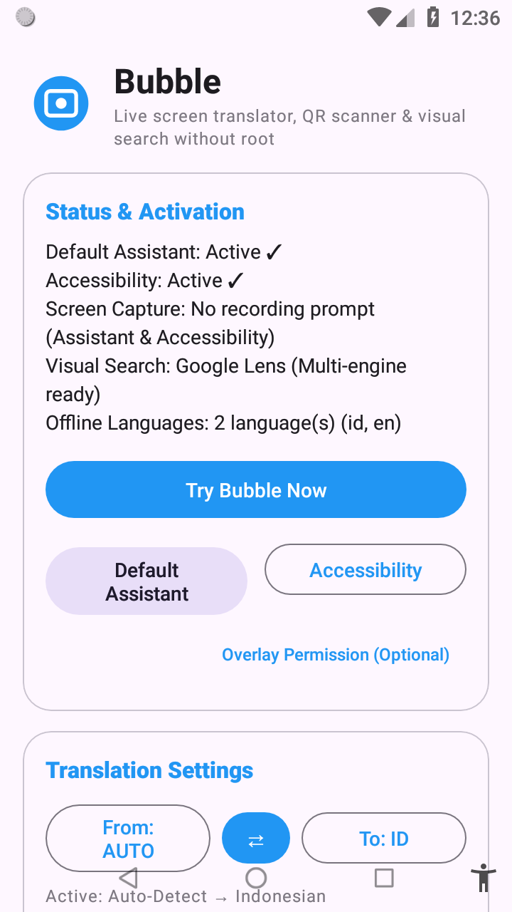<br />
      <sub><b>Dashboard (EN · Light)</b></sub>
    </td>
    <td align="center" width="25%">
      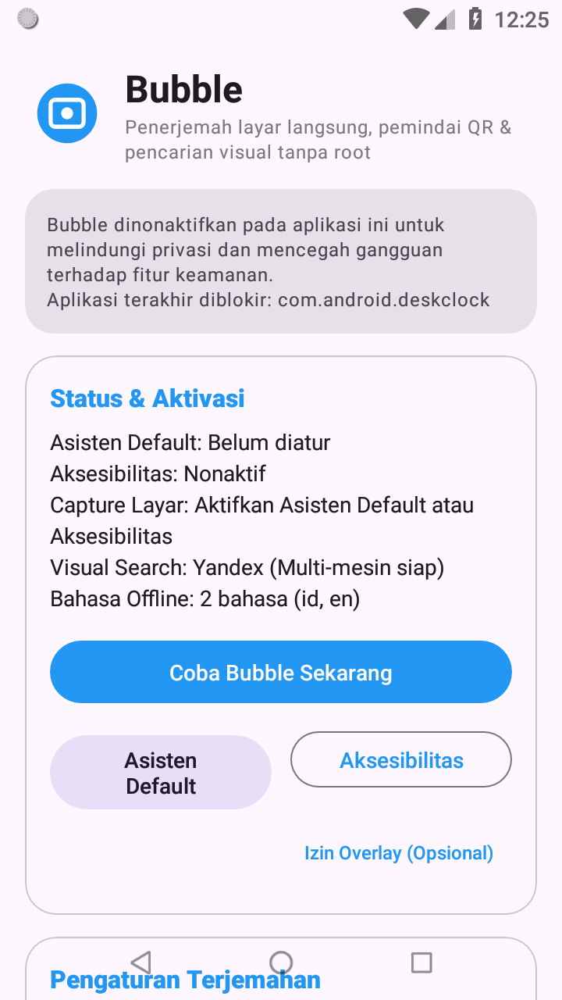<br />
      <sub><b>Dashboard (ID · Light)</b></sub>
    </td>
    <td align="center" width="25%">
      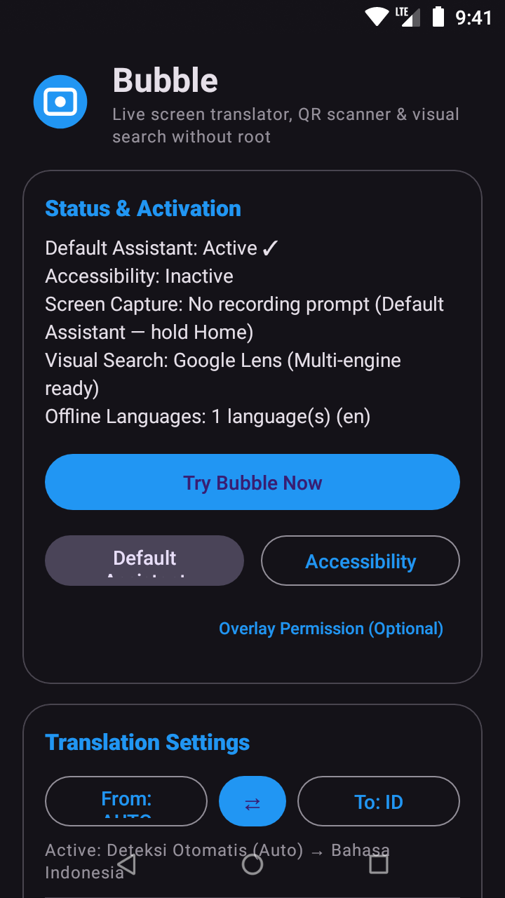<br />
      <sub><b>Dashboard (EN · Dark)</b></sub>
    </td>
    <td align="center" width="25%">
      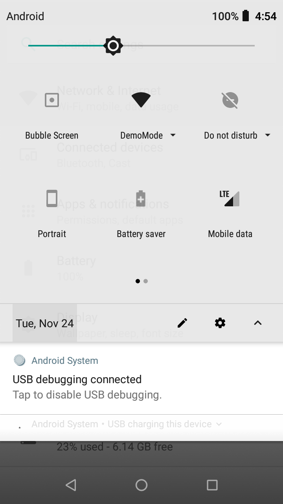<br />
      <sub><b>Quick Settings Tile</b></sub>
    </td>
  </tr>
</table>

### Overlay, Terjemahan Langsung, Tesseract 5 OCR & Pilih Teks

<table>
  <tr>
    <td align="center" width="25%">
      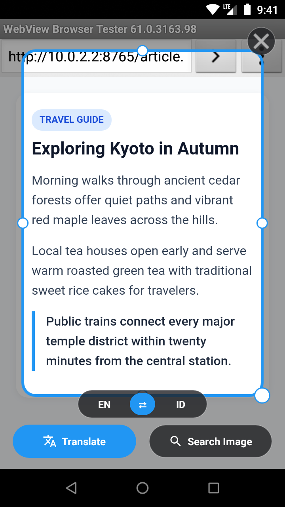<br />
      <sub><b>Assistant Overlay</b></sub>
    </td>
    <td align="center" width="25%">
      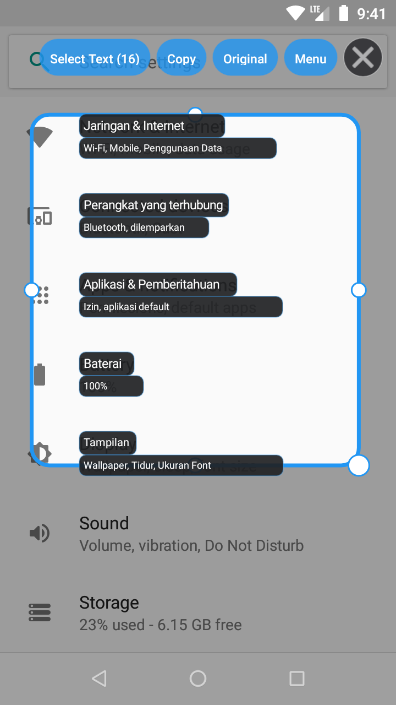<br />
      <sub><b>Terjemahan Langsung (EN → ID)</b></sub>
    </td>
    <td align="center" width="25%">
      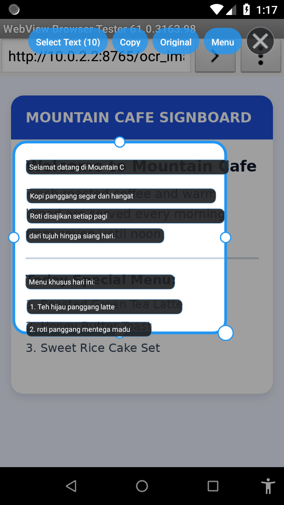<br />
      <sub><b>Tesseract 5 OCR Gambar</b></sub>
    </td>
    <td align="center" width="25%">
      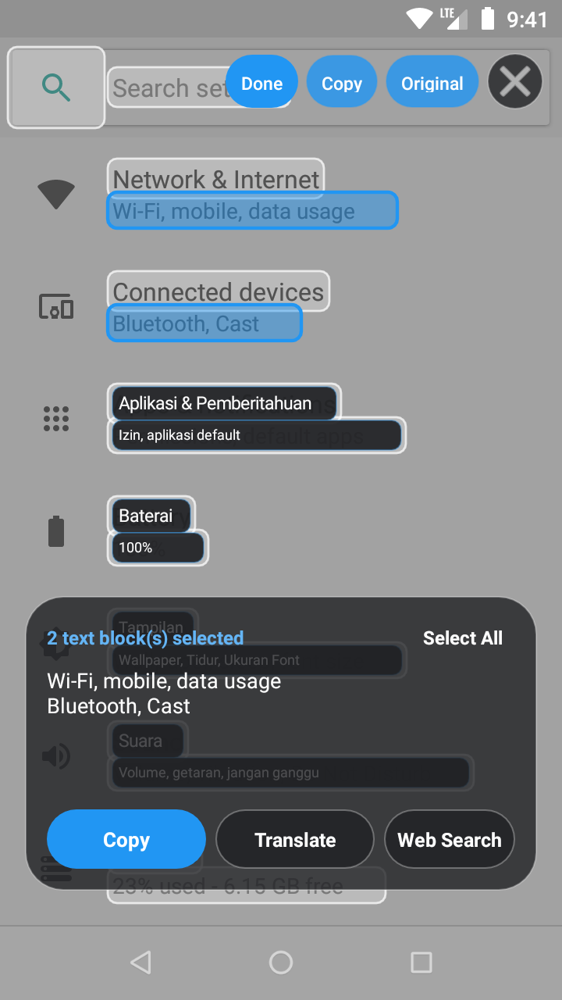<br />
      <sub><b>Select Text Seluruh Layar</b></sub>
    </td>
  </tr>
</table>

### Pengaturan, Model Offline & OCR Kustom

<table>
  <tr>
    <td align="center" width="33%">
      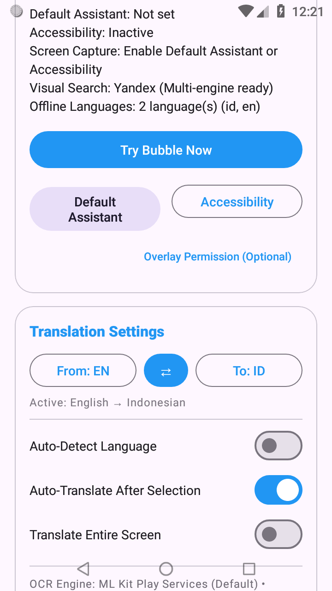<br />
      <sub><b>Pengaturan Terjemahan</b></sub>
    </td>
    <td align="center" width="33%">
      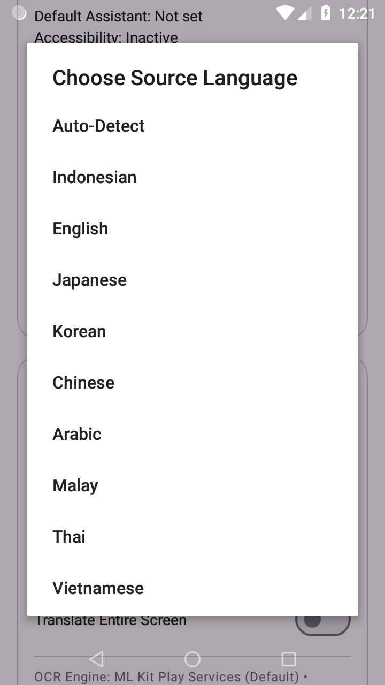<br />
      <sub><b>Pemilih Bahasa Asal / Target</b></sub>
    </td>
    <td align="center" width="33%">
      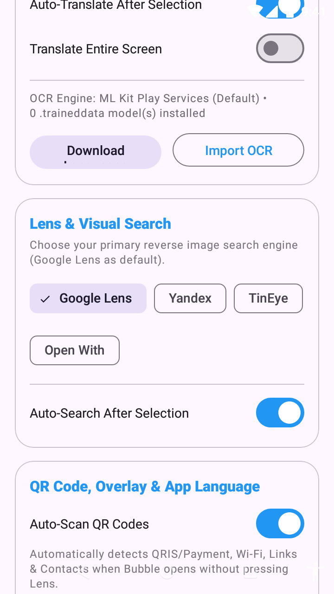<br />
      <sub><b>Pengaturan Pencarian Visual &amp; QR</b></sub>
    </td>
  </tr>
  <tr>
    <td align="center" width="33%">
      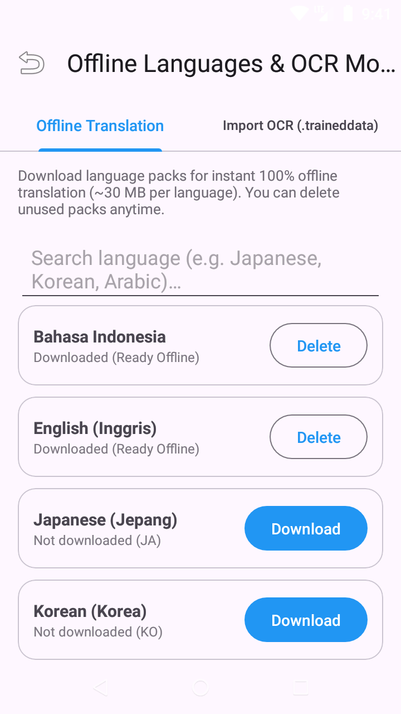<br />
      <sub><b>Model Offline (EN &amp; ID Siap)</b></sub>
    </td>
    <td align="center" width="33%">
      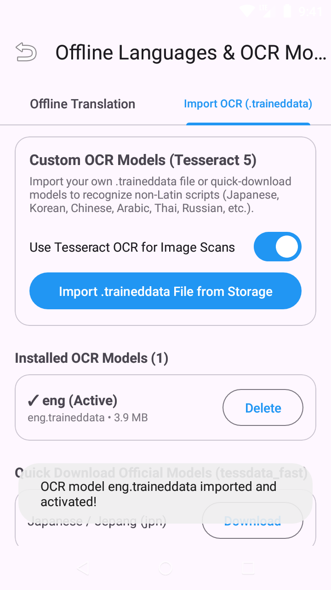<br />
      <sub><b>OCR Kustom (.traineddata Aktif)</b></sub>
    </td>
    <td align="center" width="33%">
      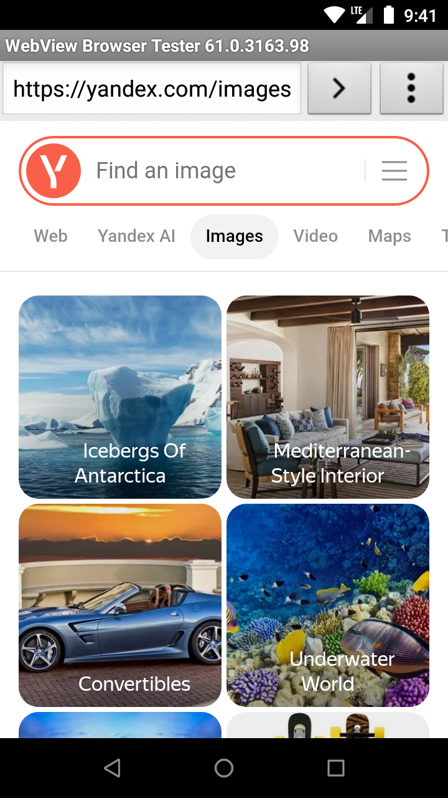<br />
      <sub><b>Pencarian Visual (Yandex Web)</b></sub>
    </td>
  </tr>
</table>

### Privasi & Bubble Safe Mode

<table>
  <tr>
    <td align="center" width="33%">
      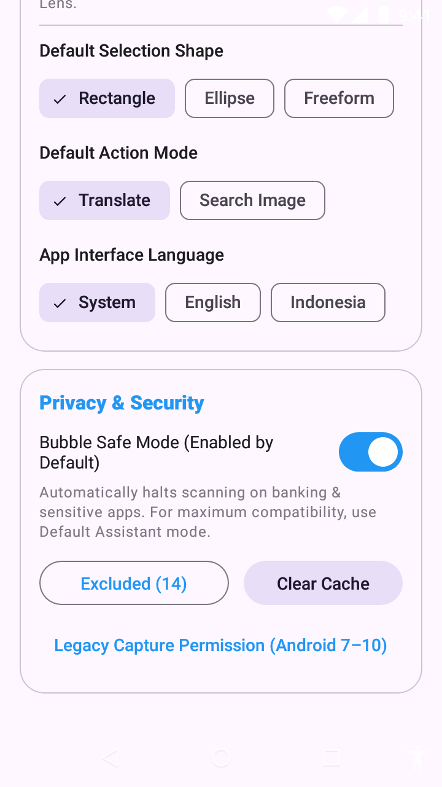<br />
      <sub><b>Pengaturan Privasi &amp; Safe Mode</b></sub>
    </td>
    <td align="center" width="33%">
      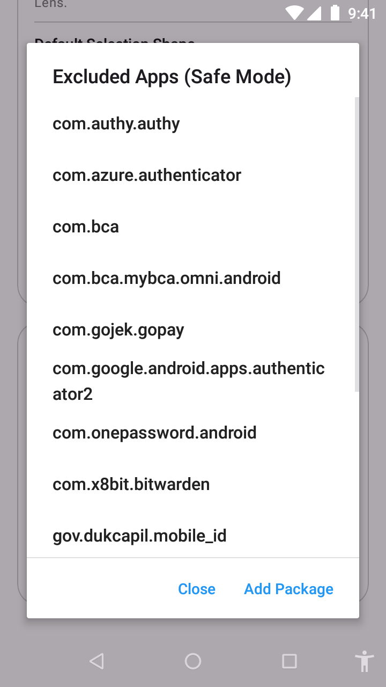<br />
      <sub><b>Daftar Aplikasi Dikecualikan (14 Default)</b></sub>
    </td>
    <td align="center" width="33%">
      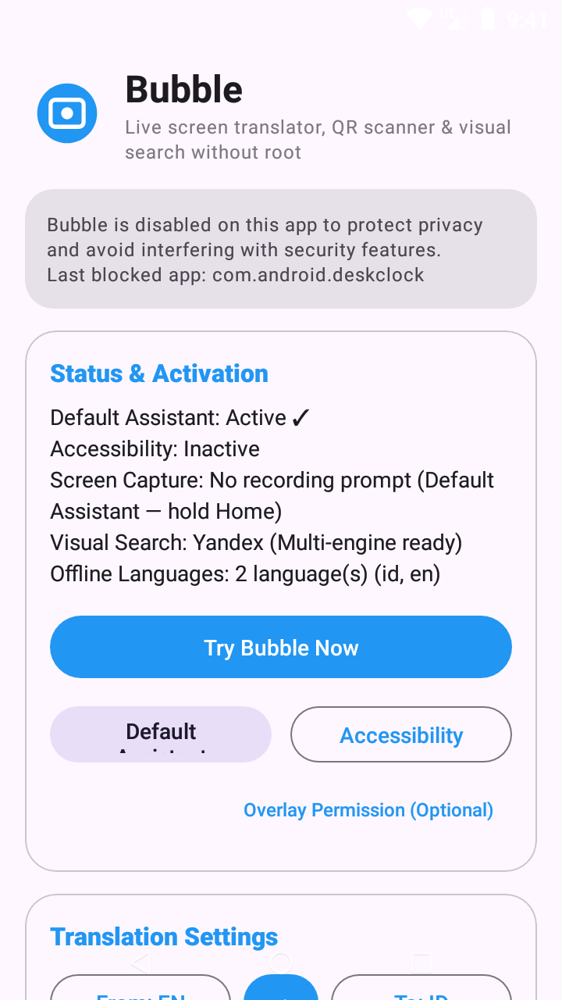<br />
      <sub><b>Banner Safe Mode (Aplikasi Uji Diblokir)</b></sub>
    </td>
  </tr>
</table>

---

## Contoh Penggunaan Sehari-hari

- **Memahami Menu Aplikasi & Game Berbahasa Asing:** Terjemahkan menu, tutorial, atau dialog game langsung di layar tanpa keluar dari aplikasi.
- **Membaca Artikel, Postingan & Komik Asing:** Seleksi paragraf atau balon dialog dan terjemahkan secara offline setelah paket bahasanya diunduh.
- **Menyalin Teks yang Tidak Bisa Diseleksi:** Gunakan tombol **Select Text** untuk menyalin teks dari gambar, poster, atau tampilan aplikasi yang membatasi seleksi.
- **Menerjemahkan Percakapan & Pesan:** Terjemahkan pesan masuk secara instan dan bandingkan kembali dengan teks aslinya dalam satu ketukan.
- **Mencari Informasi Produk atau Objek Visual:** Seleksi objek pada layar lalu kirim potongan gambar ke Google Lens, Yandex Images, atau TinEye.
- **Memindai Kode QR di Layar:** Deteksi langsung kode QRIS, Wi-Fi, tautan, atau kontak yang muncul di layar tanpa perlu memfoto memakai HP lain.

---

## Cara Kerja Bubble

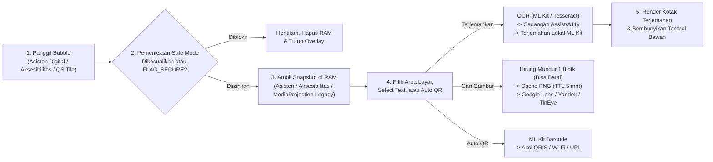

Detail arsitektur komponen lengkap tersedia di [docs/architecture.md](docs/architecture.md).

---

## Panduan Memulai (Getting Started)

1. **Instal APK:** Unduh APK rilis sesuai arsitektur perangkat dari [GitHub Releases](https://github.com/AprionoN-Officials/Bubble-Android/releases) (`arm64-v8a` untuk sebagian besar HP Android modern) atau build dari source code.
2. **Pilih Mode Aktivasi (Berikan Izin Seperlunya Saja):**
   - **Opsi 1 — Asisten Digital Default (Disarankan, Android 7–15):** Buka Bubble → ketuk **Default Assistant** → pilih **Bubble**. Mode ini tidak membutuhkan izin Aksesibilitas maupun izin Overlay.
   - **Opsi 2 — Aksesibilitas & Quick Settings Tile:** Ketuk **Accessibility** → aktifkan **Bubble**. Di Android 11+, Bubble mengambil tangkapan layar senyap lewat Aksesibilitas. Pada Android 7–10 tanpa mode Asisten Digital, aktifkan **Legacy Capture Permission** saat diminta.
   - *(Opsional)* Tambahkan ubin **Bubble Screen** melalui editor panel Quick Settings Android.
3. **Atur Bahasa Terjemahan:** Di bagian **Translation Settings**, tentukan bahasa `From` dan `To` (atau biarkan `AUTO`), lalu ketuk **Download Languages** untuk mengunduh model offline ML Kit.
4. **Mulai Menerjemahkan atau Mencari:** Buka aplikasi apa saja, panggil Bubble, sesuaikan area seleksi, lalu pilih **Translate** atau **Search Image** (atau ketuk **Select Text** di bar atas untuk memilih & menyalin teks langsung).
5. **Tinjau Safe Mode:** Bubble Safe Mode aktif otomatis sejak awal. Buka **Excluded Apps** pada bagian **Privacy & Security** untuk meninjau atau menambah/menghapus paket aplikasi terlindungi.

---

## Privasi & Keamanan

Penjelasan transparan mengenai izin dan penanganan data berdasarkan implementasi aktual di source code:

- **Izin & Alasan Penggunaannya:**
  - `INTERNET` & `ACCESS_NETWORK_STATE`: Untuk mengunduh model bahasa ML Kit sesuai permintaan, mengunduh file `.traineddata` opsional dari GitHub, serta memuat halaman pencarian visual Yandex/TinEye.
  - `SYSTEM_ALERT_WINDOW`: Izin overlay opsional bila digunakan di luar konteks `AccessibilityService` atau `BubbleAssistantActivity`.
  - `BIND_VOICE_INTERACTION` / `BIND_ACCESSIBILITY_SERVICE` / `BIND_QUICK_SETTINGS_TILE`: Binding layanan sistem Android yang hanya berjalan ketika diaktifkan secara eksplisit oleh pengguna.
  - `FOREGROUND_SERVICE`, `FOREGROUND_SERVICE_MEDIA_PROJECTION`, `POST_NOTIFICATIONS`: Hanya digunakan untuk cadangan `MediaProjection` pada Android 7–10 (`MediaProjectionService`).
  - `QUERY_ALL_PACKAGES`: Untuk memeriksa ketersediaan Google Lens / Google App serta menampilkan aplikasi pembayaran terpasang pada pemilih QRIS di Android 11+.
- **Pemrosesan Lokal vs. Layanan Eksternal:**
  - **Lokal di Perangkat:** Pengambilan snapshot di RAM, OCR (ML Kit Play Services / Tesseract 5), identifikasi bahasa, penerjemahan lokal ML Kit (setelah model terunduh), dan parsing payload QR berjalan di perangkat.
  - **Jaringan Eksternal / Aplikasi Pihak Ketiga:** Pengunduhan model ML Kit mengakses server Google; unduhan cepat model Tesseract mengambil dari GitHub (`tesseract-ocr/tessdata_fast`); fitur **Pencarian Visual** mengirimkan gambar potongan (PNG) ke aplikasi atau layanan web yang Anda pilih (Google Lens, Yandex Images, TinEye, atau aplikasi lain lewat *Open With*).
- **Buffer Sementara & Pembersihan Gambar:**
  - Bitmap tangkapan layar penuh hanya disimpan di RAM (`SessionSnapshotStore` / `BubbleOverlayController`) dan langsung dibersihkan (`recycle`) saat overlay ditutup.
  - Gambar potongan sementara untuk Pencarian Visual atau QR ditulis secara privat ke `cacheDir/lens_temp/` melalui `TemporaryImageProvider` (`FileProvider`), otomatis dihapus setelah **5 menit**, dibersihkan saat aplikasi dimulai (`BubbleApp.onCreate`), dan dapat dihapus instan lewat tombol **Clear Cache**.
  - Bubble tidak pernah menyimpan tangkapan layar ke galeri foto kecuali pengguna secara eksplisit menekan **Simpan QR** (atau memilih aplikasi pembayaran yang memerlukan impor QRIS dari galeri), yang hanya menyimpan potongan gambar QR ke `Pictures/BubbleQR`.
- **Kata Sandi, `FLAG_SECURE` & Kompatibilitas Aplikasi Perbankan:**
  - `ScreenTextExtractor` melewati node dengan `isPassword == true`; `BubbleVoiceInteractionSession` melewati kolom dengan `InputType` kata sandi.
  - Bubble menghormati proteksi `FLAG_SECURE` Android dan tidak pernah mencoba melakukan bypass terhadap layar terproteksi.
  - **Catatan Aplikasi Perbankan:** Beberapa aplikasi perbankan mendeteksi *setiap* `AccessibilityService` pihak ketiga yang aktif di sistem meskipun overlay Bubble sedang tertutup. Untuk kompatibilitas terbaik dengan aplikasi perbankan yang ketat, gunakan mode **Asisten Digital Default** dan biarkan layanan Aksesibilitas nonaktif bila tidak dibutuhkan.

---

## Stack Teknologi

| Lapisan | Teknologi / Library |
| --- | --- |
| **Bahasa Pemrograman** | Kotlin `2.0.21` (`jvmTarget = 17`) + Kotlin Coroutines `1.9.0` |
| **Android SDK & Build** | Android Gradle Plugin `8.7.2`, Gradle Wrapper `8.9`, `compileSdk 35`, `targetSdk 35`, `minSdk 24` |
| **UI & Material Design** | Android Views, `androidx.appcompat:1.7.0`, `com.google.android.material:1.12.0` (`Theme.Material3.DayNight.NoActionBar`) |
| **Mesin OCR** | `com.google.android.gms:play-services-mlkit-text-recognition:19.0.1` (unbundled) + `cz.adaptech.tesseract4android:tesseract4android:4.8.0` (`.traineddata` opsional) |
| **Deteksi Bahasa & Terjemahan** | `com.google.mlkit:language-id:17.0.6`, `com.google.mlkit:translate:17.0.3`, `android.util.LruCache` (256 entri) |
| **Pemindaian QR** | `com.google.android.gms:play-services-mlkit-barcode-scanning:18.3.1` + parser Kotlin murni `QrCodeParser` |
| **Tangkap Layar & Layanan** | `VoiceInteractionService`, `AccessibilityService.takeScreenshot()` (API 30+), `MediaProjection` + `ImageReader` (cadangan API 24–29), `TileService` |
| **Pencarian Visual & Berbagi File** | `androidx.core.content.FileProvider` (`TemporaryImageProvider`), `Intent.ACTION_SEND` / `ACTION_VIEW`, Android `WebView` (`VisualSearchWebActivity`) |
| **Optimasi Ukuran APK** | R8 Full Mode (`isMinifyEnabled = true`, `isShrinkResources = true`), ABI splits (`arm64-v8a`, `armeabi-v7a`), kompresi `jniLibs` (`useLegacyPackaging = true`), `resourceConfigurations += listOf("id", "in", "en")` |

---

## Persyaratan Sistem

| Persyaratan | Nilai Terverifikasi |
| --- | --- |
| **Versi Android Minimum** | Android 7.0 Nougat (API 24) |
| **Target / Compile SDK** | Android 15 (API 35) |
| **Ukuran APK Release Aktual** | `app-arm64-v8a-release.apk`: **12,29 MiB** (`12.883.409 byte`)<br>`app-armeabi-v7a-release.apk`: **11,18 MiB** (`11.726.884 byte`) |
| **Ukuran APK Debug Aktual** | `app-arm64-v8a-debug.apk`: **17,53 MiB** (`18.381.393 byte`)<br>`app-armeabi-v7a-debug.apk`: **16,15 MiB** (`16.936.441 byte`) |
| **Google Play Services** | Diperlukan untuk ML Kit OCR default (unbundled) dan pemindaian QR ML Kit Barcode. Terjemahan lokal ML Kit serta ekstraksi `AssistStructure`/`AccessibilityNodeInfo` tetap berjalan tanpa Play Services setelah model diunduh. |
| **Koneksi Internet** | Diperlukan untuk pengunduhan awal model bahasa, unduhan cepat `.traineddata`, dan Pencarian Visual. Tidak diperlukan untuk penerjemahan offline setelah model tersedia. |
| **Google Lens / Google App** | Opsional; hanya dibutuhkan untuk Pencarian Visual langsung ke aplikasi Google Lens. Tanpa itu, Bubble menyediakan Yandex Images, TinEye, atau dialog *Buka Dengan* Android. |
| **Ruang Penyimpanan Model** | ~30 MB per bahasa terjemahan ML Kit; ~4–15 MB per file `.traineddata` Tesseract opsional. |

---

## Instalasi & Build dari Source Code

Terverifikasi pada lingkungan build dengan **OpenJDK 21** (`sourceCompatibility` / `targetCompatibility` JDK 17), **Android SDK Platform 35**, **Build-Tools 35.0.0**, dan **Gradle Wrapper 8.9** (`./gradlew`).

```bash
# 1. Clone repository
git clone https://github.com/AprionoN-Officials/Bubble-Android.git
cd Bubble-Android

# 2. Jalankan unit test JVM (6 test di BubbleCoreLogicTest)
./gradlew testReleaseUnitTest

# 3. Build APK Debug
./gradlew assembleDebug

# 4. Build APK Release ramping (arm64-v8a & armeabi-v7a)
./gradlew assembleRelease
```

### Lokasi Output APK Terverifikasi

- `app/build/outputs/apk/release/app-arm64-v8a-release.apk`
- `app/build/outputs/apk/release/app-armeabi-v7a-release.apk`
- `app/build/outputs/apk/debug/app-arm64-v8a-debug.apk`
- `app/build/outputs/apk/debug/app-armeabi-v7a-debug.apk`

> **Signing Release (Opsional):** Jika file `keystore/bubble-release.jks` tersedia, Gradle menandatangani APK release menggunakan variabel lingkungan `BUBBLE_KEYSTORE_PASSWORD`, `BUBBLE_KEY_ALIAS`, dan `BUBBLE_KEY_PASSWORD`. Tanpa keystore, `assembleRelease` tetap berjalan lancar menghasilkan APK release unsigned.

---

## Keterbatasan yang Diketahui

- **Android `FLAG_SECURE`:** Layar yang dilindungi (seperti layar PIN perbankan, video DRM, tab penyamaran) diblokir langsung oleh OS Android. Bubble menghormati pembatasan ini dan tidak mencoba melakukan bypass.
- **Tampilan Hasil Google Lens:** Google Lens tidak menyediakan API publik untuk merender hasil langsung di dalam overlay aplikasi pihak ketiga; Bubble meneruskan gambar potongan sementara ke aplikasi Google Lens / Google App melalui `Intent.ACTION_SEND` + `FileProvider`.
- **Deteksi Aksesibilitas oleh Aplikasi Perbankan:** Beberapa aplikasi keuangan memperingatkan pengguna jika ada `AccessibilityService` pihak ketiga yang aktif; gunakan mode **Asisten Digital Default** agar tidak perlu mengaktifkan Aksesibilitas.

---

## Status Proyek & Roadmap

Berdasarkan kondisi kode aktual dan hasil verifikasi QA langsung (`v1.0.0`, `versionCode = 8`):

| Status | Fitur / Pekerjaan |
| --- | --- |
| **Selesai & Terverifikasi** | Pemicu Asisten Digital Default (`VoiceInteractionService` dengan batas tunggu screenshot `1200ms`), Terjemahan Layar Offline Langsung (31 bahasa ML Kit), OCR Kustom Tesseract 5 `.traineddata` *Thread-Safe* & Impor SAF, Pergantian Bahasa Antarmuka Bilingual EN/ID (terverifikasi cold relaunch), Tukar Bahasa `Asal ⇄ Target`, Mode `Select Text` Seluruh Layar, Seleksi Persegi/Elips/Bebas dengan kontrol otomatis tersembunyi, Pencarian Visual Multi-Mesin (Google Lens / Yandex / TinEye / Buka Dengan), Quick Settings Tile, Pengaturan Material 3 dengan Light/Dark Mode otomatis & ikon status bar gelap di Light Mode, Bubble Safe Mode dengan daftar pengecualian yang dapat diedit. |
| **Diimplementasikan (Perlu Verifikasi di Perangkat dengan Play Services)** | ML Kit OCR unbundled (`play-services-mlkit-text-recognition`), Pemindaian QR Otomatis lewat ML Kit Barcode (`QrCodeParser` lulus unit test JVM), Handoff langsung ke aplikasi Google Lens (`com.google.ar.lens`), Tangkap layar senyap `AccessibilityService.takeScreenshot()` di Android 11+. |
| **Diselesaikan pada Siklus QA (`versionCode = 8`)** | Seluruh 6 bug yang ditemukan saat audit QA emulator langsung (`BUG-01` crash locale Indonesia, `BUG-02` native `SIGSEGV` Tesseract konkurensi, `BUG-03` teks tombol 2 baris terpotong, `BUG-04` ikon status bar putih di Light Mode, `BUG-05` string Indonesia hardcoded di mode Inggris, `BUG-06` race timeout fallback screenshot `400ms`) telah **diperbaiki & diverifikasi live** — bukti lengkap di [docs/documentation-test-report.md](docs/documentation-test-report.md). |

---

## Kontribusi, Kredit & Lisensi

### Kontribusi
Laporan bug, masukan kompatibilitas perangkat, dan *pull request* sangat diterima melalui [GitHub Issues](https://github.com/AprionoN-Officials/Bubble-Android/issues) dan Pull Requests. Saat melaporkan bug, sertakan versi Android, model perangkat, mode aktivasi (Asisten Default vs. Aksesibilitas), serta langkah reproduksinya.

### Kredit & Library Pihak Ketiga
- Dikembangkan oleh **AprionoN-Officials**.
- Menggunakan [AndroidX & Material Components](https://developer.android.com/jetpack), [Google ML Kit](https://developers.google.com/ml-kit) (Text Recognition, Barcode Scanning, Language ID, On-Device Translation), dan [Tesseract4Android](https://github.com/adaptech-cz/Tesseract4Android) (Tesseract 5 OCR).

### Lisensi
Belum ada file lisensi open-source (`LICENSE`) yang disertakan pada repository ini. Seluruh hak cipta tetap berada pada pemilik repository hingga lisensi resmi ditetapkan.
