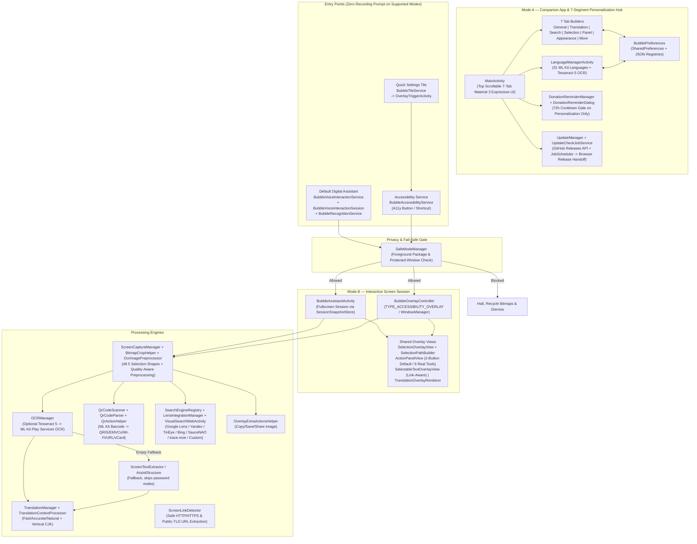
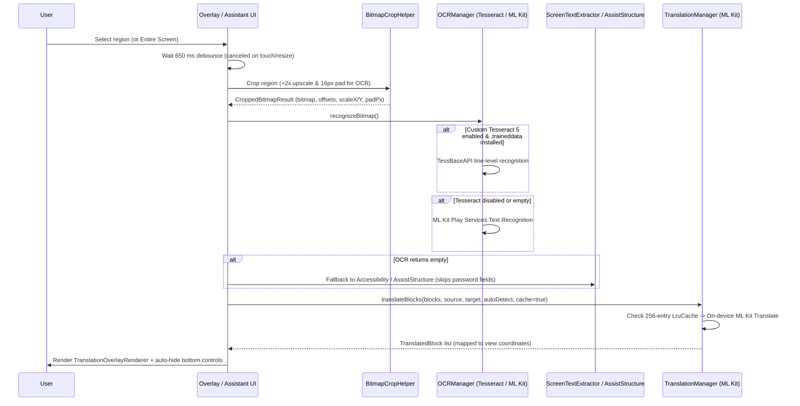

# Bubble — Technical Architecture (`com.bubble.screentools`)

This document describes the verified runtime architecture of **Bubble v1.1.1** (`versionCode = 10`, `minSdk = 24`, `targetSdk = 35`, `compileSdk = 35`) directly audited from the source code.

---

## 1. High-Level Architecture

Bubble follows a **lightweight, modular, single-module Android architecture** written in Kotlin using Android Views, Material 3 Expressive (`Theme.Material3.DayNight.NoActionBar` + Android 12+ Material You `DynamicColors`), and Kotlin Coroutines—without heavy DI, Compose, or generative LLM frameworks—to keep memory overhead and APK size compact.

---

## 2. Package & Component Map

| Package | Key Classes | Responsibility |
| --- | --- | --- |
| `com.bubble.screentools` | `BubbleApp` | Applies saved locale, applies saved `ThemeMode`, records initial usage baseline timestamp, and purges stale temp cache on startup. |
| `ui.main` & `ui.main.tabs` | `MainActivity`, `UiKit`, `LanguageManagerActivity`, `GeneralTabBuilder`, `TranslationTabBuilder`, `SearchTabBuilder`, `SelectionTabBuilder`, `PanelTabBuilder`, `AppearanceTabBuilder`, `MoreTabBuilder` | Material 3 Expressive 7-tab top scrollable settings hub with General core settings (Language, Default Mode, Auto-QR, Auto-Link), vector `=` drag-to-reorder handles, live Selection, Action Panel, Theme, and Translation pipeline previews, offline model management, and update UI. |
| `ui.overlay` | `BubbleAssistantActivity`, `BubbleOverlayController`, `ActionPanelView`, `OverlayExtraActionsHelper`, `OverlayLanguageBarHelper`, `OverlayRootFrameLayout`, `SelectionOverlayView`, `SelectionPathBuilder`, `SelectionGestureHandler`, `SelectableTextOverlayView`, `TranslationOverlayRenderer` | Full-screen Assistant & Accessibility overlay runtime sharing `ActionPanelView` and `SelectionOverlayView` with settings previews. Supports 5 selection shapes, 4 border styles, 6 working overlay tools, non-blocking Auto-QR & Auto-Link cards, link-aware `Select Text`, and customizable panel docking. |
| `theme` | `ThemeManager`, `ThemePaletteGenerator` | Follow System / Light / Dark / AMOLED Black modes, Android 12+ Material You `DynamicColors`, pure-Kotlin WCAG-compliant tonal seed palette synthesis, Theme Scope isolation, and reduced-motion detection. |
| `service` | `BubbleVoiceInteractionService`, `BubbleVoiceInteractionSessionService`, `BubbleVoiceInteractionSession`, `BubbleRecognitionService`, `BubbleAccessibilityService`, `BubbleTileService`, `OverlayTriggerActivity`, `MediaProjectionService` | OS integration entry points (Default Digital Assistant, Accessibility Service, Quick Settings Tile, legacy Android 7–10 MediaProjection fallback). |
| `capture` | `ScreenCaptureManager`, `BitmapCropHelper`, `SessionSnapshotStore`, `MediaProjectionConsentActivity` | In-memory screenshot acquisition, non-rectangular shape masking (transparent for Visual Search, backdrop-filled for OCR), and quality-mode OCR preprocessing. |
| `ocr` | `OCRManager`, `OcrImagePreprocessor`, `TesseractOcrManager`, `ScreenTextExtractor` | Hybrid OCR-first extraction with contrast preprocessing for Accurate/Natural modes, strictly validated `.traineddata` imports, and Accessibility/AssistStructure fallback. |
| `translation` | `TranslationManager`, `TranslationContextProcessor`, `LanguageDetectionManager`, `SupportedLanguages` | Quality-mode aware context reconstruction (spatial paragraph & manga speech-bubble merging, vertical CJK right-to-left columns, de-hyphenation), Preferred/Fallback/Recent languages, and ML Kit on-device translation. |
| `qr` | `QrCodeScanner`, `QrCodeParser`, `QrActionHelper` | Unbundled ML Kit Barcode Scanning (QR format), pure-Kotlin payload parser (QRIS/EMVCo TLV, Wi-Fi, URL, vCard/MECARD, UPI), and native Android action dispatch. |
| `lens` | `SearchEngineRegistry`, `LensIntegrationManager`, `TemporaryImageProvider`, `VisualSearchWebActivity` | Separated Visual & Text search engine registry (Google Lens, Yandex, TinEye, Bing Visual, SauceNAO, trace.moe, Open With, plus custom engines), image quality/format pipeline (`Original`/`Balanced`/`Data Saver`), confirm-before-upload, and `FileProvider` serving `cacheDir/lens_temp/`. |
| `update` | `SemVer`, `GitHubReleaseParser`, `UpdateAssetSelector`, `UpdateManager`, `UpdateCheckJobService` | GitHub Releases API checker with SemVer comparison, ETag caching, rate-limit handling, ABI matching, lightweight `JobScheduler` scheduling, and direct browser handoff to GitHub Releases (zero `REQUEST_INSTALL_PACKAGES` permission). |
| `donation` | `DonationConfig`, `DonationReminderManager`, `DonationReminderDialog` | Voluntary reminder triggered once on fresh install in customization menus (`Search`, `Selection`, `Panel`, `Appearance`) with a shared 72-hour global cooldown after Continue (never during overlay triggers), injectable clock for testing, and lifecycle-aware 5-second silent Continue delay. |
| `security` | `SafeModeManager` | Evaluates foreground package against editable excluded list (14 default banking/e-wallet/authenticator/ID apps) and checks protected windows to halt scanning fail-safely. |
| `data` & `model` | `BubblePreferences`, `BubbleState` | Backward-compatible `SharedPreferences` repository and strongly-typed configuration models. |
| `util` | `CompatibilityHelper`, `LocaleHelper`, `PerformanceManager`, `ScreenLinkDetector` | API 24–35 compatibility guards, per-app single-tag locale switching, debounce timings, volatile cache cleanup, and safe URL extraction/launch. |

---

## 3. Screen Capture Hierarchy

Bubble prioritizes capture mechanisms that require **no MediaProjection "Start recording or casting?" dialog**:

1. **Default Digital Assistant (Android 7–15 / API 24–35)**
   - Triggered via `VoiceInteractionService` (`BubbleVoiceInteractionSession`).
   - Android directly supplies both the screen `Bitmap` (`onHandleScreenshot`) and `AssistStructure` (`onHandleAssist`).
   - Hardware bitmaps are copied to software `ARGB_8888`, checked against `SafeModeManager`, transferred via `SessionSnapshotStore` (single-consume, cleared immediately), and displayed in `BubbleAssistantActivity`.
   - Requires **neither** `AccessibilityService` **nor** `SYSTEM_ALERT_WINDOW`.
2. **Silent Accessibility Screenshot (Android 11+ / API 30+)**
   - Triggered via Accessibility Button/Shortcut or Quick Settings Tile (`BubbleAccessibilityService`).
   - Calls `AccessibilityService.takeScreenshot(Display.DEFAULT_DISPLAY, ...)` (`android:canTakeScreenshot="true"`).
   - Converts `HardwareBuffer` to software `ARGB_8888`, closes the buffer immediately, and respects `ERROR_TAKE_SCREENSHOT_SECURE_WINDOW` (`FLAG_SECURE`).
   - Uses `WindowManager.LayoutParams.TYPE_ACCESSIBILITY_OVERLAY` when invoked from `BubbleAccessibilityService`.
3. **Legacy MediaProjection Fallback (Android 7–10 / API 24–29)**
   - Used only when Accessibility silent screenshots are unsupported (`API < 30`) and the user activates via Accessibility/Tile rather than Default Assistant.
   - `MediaProjectionService.startWithGrant()` enters foreground mode (`foregroundServiceType="mediaProjection"`) *before* calling `getMediaProjection()` to avoid Android `SecurityException` races.
   - Captures frames strictly in RAM via `VirtualDisplay` + `ImageReader` and releases them when the session ends.

---

## 4. Hybrid Text Detection, OCR & Translation Pipeline

---

## 5. Multi-Engine Visual Search & Temporary Image Lifecycle

- **Delay Protection**: Selecting a region in Visual Search mode starts a **1,800 ms** (`PerformanceManager.getVisualSearchDebounceMs()`) cancelable countdown (`2s → 1s`). Touching any selection handle immediately cancels the countdown so users can adjust framing before external apps open.
- **Dispatch Targets**:
  - **Google Lens (Default)**: Targeted `Intent.ACTION_SEND` (`image/png`) to `com.google.ar.lens`, falling back to `com.google.android.googlequicksearchbox`, then native Android `ACTION_VIEW` (*Open With*) chooser.
  - **Yandex Images / TinEye**: Opened in-app via `VisualSearchWebActivity` (`WebView`) with JavaScript `DataTransfer` file injection and top engine-switcher chips.
  - **Open With (`SHARESHEET` enum)**: Opens Android's native `ACTION_VIEW` chooser (`Pilih aplikasi untuk membuka`).
- **Temporary Cache Cleanup**: `TemporaryImageProvider` writes cropped PNGs solely to `cacheDir/lens_temp/bubble_lens_<timestamp>.png` (never MediaStore/gallery). Files expire after **5 minutes** and are purged automatically on next capture or immediately via *Clear Cache* in Settings.

---

## 6. Privacy & Safe Mode Enforcement

- **Default Excluded List**: Ships with 14 common mobile banking, e-wallet, password manager, authenticator, and digital ID packages (`BubblePreferences.DEFAULT_EXCLUDED_PACKAGES`), fully editable by the user.
- **Runtime Monitoring**: `BubbleAccessibilityService` listens to `TYPE_WINDOW_STATE_CHANGED` and invokes `BubbleOverlayController.haltAllAndDismiss()` immediately if an excluded app enters the foreground.
- **Password & Secure Content Protection**:
  - `ScreenTextExtractor` skips nodes where `node.isPassword == true`.
  - `BubbleVoiceInteractionSession` skips `AssistStructure.ViewNode` fields with text/number password `inputType` flags.
  - Android `FLAG_SECURE` windows are respected without workaround attempts.
- **Zero Persistent Screenshot Storage**: Full-screen snapshots are kept exclusively in RAM and recycled immediately on overlay dismissal. The **only** user-initiated gallery write is when the user explicitly taps *Save QR* (or selects a payment app that requires gallery QRIS import), saving a cropped QR PNG to `Pictures/BubbleQR`.

---

## 7. Build & APK Size Architecture

Configured in `app/build.gradle.kts` and `gradle.properties`:
- **R8 Full Mode**: `android.enableR8.fullMode=true`, `isMinifyEnabled = true`, `isShrinkResources = true`.
- **ABI Splits**: Separate `arm64-v8a` and `armeabi-v7a` APKs (`isUniversalApk = false`).
- **Compressed Native Libraries**: `packaging.jniLibs.useLegacyPackaging = true` compresses Tesseract/Leptonica & ML Kit `.so` binaries inside the APK.
- **Unbundled Play Services ML Kit**: `play-services-mlkit-text-recognition:19.0.1` and `play-services-mlkit-barcode-scanning:18.3.1` keep vision models out of the base APK, while ML Kit translation models (~30 MB each) and Tesseract `.traineddata` packs are downloaded on demand.
- **Resource Pruning**: `resourceConfigurations += listOf("id", "in", "en")` strips unused library translations.
