# Bubble Android v1.1.1 — Dokumentasi Visual Fitur (Screenshot, MP4 & GIF)

Seluruh dokumentasi ini direkam langsung dari aplikasi **Bubble Android v1.1.1** (`com.bubble.screentools.debug`) pada **Android 14 (API 34, Pixel 6, 1080×2400)**. Setiap demo interaktif tersedia dalam dua format:
- **MP4 (Utama — Tajam & Mulus):** `720×1600 @ 30 FPS`, H.264 (`yuv420p`, CRF 18, `+faststart`) di [`assets/v1.1/videos/`](assets/v1.1/videos/)
- **GIF (Pratinjau Ringan — Sudah Diperbaiki):** `420px @ 15 FPS` (*palettegen/paletteuse*) di [`assets/v1.1/previews/`](assets/v1.1/previews/)
- **QA Contact Sheet (33 Frame — 11 Klip × 3 Frame):** [`qa-contact-sheet-11clips.png`](assets/v1.1/qa-contact-sheet-11clips.png)

---

## 1. Antarmuka Material 3 Expressive (7 Tab Navigasi)

Navigasi 7 tab di bagian atas (**General**, **Translation**, **Search**, **Selection**, **Panel**, **Appearance**, **More**) dengan badge versi dinamis dan state scroll tersimpan per tab.

- **Video MP4 (30 FPS):** [`01-tabs-navigation.mp4`](assets/v1.1/videos/01-tabs-navigation.mp4)
- **GIF Pratinjau:** [`01-tabs-navigation.gif`](assets/v1.1/previews/01-tabs-navigation.gif)

| Tab General (Light / Material You) | Navigasi 7 Tab (GIF) |
| :---: | :---: |
| 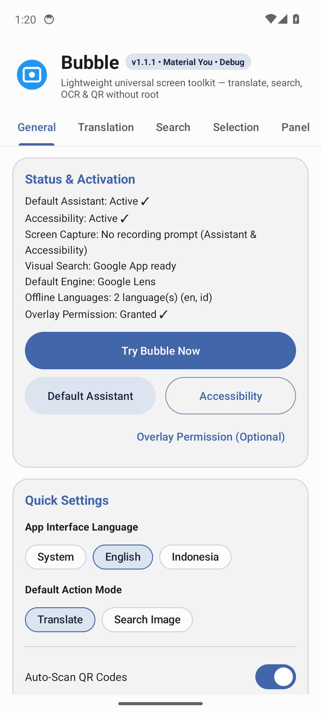 | 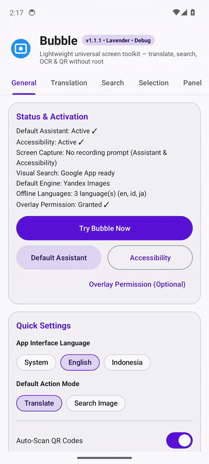 |

---

## 2. Terjemahan Offline, Profil Konteks, & OCR Kustom Tesseract 5

Mendukung mode **Fast / Accurate / Natural**, profil konteks (**General / Literal / Natural / Manga-Game**), 31 bahasa offline ML Kit, serta impor model `.traineddata` Tesseract 5.

- **Video MP4 Terjemahan Langsung EN → ID (30 FPS):** [`07-overlay-live-translation.mp4`](assets/v1.1/videos/07-overlay-live-translation.mp4)
- **GIF Pratinjau:** [`07-overlay-live-translation.gif`](assets/v1.1/previews/07-overlay-live-translation.gif)

| Tab Translation | Offline Language Manager | Custom Tesseract 5 OCR |
| :---: | :---: | :---: |
| 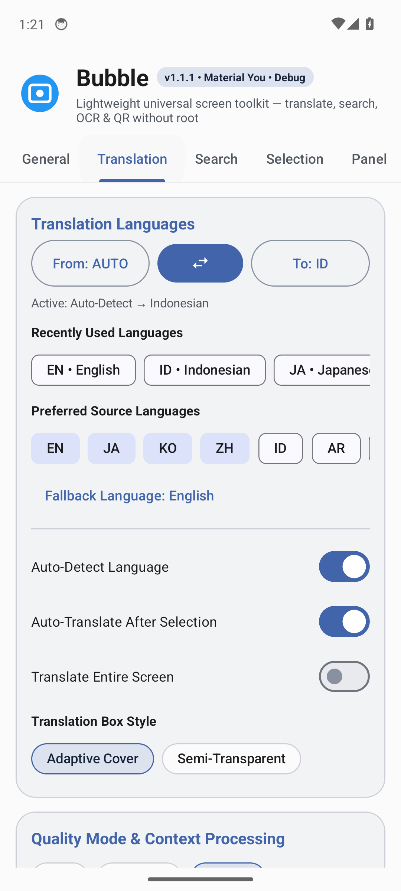 | 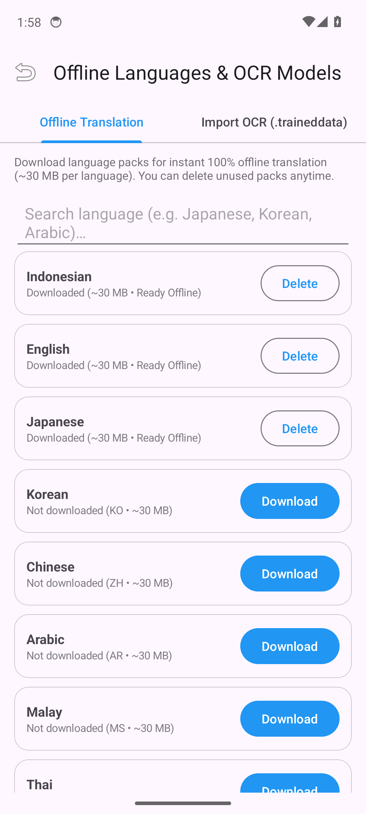 | 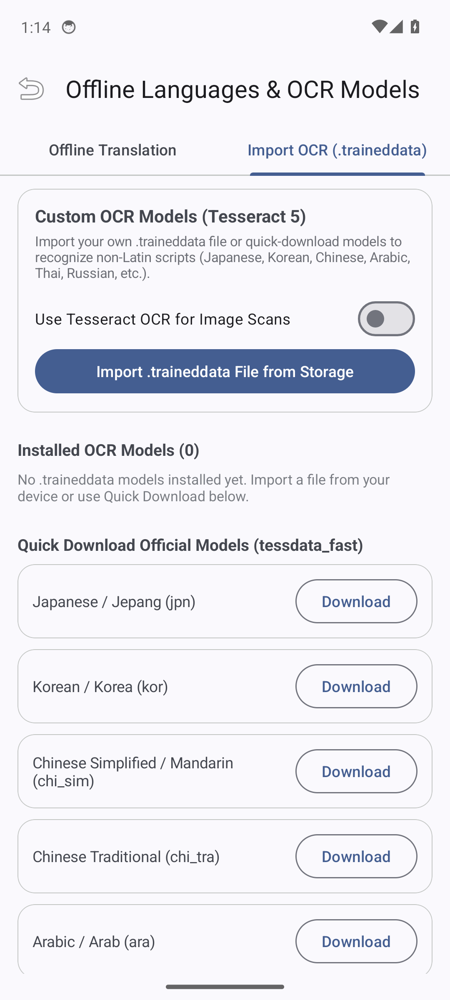 |

| Terjemahan Langsung di Layar (EN → ID) | Demo Terjemahan + Toggle Original (GIF) |
| :---: | :---: |
| 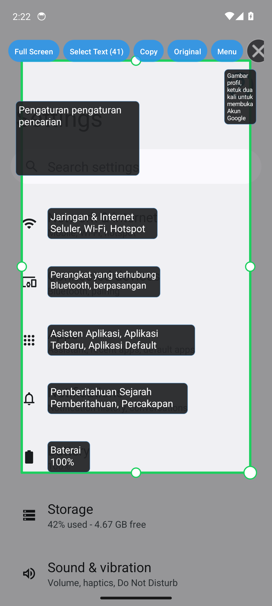 | 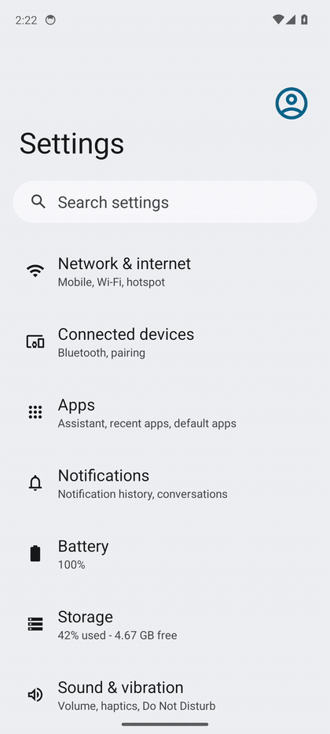 |

---

## 3. Pencarian Gambar Multi-Mesin, Jeda Kustom (1–10s), & AdBlocker Browser

Mendukung **Google Lens**, **Yandex Images**, **TinEye**, **Bing Visual Search**, **SauceNAO**, **trace.moe**, **Open With**, handle `=` untuk menggeser urutan, pengaturan jeda pencarian (`1s / 2s / 5s / 7s / 10s / Custom`), serta **AdBlocker lokal** di browser pencarian gambar bawaan yang langsung kembali ke aplikasi asal saat ditutup.

- **Video MP4 Pengaturan Jeda & AdBlocker:** [`05-search-delay-adblock.mp4`](assets/v1.1/videos/05-search-delay-adblock.mp4)
- **Video MP4 Visual Search Browser + Kembali ke Aplikasi Asal:** [`09-overlay-visual-search-adblock.mp4`](assets/v1.1/videos/09-overlay-visual-search-adblock.mp4)

| Daftar Mesin Pencarian | Jeda Kustom & AdBlocker | Demo Pengaturan Jeda (GIF) |
| :---: | :---: | :---: |
| 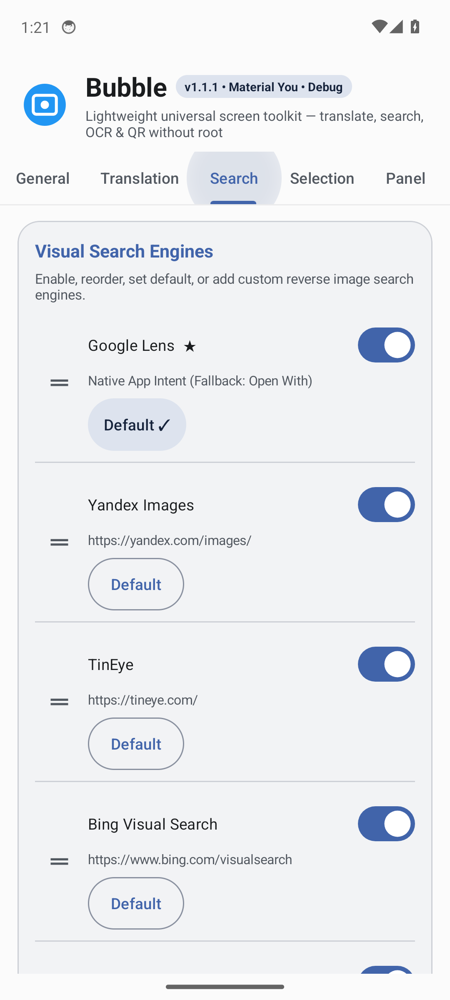 | 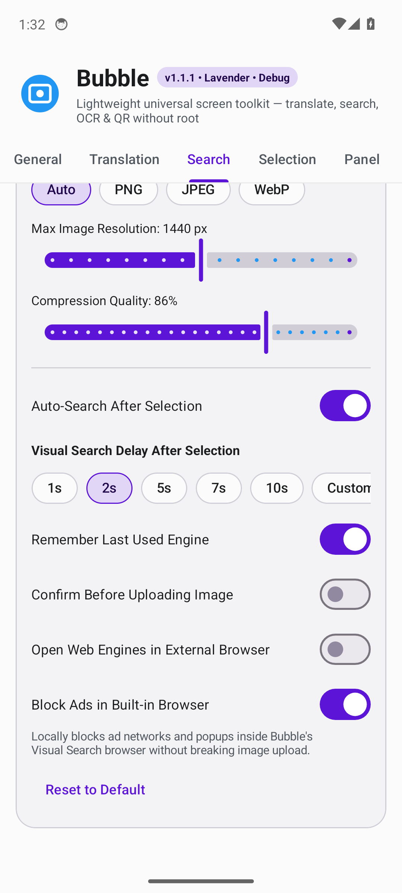 | 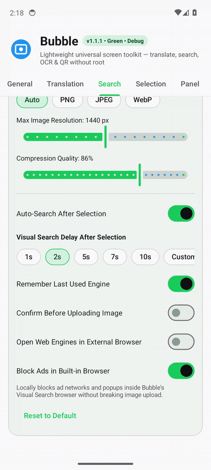 |

| Browser Pencarian Gambar Bawaan (Yandex) | Demo Visual Search Browser → Kembali ke Chrome (GIF) |
| :---: | :---: |
| 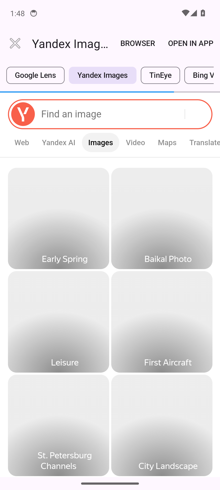 | 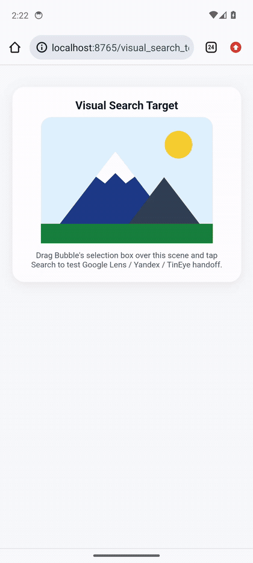 |

---

## 4. Kustomisasi 5 Bentuk Seleksi & Fitur Baru "Scan Seluruh Layar"

Tersedia **Live Selection Preview**, 5 bentuk seleksi (**Rectangle**, **Rounded**, **Ellipse**, **Freeform**, **Curved**), 4 gaya garis (**Solid**, **Dashed**, **Dotted**, **Dash-Dot**), serta tombol **Full Screen / Layar Penuh** yang melebarkan area seleksi satu layar penuh dan tetap bebas disesuaikan tepinya sebelum memindai.

- **Video MP4 5 Bentuk Seleksi & Gaya Garis:** [`03-selection-shapes-preview.mp4`](assets/v1.1/videos/03-selection-shapes-preview.mp4)
- **Video MP4 Scan Layar Penuh (Tetap Bisa Diubah):** [`06-overlay-fullscreen-selection.mp4`](assets/v1.1/videos/06-overlay-fullscreen-selection.mp4)

| Tab Selection & Live Preview | Demo 5 Bentuk & Gaya Garis (GIF) |
| :---: | :---: |
| 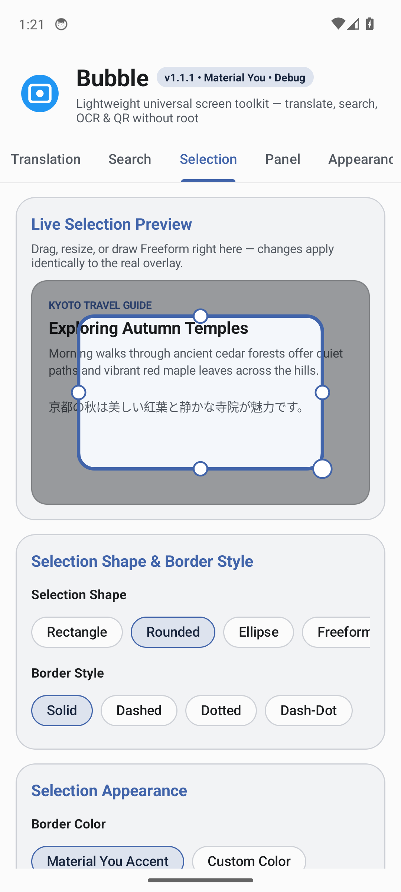 | 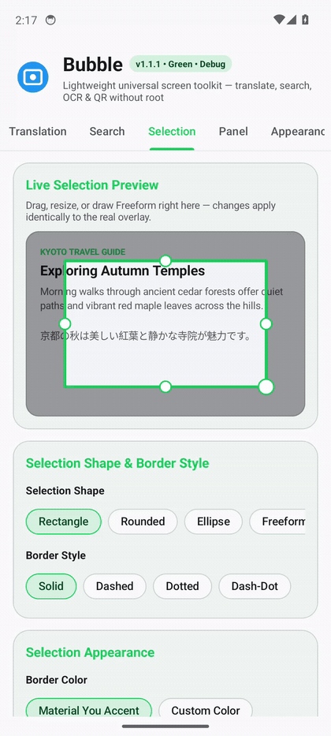 |

| Overlay "Full Screen" (Tetap Bisa Diubah) | Demo Scan Layar Penuh + Geser Sudut (GIF) |
| :---: | :---: |
| 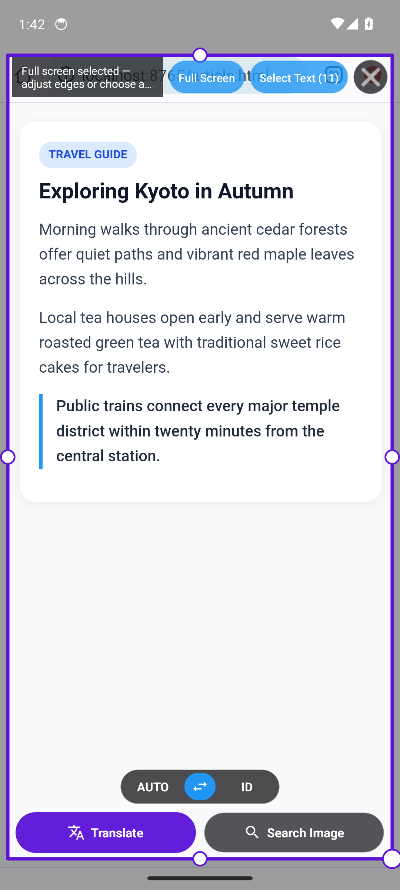 |  |

---

## 5. Deteksi Link Pintar (`X.com` / URL) & Auto QR Scanner

Saat Bubble dibuka, tautan di layar (termasuk **X.com**, **fb.watch**, dan URL berparameter) langsung terdeteksi dengan kartu cepat non-blocking **"Link found. Open link?"** (**Open Link** / **Copy Link**), sementara kode **QR** (QRIS, Wi-Fi, URL) tetap diprioritaskan otomatis.

- **Video MP4 Deteksi Link X.com + Copy Link:** [`08-overlay-smart-link-xcom.mp4`](assets/v1.1/videos/08-overlay-smart-link-xcom.mp4)
- **Video MP4 Auto QR Overlay (QRIS Demo):** [`10-overlay-auto-qr-scan.mp4`](assets/v1.1/videos/10-overlay-auto-qr-scan.mp4)

| Deteksi Link X.com Otomatis | Demo Deteksi Link X.com + Salin (GIF) |
| :---: | :---: |
| 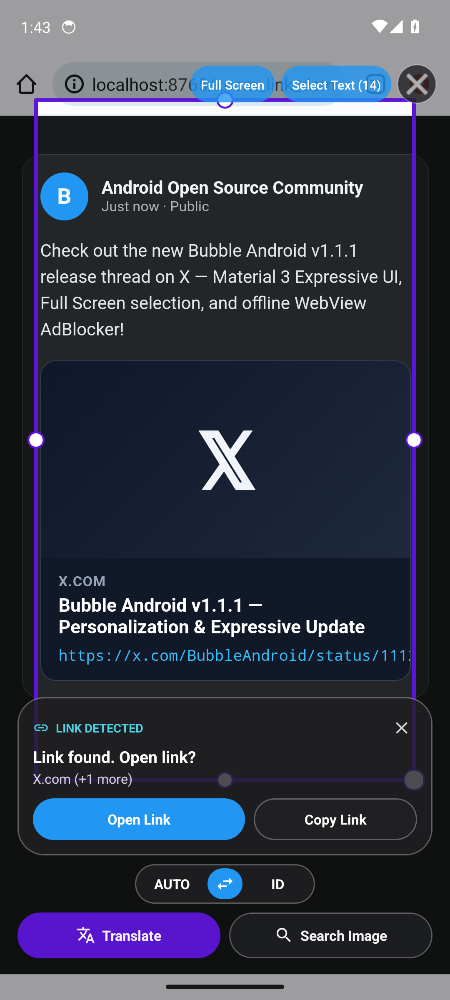 | 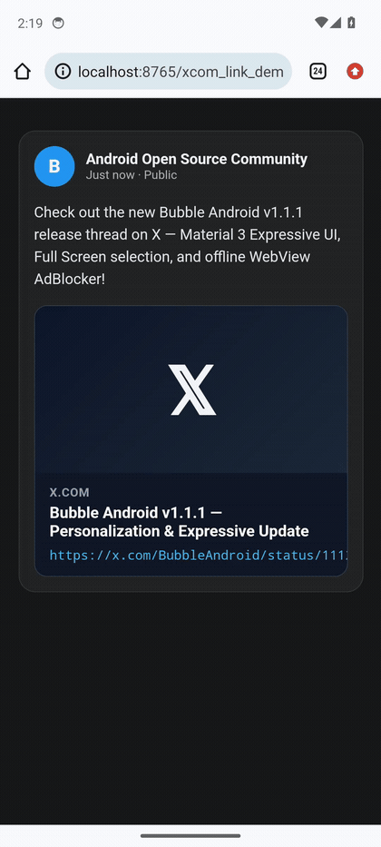 |

| Overlay Auto QR Scanner (QRIS Demo) | Demo Auto QR (GIF) |
| :---: | :---: |
| 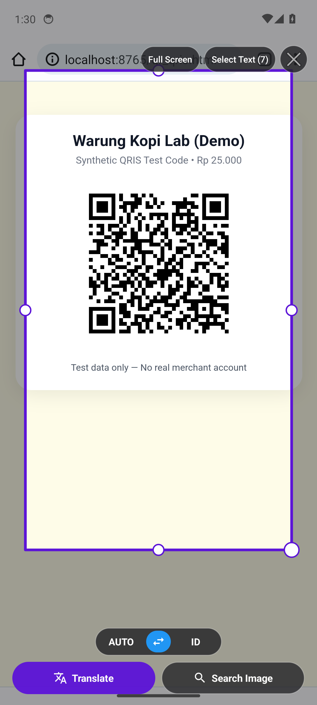 | 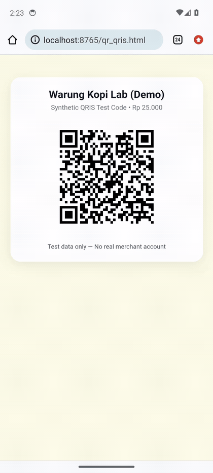 |

---

## 6. Mode Pilih Teks Layar Penuh (`Select Text`)

Deteksi blok teks di seluruh layar secara langsung (41 blok teks pada Setelan Android) untuk langsung disalin (**Copy**), diterjemahkan (**Translate**), atau dicari (**Web Search**).

- **Video MP4 Mode Select Text (41 Blok Teks):** [`11-overlay-select-text.mp4`](assets/v1.1/videos/11-overlay-select-text.mp4)

| Mode Select Text (41 Blok Teks) | Demo Select Text (GIF) |
| :---: | :---: |
| 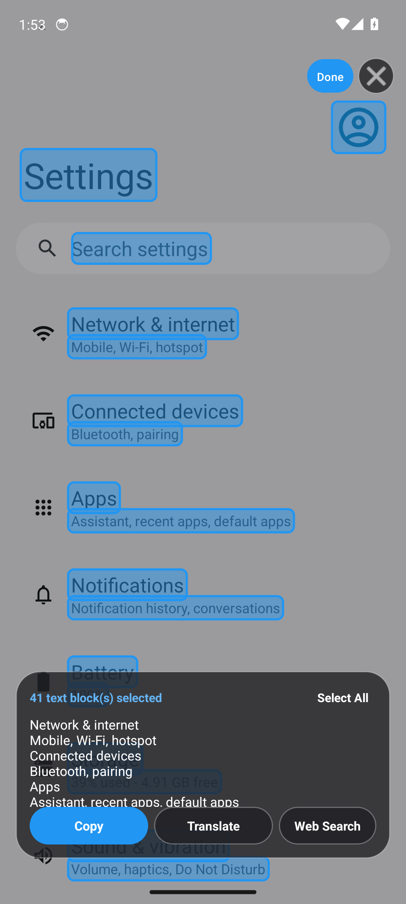 |  |

---

## 7. Panel Aksi Kustom (Drag `=` Reorder & Live Preview)

Mempertahankan tampilan default 2 tombol yang bersih, dapat diperluas hingga 7 alat (termasuk **Full Screen**), geser urutan dengan handle vektor `=`, serta posisi panel **Top / Bottom / Left / Right / Custom**.

- **Video MP4 Kustomisasi Panel Aksi:** [`04-panel-customize.mp4`](assets/v1.1/videos/04-panel-customize.mp4)

| Tab Panel & Live Preview | Demo Kustomisasi Panel (GIF) |
| :---: | :---: |
| 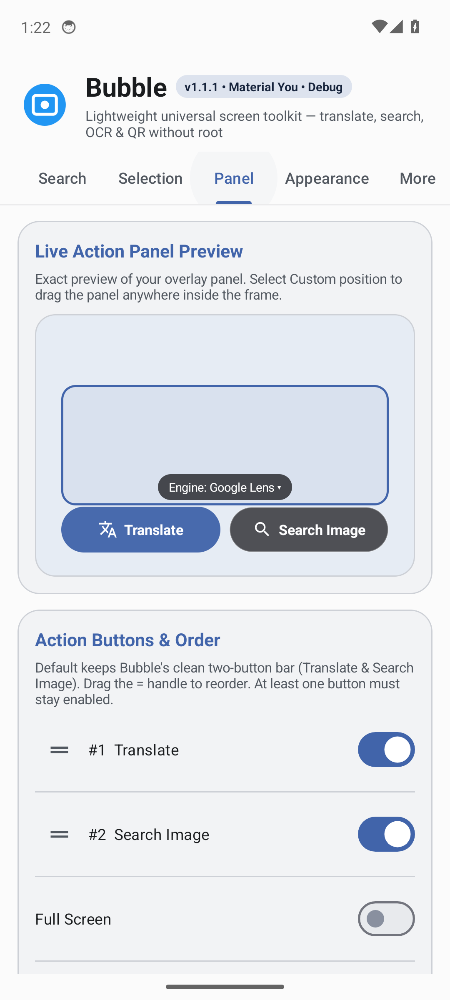 | 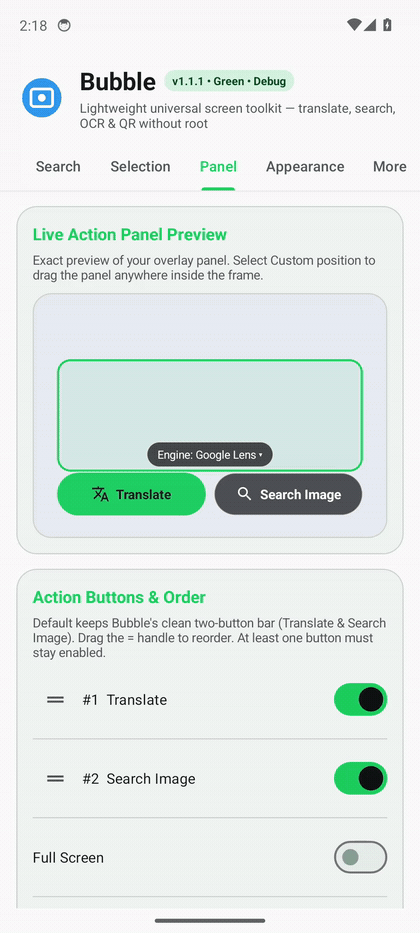 |

---

## 8. Personalisasi Tema (Light, Dark, True AMOLED Black, & Dynamic Color)

Dukungan **System / Light / Dark / True AMOLED Black (`#000000`)**, **Material You Dynamic Color** (Android 12+), 7 palet warna bawaan (termasuk **Lavender** dan **Green**), serta pemilih warna HEX/RGB kustom.

- **Video MP4 Pergantian Tema & AMOLED:** [`02-theme-amoled-switch.mp4`](assets/v1.1/videos/02-theme-amoled-switch.mp4)

| Tab Appearance (True AMOLED + Lavender) | Demo Ganti Tema & Palet (GIF) |
| :---: | :---: |
| 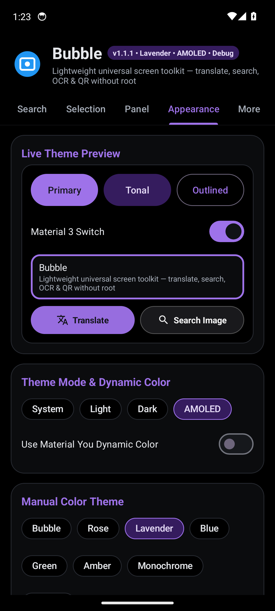 | 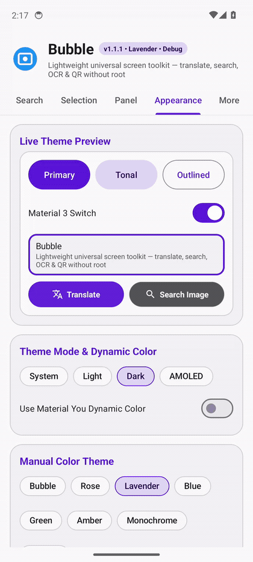 |

---

## 9. Privasi, Bubble Safe Mode, & Pembaruan GitHub

Tab **More** memuat pengecekan rilis otomatis dari GitHub (Wi-Fi Only, interval 6j–7h), **Bubble Safe Mode** aktif default dengan daftar aplikasi perbankan/sensitif yang dikecualikan (`Excluded Apps (14)`), dan tanpa pelacak apa pun.

| Tab More (AMOLED + Safe Mode) | Daftar Aplikasi Dikecualikan (Safe Mode) |
| :---: | :---: |
| 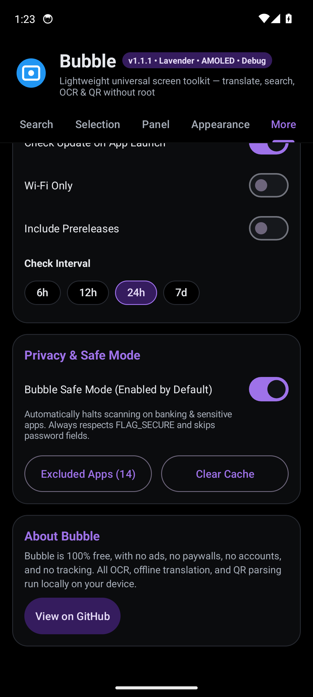 | 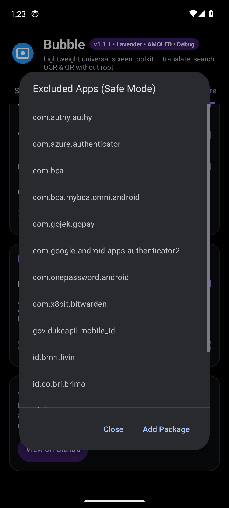 |
